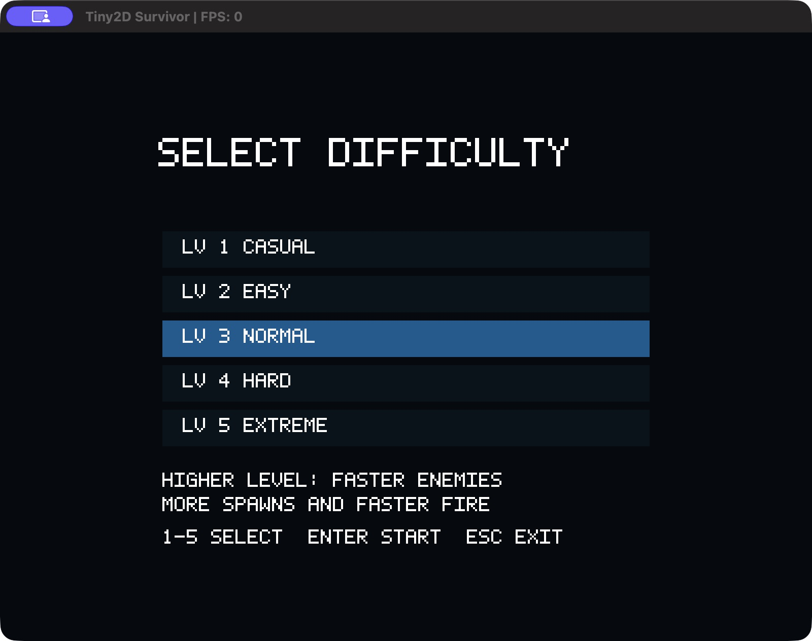
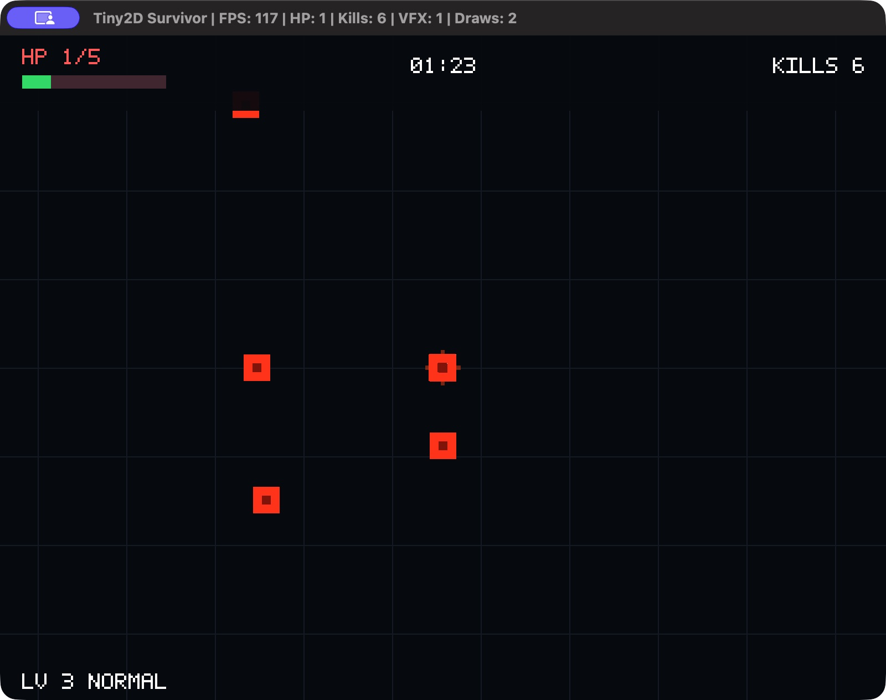
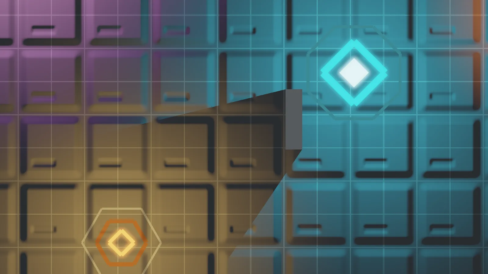

# Tiny2D Engine

**C++17 · macOS OpenGL · Batched 2D rendering · Playable arena survival**

Tiny2D is a lightweight C++17 2D engine built with OpenGL on macOS. It combines
RAII GPU ownership, fixed-step simulation, collision detection and a playable
90-second arena-survival game with five difficulty levels.



[Play / RC notes](docs/releases/v0.5.0-rc1.md) · [Architecture](docs/project-architecture-overview.md) ·
[Performance evidence](docs/performance-m41.md) · [Interview walkthrough](docs/interview-walkthrough.md)

## Overview

An engineering portfolio focused on explicit ownership, testable gameplay and
measured rendering behavior. The standalone **Tiny2D Survivor** opens directly to
the difficulty menu; the developer Sandbox retains its original demos and CLI.
Version **0.5.0 / rc1** is a local release candidate, not a published GitHub Release.

## Features

- C++17 and RAII; move-only GPU objects with owning-context checks.
- OpenGL 3.3 Core request, orthographic cameras, alpha blending and PNG textures.
- Dynamic VBO / static EBO batching, up to eight texture slots and automatic flush.
- Scene identity and ObjectId generations reject stale or foreign handles.
- 60 Hz fixed ticks, AABB/circle collisions and ordered combat resolution.
- CPU-only GameSession, five difficulty configurations and 90-second survival.
- Event-driven bounded VFX, independent HUD camera, Victory/GameOver and restart.
- Exception-safe render passes and CPU / real-context GPU regression tests.

## Play the Game

The RC ZIP is prepared locally; **no download asset has been published yet**.
After owner review, extract the ZIP and double-click `Tiny2D Survivor.app` in Finder.
This candidate is **arm64 only**, deployment target macOS **26.0**, tested on **26.5.1**.
Ad-hoc signing is for local integrity checks; it is not Developer ID signing or Apple notarization.
External downloads may be blocked by Gatekeeper. See [release notes](docs/releases/v0.5.0-rc1.md).

| Input | Action |
|---|---|
| 1–5, Enter | Select difficulty, start |
| WASD | Move; combat fires automatically |
| Arrow keys; Q/E | Camera offset; zoom |
| R (press/release) | Restart the applied difficulty after an outcome |
| Escape | Exit |



## Build from Source

Install Xcode Command Line Tools, CMake, GLFW and libpng (`brew install cmake glfw libpng`).
The build uses local dependencies and performs no implicit source downloads.

```bash
cmake -S . -B build/m63c-release -DCMAKE_BUILD_TYPE=Release -DTINY2D_OPENGL_TESTS=ON
cmake --build build/m63c-release --parallel
ctest --test-dir build/m63c-release --output-on-failure
cmake --build build/m63c-release --target package_macos
```

The packaging target builds `Tiny2DSurvivor`, stages a fresh named App, recursively
embeds third-party libraries, signs inside-out, verifies, archives with `ditto`,
checks SHA-256 and verifies an independent extraction. Each invocation preserves
previous candidates under `build/m63c-dist/candidate-*`.
[Bundle design and exact commands](docs/release-architecture.md).

The developer executable remains `build/m63c-release/tiny2d_sandbox`:

```bash
./build/m63c-release/tiny2d_sandbox --scene survivor-demo --difficulty 3 --frames 600
./build/m63c-release/tiny2d_sandbox --scene sprites --renderer batch --sprite-count 500 --frames 4
```

No arguments still select the original immediate sprite demo.

## Tiny2D Lab · Neon

Move the cyan Player with WASD and hold Space to fire. **F2** toggles the Inspector.
Click a Player, Relay, Bolt or Burst in Scene or Final, or use the **Objects** tab in
any view. Enable **Buffers** for display-mapped thumbnails. **Timing** shows
CPU submission and the latest available GPU timestamp measurements with their frame IDs.

**L** enables dynamic lighting. Cyan light follows the player, orange light travels with each bolt,
and amber relays and fading violet bursts illuminate the grid. **5** shows the linear Light Buffer
through the display transform. The **Lighting** tab controls ambient intensity, global strength,
radius scale and radius outlines. Lighting defaults to off.

With lighting on, **N** toggles world-space normal mapping. Move the player past a
floor panel to see its opposing bevels respond to the same light. **6** shows the
signed normal buffer encoded as RGB. In **Lighting**, switch between flat and beveled
tiles or adjust **Normal strength** from 0 to 2. Normal mapping defaults to off.

With lighting on, **O** enables two visual-only walls and per-light hard shadows.
Hold **A** to move the cyan Player past the short wall. Amber light from the nearby
relay can still reach the floor in the player's shadow. **7** displays the selected
light's visibility mask. In **Shadows**, choose a caster, change the budget from
1 to 8, or display wall edges and projected triangles. The default budget is 4.

**1–4** select Scene, Bright, Blur and Final. **B** toggles Bloom, **[ / ]** adjust
strength by 0.1, **P** pauses, **.** advances one paused tick, **R** resets the seed
and **F1** toggles the HUD. Escape exits when the scene owns keyboard input.

```sh
cmake -S . -B build/m74b-release -DCMAKE_BUILD_TYPE=Release -DTINY2D_OPENGL_TESTS=ON
cmake --build build/m74b-release --parallel
./build/m74b-release/lab/tiny2d_lab --scene neon --lighting on --normal-mapping on --shadows on --view final
./build/m74b-release/lab/tiny2d_lab --seed 71 --frames 4 --lighting on --normal-mapping on --view normal --capture /tmp/neon-normal.png
```



[M7.4b shadow geometry, HDR pixel tests and measurements](docs/milestone-07-4b.md) ·
[M7.4a normal materials, framebuffer readbacks and measurements](docs/milestone-07-4a.md) ·
[M7.3 dynamic lighting, tests and measurements](docs/milestone-07-3.md) ·
[M7.2 controls, measurements and verification](docs/milestone-07-2.md) ·
[M7.1 rendering pipeline](docs/milestone-07-1.md) · [Lab roadmap](docs/lab-roadmap.md)

## Architecture

CPU gameplay owns rules and collision; presentation consumes copied combat events.
The Survivor adapter coordinates simulation and separate world/UI passes. See
[architecture diagram and ownership](docs/project-architecture-overview.md).

## Performance

| Measured fixture | Result | Evidence |
|---|---|---|
| 500 sprites, immediate vs batch | 500 → 1 draw calls (99.8% fewer) | [M4.1](docs/performance-m41.md) |
| M4.1 500-sprite CPU workload | CPU submission p50 489.92 → 90.67 µs (~5.40× ratio) | [M4.1 methodology](docs/performance-m41.md) |
| Historical M6.3b, 48 enemies + 64 projectiles | Fixed update p95 24.625 µs; CPU frame p95 103.291 µs | [raw summary](docs/data/m63b/summary.md) |

These are fixture-specific measurements, not a 5.4× game-FPS claim. CPU frame
excludes swap/poll and explicit `glFinish`; completion wait is not pure GPU time.
[M6.3b methodology](docs/performance-m63b.md) and [M6.3b.1 follow-up](docs/m63b1-review-fixes.md)
retain regressions and tail-latency limitations. No new performance claim is made for packaging.

## Testing

M7.4b passed **52/52 Debug**, **52/52 Release** and **29/29** with OpenGL tests disabled on Apple M5 Pro. The new fixtures compare GPU shadows with CPU ray intersections, verify HDR red/blue contributions and exercise attachment rollback. [Shadow tests and native evidence](docs/milestone-07-4b.md)

M7.4a passed **50/50 Debug**, **50/50 Release** and **28/28** with OpenGL tests disabled on Apple M5 Pro. The GL suites include signed normal readback, equal-distance lighting from opposite sides, preview orientation and the original radial lighting fixtures. [Test logs and pixel evidence](docs/milestone-07-4a.md)

M7.1 passed **43/43 Debug**, **43/43 Release** and **24/24** with OpenGL tests disabled. [M7.1 evidence](docs/milestone-07-1.md)

M6.3c: Debug **40/40**, Release **40/40**, Headless **23/23**.
[Logs, packaging checks and manual acceptance](docs/milestone-06-3c.md).
Use the same configure/build/ctest sequence with `build/m63c-debug` and `Debug`;
for headless use `build/m63c-headless`, `Release`, `-DTINY2D_OPENGL_TESTS=OFF`.
Headless still requires platform build dependencies; CPU GameSession tests create no GL context.
No hosted CI execution is claimed.

## Project Structure

| Directory | Role |
|---|---|
| `engine/` | Math, Scene, collision, platform and rendering |
| `game/` | CPU gameplay, difficulty and flow |
| `lab/` | Independent Neon demo, HDR passes, observation and finite-frame capture |
| `sandbox/` | Developer scenes, standalone entry, HUD/VFX, assets |
| `tests/` | CPU/GPU regressions and profiling fixtures |
| `scripts/`, `cmake/` | Packaging, verification and bundle metadata |
| `docs/` | Design, measured evidence, release and portfolio material |

## Milestones

[M0–M6.3b historical README](docs/development-history.md) preserves the earlier narrative.
[M6.3a](docs/milestone-06-3a.md) adds difficulty; [M6.3b](docs/milestone-06-3b.md)
adds presentation; [M6.3b.1](docs/m63b1-review-fixes.md) fixes priority/recovery;
[M6.3c](docs/milestone-06-3c.md) packages the macOS RC. [M7.1](docs/milestone-07-1.md) opens the HDR/Bloom Lab, [M7.2](docs/milestone-07-2.md) adds its Inspector, and [M7.3](docs/milestone-07-3.md) lights its surfaces.

## Known Limitations

macOS only; no Intel/Universal validation or alternative rendering backend. Apple
OpenGL is deprecated. Main-thread, current-context GPU lifetime is required; no
multithreaded rendering or full-process leak certification. The Lab has its own explicit HDR-to-sRGB output contract. Cross-system,
Finder quarantine, resize/minimize, multi-display Retina and extended human playtesting
remain acceptance work. [Media capture status](docs/media/README.md).

## Credits & Licenses

**No repository-wide source license has been selected.** The owner must decide
before formal release; this work does not assign MIT, Apache or GPL to Tiny2D.
GLFW (zlib/libpng license) and libpng (PNG Reference Library License version 2)
notices are preserved in [third-party credits](docs/third-party/README.md) and the App.
Original procedural texture CC0 notices remain in [assets](sandbox/assets/textures/LICENSE.txt)
and [M4 assets](sandbox/assets/textures/M4-LICENSE.txt).

The Lab tools vendor [Dear ImGui v1.93.0 and its MIT license](third_party/imgui/LICENSE.txt).
