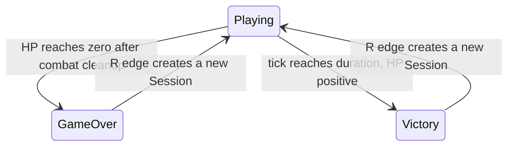

# M6.2 game loop

GameSession owns phase and SurvivalRules. Default duration is 5400 ticks at 60 Hz;
rules accept integer durations 1..5184000 (one day). Larger values and zero throw.
This explicit cap leaves cooldown/expiry arithmetic safely below uint64 overflow.
CombatConfig remains independent, including its spawn ramp. Existing constructor
calls remain valid. Tick 5400 completes damage and cleanup before deciding phase;
death wins ties. Terminal fixedUpdate returns before input validation, including
NaN input. No Scene update, collision, spawn, fire, cleanup or counter changes occur.
Elapsed and remaining time describe simulation only, never wall clock.

SessionController owns a unique_ptr<GameSession>, config, rules and R's previous
state. It consumes edges in all phases, and only replaces terminal sessions.
Construction precedes swap; failure preserves the old session. The failed edge is
consumed, so release/repress retries. Every new Scene allocates a new token; all old
IDs fail lookup, even if slots/generations match. Borrowed references must not cross
an update or replacement. Scene remains nonmovable. Controller has no GPU types.

Survivor replaces only at update boundaries, resets FixedTimestep, camera offset
and zoom, and gives the new game zero steps in that update. Renderer, shader,
buffers, white texture and window survive. No active render pass crosses update.
Interactive time uses the existing six-step bounded accumulator. Zero framebuffer
pauses interactive simulation and resets accumulation. Finite-frame mode gives one
simulation opportunity per rendered frame; terminal opportunities are no-ops.
Thus 600 frames need not mean 600 ticks. Escape remains checked every update.

Damage tint pulses its blue channel every four ticks while invulnerable, with
red/yellow tint and HUD warning. Terminal colors freeze. HUD kill text flashes
white for 12 simulation ticks after a kill; no visual entity enters collision or
scoring. No particle system or enemy death semantic changes are introduced.
