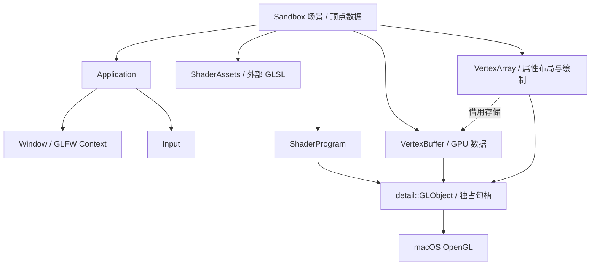

# Milestone 02 — Programmable Rendering Pipeline

## 基线与范围

2026-10-29 fetch 后，`origin/main` 为 `52587ef`，M1 的
`origin/feat/window-input-loop` 为 `d1be1c3`，尚未合入 main。
M2 分支 `feat/shader-triangle` 从 M1 创建；PR base 为
`feat/window-input-loop`。保留 Window、Input、Application 和 Vector2 的实现。

环境为 C++17、CMake 3.20+、AppleClang、macOS Apple Silicon、GLFW 和系统
`<OpenGL/gl3.h>`。请求 OpenGL 3.3 Core / forward-compatible，使用 GLSL 330 Core。
macOS 可返回更高版本 Core Context；本机实际返回 4.1。CMake 明确拒绝未支持的非
macOS 平台，没有新增依赖或函数加载器。

## 架构与接口



| 类 / 文件 | 职责与接口 |
| --- | --- |
| `ShaderProgram` | 接收两个源码 `string_view` 和诊断标签；`bind/unbind`、`setFloat/setVec2`；没有三角形数据或文件系统依赖 |
| `VertexBuffer` | `VertexBuffer(data, sizeBytes)` 一次性 `GL_STATIC_DRAW` 上传；`bind/unbind`、`sizeBytes` |
| `VertexArray` | 构造时接收 VBO、stride 和 `VertexAttribute{location, components, offsetBytes}`；`bind/unbind`、`drawTriangles(count, first=0)` |
| `detail::GLObject` | 内部共享所有权实现：创建、销毁、移动、Context/线程契约、错误检查 |
| `sandbox/src/ShaderAssets.*` | 按可执行文件真实位置读取 `assets/shaders`；文件打开/读取错误含路径 |

三个公开资源类都删除复制构造/赋值，支持 `noexcept` 移动构造/赋值。
`nativeHandle()` 供集成/诊断使用，仅借出句柄，调用者不得删除它或修改封装所依赖的布局与存储。
移动后源句柄为 0，对它调用 `bind()` 会报错；移动赋值会先释放目标原有资源。
VBO 被 VAO 引用时，不应销毁或用移动赋值替换它的存储；移动 VBO 所有者本身不改变 GPU 句柄。

VBO 持有顶点字节。VAO 保存如何解释这些字节以及属性引用哪个 VBO，不会复制顶点数据，
也不拥有 VBO 的 C++ 生命周期。本阶段只支持一个交错 float VBO，属性分量数为 1..4；
布局构造时验证 stride、offset、location 上限及重复属性。绘制验证上传数据边界和当前程序。
`drawTriangles` 放在 VAO 上是本阶段的轻量绘制入口；未来多种 primitive/材质出现时再拆出 Renderer。

绑定接口会改变 Context 状态，不恢复之前的任意绑定。VBO 构造后保持绑定，VAO 构造成功后
解绑 VAO 和 ARRAY_BUFFER；Program 构造不绑定；绘制留下当前 VAO。Uniform 设置要求本程序已绑定，
不存在或被优化掉的 uniform 会报错。没有隐式 program 切换或静默忽略。

## Shader 编译和链接

1. 创建 RAII Program owner，再分别为顶点/片段创建 Shader owner。
2. `glShaderSource` 接收显式源码长度，`glCompileShader` 编译。
3. 检查 `GL_COMPILE_STATUS`，失败时读取完整 info log，异常包含阶段/文件标签和驱动行号。
4. `glAttachShader` 两个 Shader，`glLinkProgram`，检查 `GL_LINK_STATUS`。
5. 链接失败时异常包含两个源码标签与 program info log。
6. 成功后 detach 两个 Shader，由局部 owner 删除，Program 留存供每帧绑定。

源码为空/过大、创建返回 0、GL API 错误也会抛出异常。创建句柄后立刻归 owner 管理，
状态检查失败时清理。片段编译失败会释放先前的顶点 Shader 和 Program；链接失败时
已附着 Shader 先标记删除，Program 删除会解除引用，使其最终释放。

## CPU 顶点到 GPU 的调用链

Sandbox 使用标准布局 `Vertex { float position[2]; float color[3]; }`，静态断言
大小为 5 个 float，并以 `offsetof` 指定偏移：

| 属性 | Shader location | 类型 | stride | offset |
| --- | --- | --- | --- | --- |
| position | 0 | vec2 / 2 × GL_FLOAT | 20 字节 | 0 |
| color | 1 | vec3 / 3 × GL_FLOAT | 20 字节 | 8 字节 |

初始化调用链：CPU 三个 Vertex → `VertexBuffer` → `glBufferData` 上传 60 字节 →
`VertexArray` 绑定 VBO/VAO → `glVertexAttribPointer` + `glEnableVertexAttribArray`。
VAO 捕获属性对应的 VBO，因此之后解绑 ARRAY_BUFFER 不会丢失关联。

每帧调用链：`Application::run` → poll/update → 激活 Context → `Sandbox::render` →
清除背景 → `program.bind()` → 更新 `uScale` → `array.drawTriangles(3)` →
`glDrawArrays(GL_TRIANGLES, 0, 3)` → GPU 顶点着色 → 光栅化插值 → 片段着色 → swap。
顶点 Shader 将 position 转为 clip coordinates，将 color 传给片段 Shader，片段 Shader 输出插值 RGB。

三角形围绕画面中央布置。`uScale=(min(w,h)/w, min(w,h)/h)` 使用 framebuffer 像素尺寸，
保持不同宽高比下的几何比例；M1 resize callback 同步 viewport。尺寸为 0 时跳过绘制，
避免最小化期间除零。Shader、VBO、VAO 和布局均只初始化一次，不在帧循环中创建。
WASD 背景、Escape 和每秒 FPS 标题逻辑保留；没有声称或测量批处理、缓存等性能优化。

## 生命周期、线程与异常

构造顺序是 Application 的 Window/Context → Sandbox 的 Program → VBO → VAO。
正常退出和异常展开均按反向顺序释放：VAO → VBO → Program → Window → 最后一个 GLFW Runtime。
绑定中的 Program 在删除前先 `glUseProgram(0)`，避免继续持有待删除 Program。
`main` 捕获标准异常、写入 stderr 并返回 1；正常 Escape/关闭返回 0。
`--frames N` 是测试入口，渲染 N 帧后走同一个 `requestClose` 和正常析构路径。

所有 GPU 操作及析构都要求创建资源的 Context 仍存活、在 macOS 主线程且为 current。
普通操作在 GL 调用前检查线程和当前 Context，不满足时抛 `logic_error`；同组共享 Context
也不视为等价。本阶段不管理资源到 Context 的共享所有权，调用者负责 lifetime。
析构不能抛异常；若违反 Context/线程契约，写明原因后 `terminate`，防止错误 Context 下
删除碰巧同名的其他对象。析构中的 GL 错误逐个写入 stderr；普通路径逐个收集后抛出异常。
不会用 `glGetError` 静默丢弃历史错误。这个严格契约适合当前单窗口场景，未来多窗口资源
管理需要显式 Context owner / 删除队列，不能直接把资源搬去工作线程。

## 外部资源和启动目录

CMake 的 `tiny2d_shader_assets` target 每次 build 将 `sandbox/assets` 复制到
Sandbox 可执行文件旁的 `assets`，仅编辑 GLSL 也能刷新副本。资源加载用 macOS
`_NSGetExecutablePath` 和 `filesystem::canonical` 定位真实可执行文件，未编译个人绝对路径，
不依赖当前目录；部署时一并复制 executable 与 `assets`。符号链接启动时以真实 executable
所在目录为准。当前不提供 install/app bundle 规则、热重载、搜索路径覆盖或跨平台资源定位。

```bash
cmake -S . -B build -DCMAKE_BUILD_TYPE=Debug
cmake --build build
ctest --test-dir build --output-on-failure
./build/tiny2d_sandbox
(cd build && ./tiny2d_sandbox)
./build/tiny2d_sandbox --frames 4
```

## 实际测试记录（2026-10-29）

修改前 M1 Debug 构建和 Vector2Tests 1/1 通过。M2 在 Apple Silicon / AppleClang
Debug 构建通过；真实驱动报告 `4.1 Metal - 90.5 | Apple M5 Pro`。

| 测试 | 结果与覆盖范围 |
| --- | --- |
| Vector2Tests | 通过，保留原有数学测试 |
| RenderFailureTests | 通过，使用生产资源类和测试替身 GL 入口；统计存活对象，注入 Program/Shader/VBO/VAO 创建失败（0 句柄及句柄伴随错误）、编译/链接失败、上传 OOM、布局错误；验证全部释放、成功链接删除 Shader、Program 移动赋值及绑定中删除 |
| OpenGLResourceTests | 通过，真实 Context；合法/非法顶点及片段源码、varying 类型不匹配链接错误、实际日志、无残留附着 Shader、资源移动、无 Context/工作线程拒绝、uniform 错误、VAO 布局和绘制越界检查、RGB 三角形像素读回、resize viewport、`glIs*` 确认正常释放、render 异常展开 |
| SandboxSmokeRoot | 通过，根目录启动 `--frames 4`，正常退出 0 |
| SandboxSmokeBuild | 通过，build 目录启动 `--frames 4`，正常退出 0 |

自动化环境的普通进程沙箱无法连接 macOS 图形服务，初次三个 GUI 测试超时；改为在有桌面权限的
图形会话运行后 5/5 通过。未通过 skip 或关闭错误检查制造成功。GUI 测试默认开启并有 30 秒超时。
无 GUI 的 CI 可显式配置 `-DTINY2D_OPENGL_TESTS=OFF`，此时只证明 CPU/替身测试通过，
不能宣称真实 Shader 编译、GPU 生命周期或显示已验证。

独立启动 Sandbox 后，用户确认：**三角形、WASD、缩放和 Escape 均正常**。
桌面工具不能附着此独立 executable，因此交互结果以用户确认记录；自动读回独立验证 RGB 插值。
M2 的 FPS 标题更新、原生关闭按钮、最小化/恢复、跨 Retina 屏幕移动尚未单独手动验收。
未运行 Instruments/Leaks；`glIs*` 和测试替身的对象计数不能证明驱动内部绝无泄漏，
真实驱动 OOM 也未强制触发。

后续 macOS 手动验收：启动后确认 800×600、红/绿/蓝三个角与连续渐变，等待标题 FPS 更新；
组合 WASD、拖动宽高并最小化/恢复；按 Escape 查看 shell 退出码 0；重新启动点击原生关闭按钮；
有条件时跨 Retina 屏幕移动、用 Instruments 检查重复创建/销毁。无 GUI 环境必须保留这些未测试标记。

## 自检、架构权衡与面试讨论

- 逐文件核对公开声明与实现、move-only 接口、异常展开和析构顺序；修正析构查询变量初始化、补齐直接使用的标准库头文件。
- 资源 owner 在检查错误前接管句柄，覆盖构造函数本体抛出时本对象析构不运行的问题；成员和局部 RAII 仍会析构。
- Shader 删除具有延迟语义；成功链接主动 detach，失败链接依靠 Program 释放引用。绑定 Program 删除前解绑。
- VBO 与 VAO 是存储和解释规则的区别。用布局参数、`offsetof` 和 draw 范围检查替代散落的魔法数字；不扩展为材质/RenderGraph。
- `detail::GLObject` 只复用所有权机制，没有把三角形逻辑塞到引擎中；公共 API 不暴露 OpenGL 头文件。
- 外部 GLSL 易于学习和修改，运行时编译失败可定位；依 executable 定位使 cwd 无关，代价是当前加载器只服务 macOS Sandbox。
- 保留逐调用错误检查和 uniform 查询，优先可诊断性；未做性能基准或 location 缓存。未来应先测量再决定缓存与调试级别。
- 真实驱动测试验证编译、状态和像素；故障注入验证难以稳定触发的失败路径，两者不能互相替代。

下一阶段可加入纹理、更多 uniform 类型、索引绘制及独立 Renderer；保留当前单 Context、主线程契约，
设计明确的资源/Context 关联后再讨论多窗口与异步上传。

## 堆叠 PR 后续

M1 合入 main 后，先 fetch 并检查历史，再在 GitHub 将 M2 base 改为 `main`。
若 M1 采用 merge commit，通常只需改 base；若 squash/rebase 导致历史不再包含原 M1 commit，
先检查 PR diff，必要时将最新 `origin/main` 合并进 M2 并解决冲突，再普通 push。
不要擅自 force push 或合并 PR。
