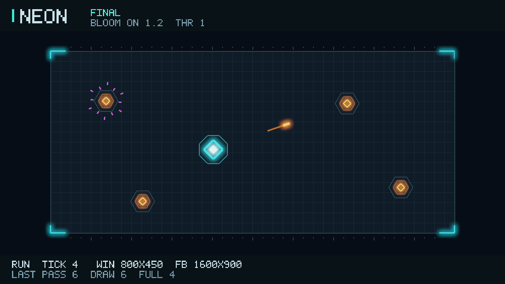
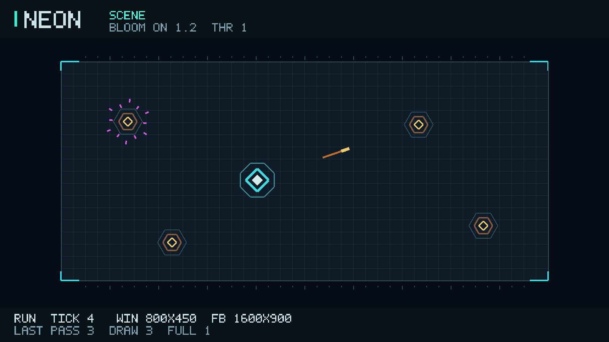
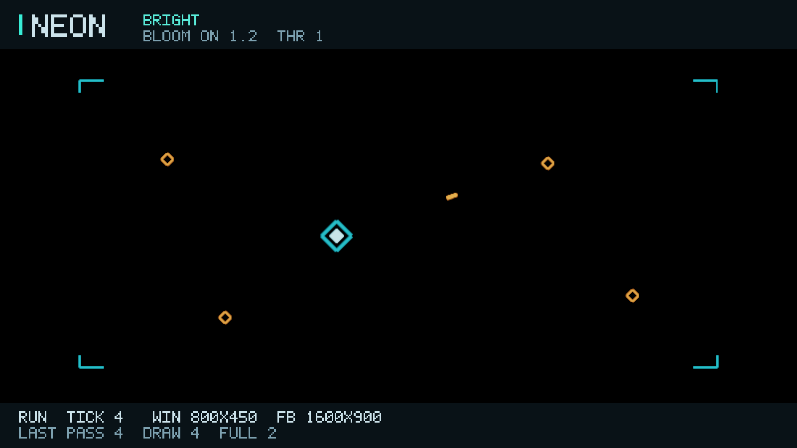
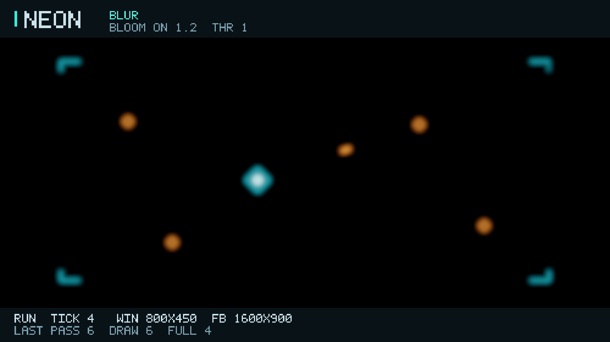

# M7.1 · Tiny2D Lab / Neon

独立程序用真实浮点场景说明一个问题：亮像素写入显示缓冲前，如何保留能量、扩散亮部，并让开发者直接检查每一步？场地、角色、弹道、爆发与字形均由程序绘制。四张图是同一 seed、Tick 4 的交换前 framebuffer 读回，包含屏幕空间 HUD。

| Final | Scene |
|---|---|
|  |  |
| **Bright** | **Blur** |
|  |  |

## 运行与试玩

```sh
cd /Users/grahm/Desktop/Tiny2D-Engine
cmake -S . -B build/m71-release -DCMAKE_BUILD_TYPE=Release -DTINY2D_OPENGL_TESTS=ON
cmake --build build/m71-release --parallel
./build/m71-release/lab/tiny2d_lab --scene neon
./build/m71-release/lab/tiny2d_lab --scene neon --seed 71 --frames 4 --bloom on --view final --capture /tmp/neon.png
```

| 输入 | 作用 |
|---|---|
| WASD | 在竞技场内移动，斜向速度归一化 |
| Space | 按住加快向四个中继点轮流发射的视觉弹丸 |
| B | 开关 Bloom |
| 1 / 2 / 3 / 4 | Scene / Bright / Blur / Final |
| [ / ] | 强度减 / 加 0.1，范围 0.0–3.0 |
| P / . | 切换暂停 / 暂停时推进一个 Tick |
| R | 重置初始 seed、Tick、槽位、轮转索引与位置，保留暂停和全部显示参数 |
| F1 / Escape | 显隐 HUD / 退出 |

HUD 的 LAST PASS、DRAW、FULL 来自上一次**完整提交**的帧，FULL 只计全屏三角形。第一帧显示 PENDING。按 P，然后切换 1–4：主体应停在原处，只有显示映射变化。按一次句号可跟踪一枚弹丸下一 Tick 的位置。

默认 seed 71，支持十进制 0–4294967295。`--frames` 仅接受 1–4294967295。缺省为交互模式，使用项目 60 Hz 时钟、最多六步追赶。暂停、恢复、失焦与不可绘制会丢弃累积时间，恢复活动后按住的键要先松开。有限模式独立于焦点与实时时钟，每个可绘制帧固定推进一 Tick，累计等待可绘制的上限为 5 秒。窗口提前关闭、绘制或输出失败返回非零。错误行分别给出已交换帧、已推进 Tick、最后成功帧及本次已提交的工作。可用 `--size WIDTHxHEIGHT` 指定 1–4096 的逻辑尺寸，`--capture PATH` 在有限运行的最后一次交换前写 PNG。

可执行文件与专用 assets 目录位于同一 lab 目录。沿用实际可执行文件路径解析，支持 symlink 和空格。每次构建 Lab 都刷新自己的 shader 目录。Survivor App、Sandbox 各自保留入口与资源布局。

## 从固定 Tick 到屏幕

`Neon` 拥有一个主体、四个固定中继点、12 个弹丸槽与 8 个爆发槽。每 32 Tick 自动发射，按住发射键时也在六 Tick 边界发射。弹丸飞行 44 Tick，爆发持续 27 Tick。独立 32 位 LCG 仅决定爆发初始角度。画面由当前槽位生成，不保存跨更新实体指针。以后从任意 Tick 恢复所需的数据见[路线](lab-roadmap.md)。

`Picture::prepare` 先生成场地与 HUD 的 CPU 四边形列表。世界相机按逻辑窗口等比缩放，HUD 相机以逻辑点计量。批渲染使用一张白色 RGBA8 纹理、原有字形和线性 HDR tint；alpha 表示覆盖率。窗口拥有当前 Context，其生命周期覆盖 Pipeline 和所有 GPU 对象。

| 提交顺序 | 读取 → 写入 | 运行条件 |
|---|---|---|
| World | 原创几何 → SceneColor | 每帧 |
| Extract | SceneColor → Bright | Bright、Blur，或 Final 有 Bloom 贡献 |
| Horizontal | Bright → Ping | Blur，或 Final 有 Bloom 贡献 |
| Vertical | Ping → Pong | 同上 |
| Output | 选中的原图 / SceneColor + 强度 × Pong → back buffer | 每帧 |
| Overlay | 显示色 HUD → back buffer | HUD 开启 |

中间附件全部是线性 RGBA16F。先按 Rec.709 权重计算亮度 Y，亮部为 `RGB × max(Y−1,0)/max(Y,0.0001)`。默认强度 1.2，阈值固定为线性亮度 1。半分辨率双线性采样后提取亮部，每个方向用半径 8、σ 3.2 的归一化离散高斯核，将相邻采样点配对为共九次纹理读取。水平和垂直各一次，Bright 保留原始提取结果。全屏三角形由 gl_VertexID 生成，各 Pass 显式绑定程序、VAO、采样器、纹理与 viewport。

Output 对每通道做 Reinhard `x = h/(1+h)`，应用一次分段 sRGB 编码（x ≤ 0.0031308 时取 12.92x，否则取 1.055x^(1/2.4)−0.055）。四种预览都经过这一步，浮点值本身由独立浮点读回测试验证。合成和显示色 HUD 期间显式关闭 GL_FRAMEBUFFER_SRGB，最后恢复。Bloom off 的 Final 读同一场景，跳过亮部与两个模糊 Pass。旧 PNG 和 Survivor 的颜色约定保持原样。

## 所有权与失败边界

- 每个 RenderTarget2D 唯一持有颜色纹理和 FBO，禁止复制。移动构造后源尺寸为零，绑定会失败。创建时验证正尺寸、设备限制和预算，连接附件并读取实际完整性状态。分配临时解除 PBO 绑定；无上传时其余 pixel-store 设置保持原值。
- 全尺寸使用实际 framebuffer 像素。正整数的半尺寸为 `n/2+n%2`。每组理论附件字节为 `8 × (W×H + 3×ceil(W/2)×ceil(H/2))`，上限 256 MiB，替换时新旧组可暂时共存。计量不包括默认 framebuffer、驱动分配、缓冲区或纹理之外的成本。
- Pipeline 在无活动 Pass 的帧边界先建立整组；成功才交换。失败保留旧组，交互入口报告错误并在后续可绘制帧重试；有限入口返回失败。零尺寸暂停绘制并保留整组。生产代码在单次调用内绑定目标，调试预览不缓存 GL 名称。
- FrameState 负责调用者的 draw/read FBO、viewport、默认 draw buffer、程序、VAO、纹理单元 0/1、sampler、栅格与测试开关、颜色与深度写掩码。BatchRenderer 恢复数组缓冲与项目使用的统一混合方程/因子。整个调用同步运行在主线程，不在 Pass 中派发回调。该契约面向工程的 3.3 Core 绘制路径。
- 对错误 Context 的 resize/draw 在修改绑定前报错；恢复所有者 Context 后方可使用或销毁资源。批提交出错时尝试取消尚未 Flush 的队列，保留原异常。已提交的绘制保留，异常路径记录已完成 Pass、批次和上传，完整标志为 false；下一帧可重新绘制。着色器在构造期编译，失败时由 RAII 释放已创建对象。

## 复现与证据

核实的 base 为 `5fe0d8c8a6feb08feeb83e64267a223da2082778`，已包含 PR #10 / M6.3c。基线清单为 Debug、Release 各 40 项，关闭图形测试为 23 项。[图形清单](data/m71/baseline-gui.txt) · [CPU 配置清单](data/m71/baseline-headless.txt)

| 配置 | 结果 | 证据 |
|---|---:|---|
| Debug，OpenGL ON | 43/43 | [CTest](data/m71/debug-ctest.txt) |
| Release，OpenGL ON | 43/43 | [CTest](data/m71/release-ctest.txt) |
| Release，OpenGL OFF | 24/24 | [CTest](data/m71/headless-ctest.txt) |

```sh
cd /Users/grahm/Desktop/Tiny2D-Engine
cmake -S . -B build/m71-debug -DCMAKE_BUILD_TYPE=Debug -DTINY2D_OPENGL_TESTS=ON
cmake --build build/m71-debug --parallel
ctest --test-dir build/m71-debug --output-on-failure
ctest --test-dir build/m71-release --output-on-failure
cmake -S . -B build/m71-headless -DCMAKE_BUILD_TYPE=Release -DTINY2D_OPENGL_TESTS=OFF
cmake --build build/m71-headless --parallel
ctest --test-dir build/m71-headless --output-on-failure
```

- **M71CPU** 在无 Context 下覆盖参数解析、整数上限、非法输入、固定输入重演、seed、暂停与单步、按住不连发的切换键、焦点恢复以及预算溢出。既有 fake-GL 套件加入 FBO 创建、浮点纹理分配与附件不完整故障。
- **M71GPU** 从 RGBA16F 目标读回 4.25，检查四个真实附件的尺寸与格式。在已知线性色块、暗背景、HUD 和邻近区域检查颜色、扩散与单次编码。预设不同读写 FBO、非默认 viewport、PBO、sampler、色掩码与绘制开关，分别以外部 sRGB 开/关绘制。覆盖最后一个 Pass 失败后的部分统计与恢复、错误 Context 拒绝、零尺寸恢复、奇数/1×1 交替重建、旧名称释放与旧 SceneRenderer 绘制。
- **M71RelocatedCLI** 从另一个 cwd 启动带空格路径中的程序，核对 9 帧和 9 Tick；破坏独立测试副本的片元 shader 后核对零帧、非零退出和编译诊断。另做了单独修改 shader、构建 Lab、比对运行目录内容与还原后的校验。[资源刷新记录](data/m71/asset-refresh.txt)
- 原三角形、500 张 immediate、500 张 batch、5000 张多纹理 batch 的末帧 Draw Calls 为 **1 / 500 / 1 / 5**。独立启动本次构建的 Tiny2DSurvivor.app，按进程 ID 观测到可见窗口后结束该测试进程。[旧入口记录](data/m71/legacy.txt)

## 性能基线

实测代码为 `e0c79ef030002b374411556393341765af490095`。macOS 26.7.3、arm64、Apple M5 Pro、Apple clang 21.0.0、OpenGL 4.1 Core / Metal 90.5。单机同屏依次设定两种窗口尺寸。每格运行一次，固定 seed 71、无实时输入、Final 和 HUD 开启；前 120 帧预热，随后 1200 帧采样。下表为整帧 CPU 工作的最近秩分位数，差值为 on − off，比例为 on / off。[预先固定的协议](data/m71/protocol.md) · [环境](data/m71/environment.txt)

| 实际像素 | CPU 分位 | off (µs) | on (µs) | 差值 (µs) | 比例 |
|---|---|---:|---:|---:|---:|
| 1600×900 | p50 | 86.875 | 113.500 | +26.625 | 1.306× |
| 1600×900 | p95 | 107.041 | 140.708 | +33.667 | 1.315× |
| 1600×900 | p99 | 138.209 | 155.000 | +16.791 | 1.121× |
| 2240×1260 | p50 | 90.417 | 114.041 | +23.624 | 1.261× |
| 2240×1260 | p95 | 110.708 | 150.458 | +39.750 | 1.359× |
| 2240×1260 | p99 | 146.667 | 179.209 | +32.542 | 1.222× |

| 逻辑窗 → SceneColor 像素 | Bright / Ping / Pong 各自尺寸 | 四附件理论字节 | Sprite p50，off → on | 上传字节 p50，off → on |
|---|---|---:|---:|---:|
| 800×450 → 1600×900 | 800×450 | 20,160,000 | 980 → 987 | 141,120 → 142,128 |
| 1120×630 → 2240×1260 | 1120×630 | 39,513,600 | 976 → 983 | 140,544 → 141,552 |

两种尺寸每帧均从 3 Pass / 3 Draw / 1 次全屏绘制增至 6 / 6 / 4。三个新增全屏三角形使用 gl_VertexID，顶点上传来自批渲染。相同 HUD 配置会绘制不同的 ON/OFF 与统计数字字形，导致此处 Sprite 中位数相差 7、上传相差 1008 字节。四个附件保留以便切换模式，两侧理论存储相同。

固定更新、CPU 准备、各 Pass 及整帧的 p50/p95/p99 和计数分布均在原始输出中。CPU 整帧计量覆盖更新到提交与状态恢复；排除事件 poll、swap、显式等待、读回，有限模式请求 swap interval 0。CPU 调用仍可能等待驱动。本阶段未实施 GPU 时间查询，没有 GPU 执行时间或帧率目标。[默认 off](data/m71/perf-800x450-off.txt) · [默认 on](data/m71/perf-800x450-on.txt) · [高分 off](data/m71/perf-1120x630-off.txt) · [高分 on](data/m71/perf-1120x630-on.txt)

```sh
cd /Users/grahm/Desktop/Tiny2D-Engine
for size in 800x450 1120x630; do
  for bloom in on off; do
    ./build/m71-release/lab/tiny2d_lab --scene neon --size "$size" --bloom "$bloom" --view final --seed 71 --frames 1320
  done
done
```

## 人工验收

已检查四张 PNG 的真实 back buffer 输出，四份日志均为相同 seed、4 帧与 4 Tick。[采集记录](data/m71/captures.txt)

| 待人工试玩 | 观察点 |
|---|---|
| 视觉舒适度与交互 | 持续移动、发射并调整强度，确认辉光、短闪和 HUD 在常用观看距离下舒适 |
| macOS 最小化、失焦与恢复 | 按住移动或操作键离开窗口，恢复后确认模拟没有追赶，松开再按可以操作 |
| 跨不同 backing scale 的显示器 | 拖动窗口跨屏，核对 HUD 的逻辑与像素尺寸，确认投影、发光主体、HUD 与画面边缘同步更新 |

## 三个面试讲解问题

1. 为什么亮部提取要在 Reinhard 和输出编码前？用相同曝光下线性 1 与 4 的数值说明量化可能丢失的信息。
2. 从 SceneColor 跟踪一枚弹丸的像素。为什么需要 Bright、Ping、Pong；如何在 Bloom 关闭时保证 Scene 与 Final 的映射一致？
3. 调整窗口时，旧纹理仍被绑定会产生什么后果？结合当前 Context、成组替换、状态保护和部分帧计数说明失败后的下一次绘制。
