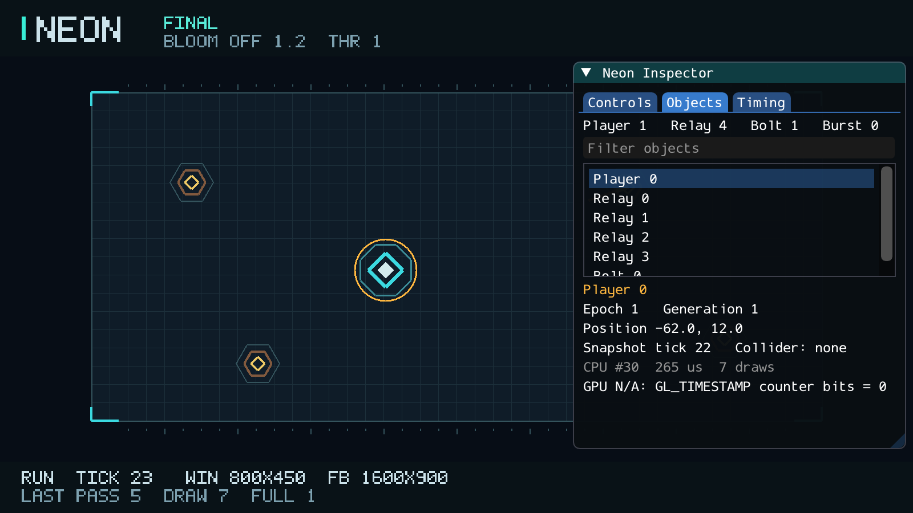
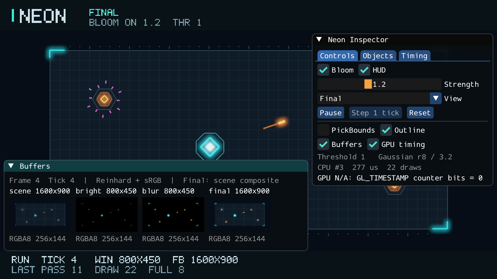
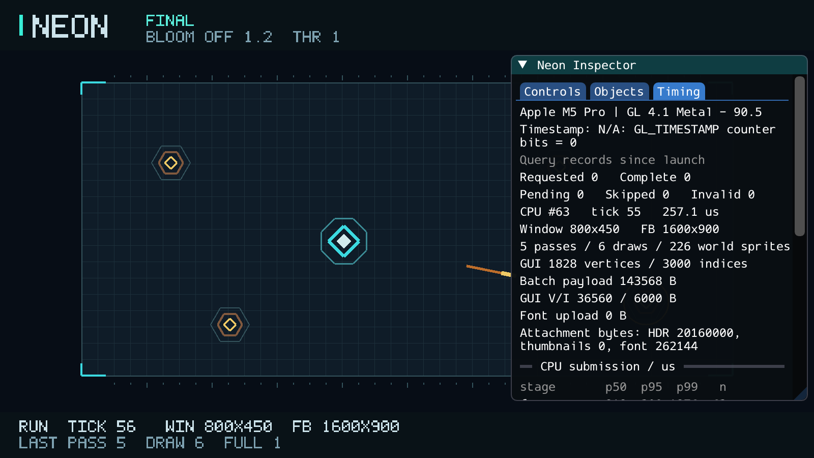

# M7.2 · 在运行中的 Neon 上检查对象与渲染成本



橙色轮廓标出当前选中的 Player。右侧读取选中对象的位置、身份和快照 Tick。对象面板在本帧固定更新前构建，运行时它的快照 Tick 可以比底部 HUD 小一。暂停后可在同一 Tick 对照属性和图像。

## 操作与复现

| 操作 | 效果 |
|---|---|
| F2 / F1 | 显隐 Inspector / HUD |
| WASD / Space | 移动 / 加快发射 |
| B / [ / ] | Bloom 开关 / 强度以 0.1 调整，内部整数 0–30，默认 12 |
| 1 / 2 / 3 / 4 | Scene / Bright / Blur / Final |
| P / . / R | 暂停或恢复 / 暂停时恰好一 Tick / 按原 seed 重置 |
| 左键 / Objects | 在 Scene 或 Final 拾取，或在任意视图用列表选择；文本框可按对象名称或槽号筛选 |
| Controls | 调整显示、暂停、单步、重置、PickBounds、选中轮廓、缓冲预览、GPU 计时 |
| Timing | 最近一次 CPU 提交与异步 GPU 记录、Pass Draw、payload 和最近秩分位数；悬停阶段行看最近值 |
| Escape | 文本或弹出层处理自己的交互，场景获得键盘时退出 |

```sh
cd /Users/grahm/Desktop/Tiny2D-Engine
cmake -S . -B build/m72-release -DCMAKE_BUILD_TYPE=Release -DTINY2D_OPENGL_TESTS=ON
cmake --build build/m72-release --parallel
./build/m72-release/lab/tiny2d_lab --scene neon
./build/m72-release/lab/tiny2d_lab --scene neon --seed 71 --frames 4 --view final --bloom on --inspector off --gpu-timing off --capture /tmp/m72-final.png
./build/m72-release/lab/tiny2d_lab --scene neon --seed 71 --frames 4 --view final --bloom on --inspector on --previews all --gpu-timing on --capture docs/data/m72/buffers.png
python3 docs/data/m72/measure.py run
python3 docs/data/m72/measure.py summarize
```

交互默认为面板和计时开启、预览关闭。有限帧默认为三者全关，显式开启预览需要 `--inspector on`。保留 `--size`、`--scene`、`--seed`、`--frames`、`--bloom`、`--view`、`--capture` 以及基线的错误返回。新增 `--inspector on|off`、`--gpu-timing on|off`、`--previews off|all` 和 `--metrics PATH`。有限帧每个成功展示帧推进一个 Tick，ImGui 关闭实时设备输入、使用固定初始布局和 1/60 GUI delta time，关闭 ini 读写。性能文字反映当次运行。四种无工具画面另行对照 M7.1。

## 输入到展示

`Window` 持有唯一 GLFW 窗口与原 OpenGL Core Context。仅 Lab 工具目标链接 Dear ImGui v1.93.0，官方标签解析到 `c1aaac65e896a45f81f47a4d68f9959e0f86c859`。CMake 从仓库源码构建，GL 使用项目现有的 Apple 系统头。ImGui 使用动态字体纹理和实际 framebuffer scale，面板位置、控件、鼠标均以逻辑点计算。许可证、使用文件和后端补丁记录在[依赖说明](../third_party/imgui/README.md)与[完整许可证](../third_party/imgui/LICENSE.txt)。

1. GLFW poll 原始事件。官方 GLFW backend 安装并串联回调，接收按键、字符、滚轮、鼠标与焦点。Window 自己的焦点回调记下同一轮 poll 内的失焦，framebuffer resize 回调继续属于 Window。
2. 查询逻辑与像素尺寸，在帧边界提交完整目标组替换，回收可读的旧 query。真实失焦和不可绘制使固定时钟丢弃累积时间。有限帧沿用原有 drawable 等待上限。
3. GUI NewFrame 构建控件。F2 使用原始键的按下边沿，即使输入框持有键盘也可切换。键盘捕获和活动控件屏蔽场景动作，已按住的键进入释放门控。Return 属于输入框，场景没有 Return 松开动作。鼠标按下时判定归属，面板切换、弹出层和恢复帧额外屏蔽穿透；拖出再松开不会拾取。
4. UI 和键盘的动作边沿取并集，显示参数在固定更新前应用。调度优先级依次为 Reset、Pause 切换、暂停单步或运行时累积时钟。捕获键盘期间运行中的时钟继续推进。列表选中走工具路径。重置保留暂停、显示、工具开关和布局，增加 epoch，清除选择、已展示几何与场景性能窗口。
5. 更新模拟，准备世界、HUD 和调试几何。补齐预览窗口并记录可见图像需求和本帧 Tick，生成 draw data。Pipeline 生产纹理、转换、合成、绘制轮廓与 HUD，最后提交 GUI。成功交换才发布供下一次点击使用的几何快照。

关闭时，未提交的 GUI 帧先丢弃，再释放 OpenGL 后端、恢复 GLFW 回调、销毁 ImGui Context。query 和图像均在所属 Context 有效时销毁。初始化失败按已完成的步骤清理。CPU 的 Neon、控制和选择逻辑可在无窗口进程中测试。

## 身份、显示坐标与调试几何

`LabHandle` 由 session epoch、类别、slot 和 spawn generation 组成。Player 和四个 Relay 的 generation 固定。12 个 Bolt 槽、8 个 Burst 槽在实际生成点递增各自 generation。列表和拾取都复制值，访问时验证 epoch、kind、槽界限、存活和 generation；重置的 epoch 位于 Neon 外层。选择操作只读模拟，不推进 RNG。

已展示快照带 camera、逻辑内容矩形、视图、目标 generation、renderFrameId、Tick 及对象几何。当前帧切视图、尺寸失配、尚未交换、零尺寸和过期句柄都拒绝旧画面命中。无旋转正交相机先减内容原点，再由相机中心加上相对视口中心的位移除以 zoom，世界 +Y 向下。鼠标已经是逻辑点，framebuffer 像素只用于目标和读回。Bolt 使用与显示相同的插值函数，Burst 使用同一射线半径。语义圆在屏幕空间增加 3 个逻辑点容差；重叠先按显示层，再按距离和槽号决定。

Neon 的物体没有 Collider。PickBounds 显示对应点击范围，选中轮廓与其共用几何。引擎的 `outlineCollider` 通过 Scene 和 ObjectId 查找真实启用对象，复用碰撞模块的 `worldShape`，将局部 AABB 或圆按位置平移，生成世界线段。现有碰撞规则中旋转与缩放只影响视觉。真实 Collider fixture 验证了 AABB 像素、位置变更后的圆以及删除后的失效。

## 缓冲预览与资源



SceneColor 与 Bright/Ping/Pong 保持线性 RGBA16F。GUI 借用的四张图是长边最多 256 像素、等比缩小的 RGBA8。复用主画面的 display shader 做 Reinhard 和一次 sRGB 编码，Final 使用相同强度的场景合成。HUD、轮廓和 Inspector 随后画到默认 framebuffer。ImGui 图像顶端用 V=1，底端用 V=0。像素测试通过实际 draw command 找到屏幕上的缩略图，读取非对称 HDR 标记，覆盖外部 sRGB 开和关。

| 需求 | 生产与提交 |
|---|---|
| Bright 可见 | 本帧提取亮部 |
| Blur 可见，或 Final 有 Bloom 贡献 | 本帧提取亮部，水平、垂直模糊 |
| 可见缩略图 | 每张一次输出 shader 转换。缩略图折叠、屏外、关闭时按实际可见掩码跳过 |
| 主画面 | 输出所选视图，Scene/Final 才提交启用的世界轮廓，再画 HUD 和 GUI |

纹理视图含借用名称、源尺寸、缩略图尺寸、目标 generation。渲染器唯一拥有资源。首次需要预览时整组分配，resize 对已有预览连同 HDR 组先构造候选组，全部成功才交换。生成 Image 命令后到 RenderDrawData 提交或显式 discard 之间，主循环不替换目标。恢复和异常测试包含两个真实新目标成功后，下一次生产 GLObject 创建检测到注入错误。检查临时名称释放、旧组身份与字节、viewport/FBO 恢复、失败期间拒借及下一次绘制。

FrameState 保护 draw/read FBO、viewport、程序、VAO、采样器、纹理、混合、写掩码、scissor 与 sRGB 等状态。GUI backend 保护自己的 VAO/VBO、scissor box、混合因子等，Lab 另包围字体更新所需的 unpack PBO 和 skip offsets。外部 sRGB 在显示绘制时关闭，离开时恢复。四个 HDR 附件理论字节为 `8 × (W×H + 3×ceil(W/2)×ceil(H/2))`；四张 256×144 预览合计 589824 B。字体按实际存在的 RGBA32 atlas 尺寸计。以上为已知附件和纹理数据，驱动额外存储未知。

## CPU 提交与 GPU 命令边界



CPU 稳态窗口最近 120 个完整帧。总 CPU 时间从 poll 返回后开始，覆盖尺寸、query 回收、GUI 构建、输入、固定更新、几何准备、各 Pass 提交与状态恢复，在 swap、读回、文件写入前停止。GUI build 分两段，预览行聚合本帧实际执行的转换。阶段时间嵌套于 total。全部有效帧的最近秩分位数可从 CSV 重算。批次上报已提交的顶点 payload，GUI 在后端实际上传与越过剪裁/回调筛选后的 Draw 位置计数；纹理上传单列。静态 EBO、VBO 预留容量和驱动显存不计入每帧 payload。

GPU 路径探测实际版本/扩展、入口和 `GL_TIMESTAMP / GL_QUERY_COUNTER_BITS`。8 个槽，每槽 20 个 query 名称，覆盖 9 个阶段及总渲染的一对起止 timestamp，支持时上限 160。总区间含本帧实际执行的预览与 GUI，结束在交换前。每槽携带发起帧、Tick、epoch、目标组及像素尺寸、显示/预览/GUI 配置、实际 Pass mask、预热或测量归属。后续边界有限检查 AVAILABLE，已发出的全部标记可用才读 64 位结果。池满直接 skipped。计时关闭仍继续回收旧槽。

按有效位屏蔽高位，拒绝逆序、跨度超过半个计数范围或超出外层区间的区间，纳秒差除以 1000 得到 µs。不完整帧计 invalid，槽位仍占用直到先前标记都可回收。晚到的旧 epoch 不进入当前场景窗口。CPU 和 GPU 分别显示帧号，GPU 同时显示回收延迟。timestamp 之间的间隔可包含调度影响。全程和采样窗口分别记录 requested = completed + pending + skipped + invalid，未发起或未就绪的区间没有 GPU 时长。[OpenGL glQueryCounter](https://github.com/KhronosGroup/OpenGL-Refpages/blob/main/gl4/glQueryCounter.xml) · [ARB_timer_query](https://github.com/KhronosGroup/OpenGL-Registry/blob/main/extensions/ARB/ARB_timer_query.txt)

## 测试与回归

基线 `927c8f89aef9abcf410019ce008e432b641fef4d` 已合并 PR #11，包含 M7.1 交付 `4c268f10bd1d9b73ed0d5a273484daec8ab096d2`。继承全部历史 CTest，新增 M72CPU 和 M72InspectorGL。

| 构建 | 基线清单 | 本次结果与用例 |
|---|---|---|
| Debug，OpenGL ON | [43 项](data/m72/baseline-debug.txt) | [45/45](data/m72/ctest-debug.log) |
| Release，OpenGL ON | [43 项](data/m72/baseline-release.txt) | [45/45](data/m72/ctest-release.log) |
| Release，OpenGL OFF | [24 项](data/m72/baseline-headless.txt) | [25/25](data/m72/ctest-headless.log) |

```sh
cmake -S . -B build/m72-debug -DCMAKE_BUILD_TYPE=Debug -DTINY2D_OPENGL_TESTS=ON
cmake --build build/m72-debug --parallel
ctest --test-dir build/m72-debug --output-on-failure
ctest --test-dir build/m72-release --output-on-failure
cmake -S . -B build/m72-headless -DCMAKE_BUILD_TYPE=Release -DTINY2D_OPENGL_TESTS=OFF
cmake --build build/m72-headless --parallel
ctest --test-dir build/m72-headless --output-on-failure
sh docs/data/m72/verify-demo.sh
```

- M72CPU 核对 CLI 组合、Release 门控和调度优先级，比较脚本输入下的全部原模拟字段、轮转索引与 RNG。覆盖句柄过期、复用、epoch、非法类别和槽位、非零原点/奇数尺寸/zoom 与不同像素密度下的坐标转换。fake query 后端在读取未就绪结果时使测试失败，断言池满跳过、partial 回收、旧 epoch/预热身份、有效位与回绕、微秒换算和分类守恒。CSV fixture 验证在没有后续渲染帧时也能写出迟到记录。
- M72InspectorGL 使用图形登录会话、生产 renderer 和官方后端。注入鼠标、键盘和字符，操作 Bloom、Pause/Resume、Step、对象列表和可编辑筛选框。测试拖离释放、文本中的 R/W/Space/P/Return、F2 持有与恢复、有限帧隔离。另行读回真实 Collider 轮廓、GUI 缩略图的非对称标记、Bloom off 时变化的中间缓冲及 HUD 外的 Final。测试创建故障、外部 unpack/sRGB 状态、错误 Context、弃帧和下一帧恢复。硬件有可用位时相同测试要求真实 query 完成。
- M71GPU 的原四视图、浮点和状态恢复断言，M71RelocatedCLI 的资源定位及故障返回均继续通过。正式 CLI 的四张 Tick 4 无工具截图用 `cmp` 与仓库 M7.1 PNG 逐字节相等。旧 Sandbox 的三角形、500 immediate、500 batch、5000 multitexture 分别为 1 / 500 / 1 / 5 Draw。经典 Survivor 的难度、流程、事件、终局及容量测试保留。[命令与日志](data/m72/demo.log)
- 交互 Lab 和 Tiny2DSurvivor.app 各自启动后，按进程 ID 观察到可见窗口，随后结束本次 smoke 启动的进程。对象和 Timing 截图来自固定窗口尺寸的自动后端事件测试，Buffers 截图来自正式有限帧入口。这些是自动化运行证据。[启动记录](data/m72/interactive.log)

源码复核期间修正了异常退出的计数、跨帧 CSV 回收和面板隐藏时字体存储的记录。首次编译新 GL fixture 时 `Scene` 类型名与 Lab 按键同名，改用限定名后重新构建。沙箱内的 GitHub 请求及硬件 sysctl 查询受限，通过受管授权重试取得结果。

## Release 工具成本

实测代码 `6df39b8efa14fb718cad3327a165dc4afae5b26c`。Apple M5 Pro、macOS 26.7.3、Apple clang 21.0.0、OpenGL 4.1 Metal 90.5。每格单独启动同一个 Release 程序，1320 个成功展示帧、1320 Tick。预热 120 帧，随后采样 1200 帧。两个尺寸都用本次配置 1 作为各自基线。全窗场景、HUD 与 Bloom 开启，seed 71、Final、无选择、无调试几何。含预览的每个测量帧均验证 mask=15 及四次转换 Draw。[协议](data/m72/protocol.md) · [环境](data/m72/environment.txt) · [全部阶段分位数与样本数](data/m72/quantiles.md)

| 实际像素 | 配置 | CPU 帧 p50 / p95 / p99（µs） | Pass / Draw | 批次顶点 payload p50（B） | GUI 顶点 / 索引 payload p50（B） | 原始记录 |
|---|---|---:|---:|---:|---:|---|
| 1600×900 | 1 · 工具全关 | 109.208 / 130.875 / 158.542 | 6 / 6 | 142128 | 0 / 0 | [CSV](data/m72/800x450-1.csv) · [日志](data/m72/800x450-1.log) |
| 1600×900 | 2 · Inspector | 125.958 / 166.709 / 202.708 | 7 / 8 | 142128 | 20680 / 4260 | [CSV](data/m72/800x450-2.csv) · [日志](data/m72/800x450-2.log) |
| 1600×900 | 3 · 再开四预览 | 158.292 / 192.583 / 218.125 | 11 / 22 | 144144 | 35080 / 6582 | [CSV](data/m72/800x450-3.csv) · [日志](data/m72/800x450-3.log) |
| 1600×900 | 4 · 再请求 GPU 计时 | 164.291 / 203.917 / 221.250 | 11 / 22 | 144144 | 36880 / 6870 | [CSV](data/m72/800x450-4.csv) · [日志](data/m72/800x450-4.log) |
| 2240×1260 | 1 · 工具全关 | 113.791 / 152.833 / 188.500 | 6 / 6 | 141552 | 0 / 0 | [CSV](data/m72/1120x630-1.csv) · [日志](data/m72/1120x630-1.log) |
| 2240×1260 | 2 · Inspector | 126.875 / 178.500 / 201.334 | 7 / 8 | 141552 | 20680 / 4260 | [CSV](data/m72/1120x630-2.csv) · [日志](data/m72/1120x630-2.log) |
| 2240×1260 | 3 · 再开四预览 | 170.708 / 239.708 / 273.708 | 11 / 22 | 143568 | 35400 / 6630 | [CSV](data/m72/1120x630-3.csv) · [日志](data/m72/1120x630-3.log) |
| 2240×1260 | 4 · 再请求 GPU 计时 | 175.542 / 256.625 / 302.583 | 11 / 22 | 143568 | 37200 / 6918 | [CSV](data/m72/1120x630-4.csv) · [日志](data/m72/1120x630-4.log) |

两档尺寸中，单开面板增加 2 个实际 GUI Draw。配置 2 的 GUI build 和 render 中位数分别为 7.334 / 6.667 µs、8.125 / 6.708 µs。配置 3 在同一 Bloom 生产链上增加 4 次转换，转换段中位数分别为 26.875 和 28.875 µs。带缩略图的两个窗口共提交 12 个 GUI Draw。世界批次始终为 1 Draw，World Sprite 中位数均为 238。HUD 的统计数字和面板文字影响各自的几何 payload。

1600×900 的四个 HDR 附件合计 20,160,000 B，2240×1260 为 39,513,600 B。四张预览增加 589,824 B，已创建的字体 atlas 在测量窗口为 262,144 B。默认 framebuffer 和驱动额外存储未知。

本机查询得到 0 个有效 timestamp 位。配置 4 全程及采样窗口的 requested、completed、pending、skipped、invalid 均为 0，各阶段 GPU 有效样本均为 0。配置 4 的界面绘制能力诊断，CSV 区分 unavailable 与 off。配置 3→4 的 CPU 差值包含界面变化和运行波动。实际发起 GPU query 的设备成本仍待测量。另用无效截图路径验证了非零退出、部分帧信息与计数报告。[错误退出记录](data/m72/failed-capture.log)

## 待人工试玩与下一阶段接口

M7.1 用户反馈交互和视觉无异常，PR #11 已合并。本次 M7.2 的自动注入覆盖不替代人的键鼠手感与视觉验收。请在常用窗口尺寸下拖动/折叠面板，暂停后单步跟随 Bolt，观察槽位复用，再以不同 backing scale 的显示器验证跨屏字体、点击与最小化恢复。本次机器仅覆盖 Apple M5 Pro、arm64、macOS 26.7.3、同一屏幕的两个 framebuffer 尺寸。支持非零 timestamp bits 的另一台真实设备仍需复核 GPU 时间与帧延迟。

M7.3 可在 Controls 命令中增加经过验证的光照参数，在 Pipeline 的需求判断中加入 Light Buffer，复用带 generation 的纹理借用、显示转换与 timestamp 区间。新增 Pass 时一起扩展名称、mask、区间数、CSV 和像素 fixture。本 PR 停在 Inspector 的源码 Review 和人工试玩。
