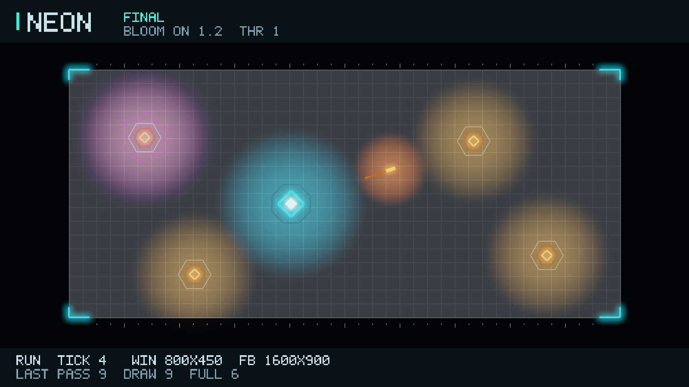
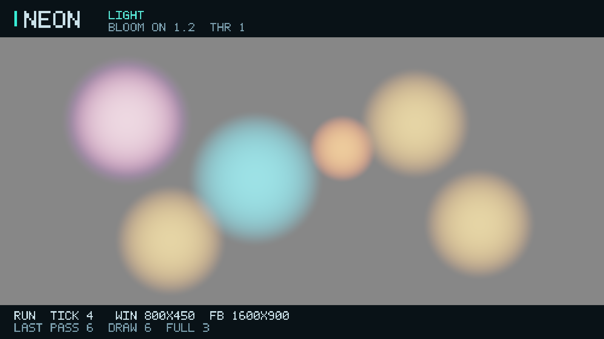
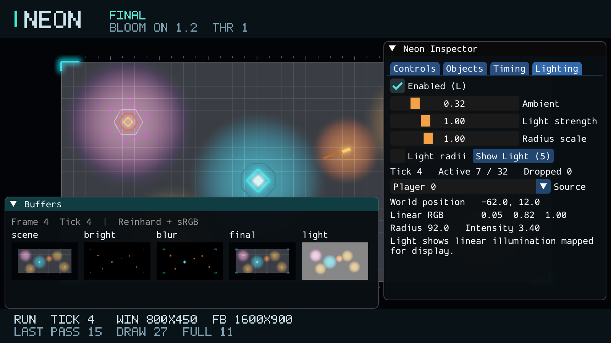

# M7.3 · Neon 动态二维光照

在 Final 中按 **L**，再用 **WASD** 移动青色 Player。观察玩家前方的地面方格变亮，以及身后的方格回到环境光。按 **5** 可以在同一世界位置查看光照强度。亮部扩散来自后续 Bloom。下面两张图取自 Release 的同一 seed 71、Tick 4 和 1600×900 framebuffer。

| 受光场景与 Bloom | LightBuffer 的显示映射 |
|---|---|
|  |  |

## 运行与检查

```sh
cmake -S . -B build/m73-release -DCMAKE_BUILD_TYPE=Release -DTINY2D_OPENGL_TESTS=ON
cmake --build build/m73-release --parallel
./build/m73-release/lab/tiny2d_lab --scene neon --lighting on --view final
./build/m73-release/lab/tiny2d_lab --seed 71 --frames 4 --lighting on --ambient 0.32 --view light --capture /tmp/light.png
```

| 输入 | 效果 |
|---|---|
| L、5、1–4 | 切换光照、查看 Light、查看原 Scene / Bright / Blur / Final。关闭光照时，从 Light 返回 Final |
| F2 → Lighting | 查看当前 Tick、源类型与槽位、世界坐标、线性颜色、半径、强度、容量与丢弃数 |
| Ambient / Light strength / Radius scale | 标量环境光 0–2，默认 0.32。全局强度 0–4，默认 1。世界半径倍率 0.25–3，默认 1 |
| Light radii | Scene / Final / Light 在输出变换后画十字中心和影响圆。选中项加粗，拾取仍用原对象的 PickBounds |
| Controls → Buffers | 关闭光照显示四个缩略图，开启光照可显示第五个 Light。查看 Light 主画面无需打开 Inspector |
| WASD / Space、B、P / . / R | 移动与发射、切换 Bloom、暂停 / 单步 / 按原 seed 重置。Reset 保留显示参数，清空选中项，推进 epoch |

解析 CLI 后才创建窗口。`--lighting` 默认为 `off`，`--view light` 要求显式开启 Lighting，选项顺序自由。交互的 L 和 5 与 M7.2 其他场景键共享键盘捕获、失焦清理、F2 切换及释放门控。拖动滑块时固定更新继续；暂停后 GUI 和渲染仍运行。有限帧忽略实时设备，每个成功展示帧推进一个 Tick。



## CPU 数据、材料与合成

`Neon` 拥有模拟。更新后，`Picture::prepare` 生成值类型的 `LightList`，按 Player、Relay、Bolt、Burst 顺序提取，同类按槽号递增。`Light2D` 保存世界中心、半径、线性 RGB、强度和 `epoch/kind/slot/generation` 身份。Inspector 查本次快照，Renderer 只读取已验证的元素，提取过程不消耗 RNG。初始 1 个玩家、4 个中继器与最多 12 个弹丸、8 个爆发共 25 个候选；通用列表最多收下 32 个合法候选，后续候选按顺序计入 dropped。

| 来源 | 线性 RGB | 基本半径（世界单位） | 基本强度与位置 |
|---|---|---:|---|
| Player | 0.055 / 0.82 / 1 | 92 | 3.4，玩家中心 |
| Relay | 1 / 0.49 / 0.085 | 76 | 3.3，四个既有中继点 |
| Bolt | 1 / 0.225 / 0.035 | 46 | 5，按 `along(start→end, age/44)` 计算弹头 |
| Burst | 0.77 / 0.095 / 1 | 89 | `7 × (1 − age/27)²`，爆发中心 |

设世界采样点为 x，光源中心为 p，半径为 r，单灯权重为 `max(0, 1 − |x−p|²/r²)²`。中心权重为 1，半径边缘连续降为 0。有界列表拒绝非有限参数，中心各分量限于 ±1,000,000，半径范围为 1/1024 至 4096，强度 0–32，RGB 0–1、alpha 为 1。即使 32 个最强白灯重叠，加上最高环境光，单通道也只到 1026，处于 RGBA16F 的有限表示范围内。这个模型描述二维径向衰减，当前材料只包含颜色和自发光。光照关闭时走原有的场景着色，因此两种模式的静态底色也有差异。下面的地面数值测试在同一受光材质上单独移动玩家，以隔离光源的影响。

1. **Albedo** 写入线性反射色。开启光照的地面为 (0.14, 0.16, 0.19)，网格为 (0.24, 0.30, 0.33)，两者使相同照明在不同材质上产生不同结果。发光体是覆盖地面的不透明几何，其足迹在此写黑，阻止底层地面穿过发光体。
2. **Emission** 在黑底上写入中继核心、玩家轮廓与核心、弹道和爆发的线性自发光颜色，保留大于 1 的分量。
3. **Light** 用一个全屏三角形在每个像素累积环境光和点光。两个定长 vec4 数组保存每盏灯的空间参数与颜色能量，每帧至多两次批量上传。CPU 和 GLSL 都将数量限制为 32。
4. **SceneCompose** 用像素坐标从三张等大纹理读取同一 texel，计算 `SceneColor = Albedo × Light + Emission`。Bloom 从这里的 SceneColor 提亮并模糊。检查 Light 时只对照明纹理施加既有 Reinhard 和 sRGB 显示变换。缩略图保存为 RGBA8 显示值，ImGui 直接采样并翻转 V。
5. 关闭光照后恢复原 World → SceneColor，其颜色与原 Bloom shader 保持原有取值。HUD、拾取轮廓、光源范围与 GUI 均在后处理之后绘制。

`Camera2D` 投影使用逻辑视口，y 轴向下。shader 取 GL 像素中心 `gl_FragCoord.xy` 和实际附件宽高，计算 `ndc = 2 × pixel / framebufferSize − 1`。取当前 view-projection 的对角尺度及平移，反解 `world = (ndc − translation) / scale`。Y 符号来自矩阵本身，背板倍率来自实际宽高；半径始终以世界单位计算。GPU 测试覆盖有平移、非单位 zoom、奇数像素及 2× backing scale 的相机。

## 附件所有权与失败恢复

Pipeline 在创建它的 Context 中拥有目标。SceneColor 和三个光照附件使用全分辨率 RGBA16F，Bright、Ping、Pong 每轴向上取半。按需创建的四张历史缩略图和单独的 Light 缩略图各使用 RGBA8，最长边至多 256。组预算按每个附件的实际宽 × 高 × 每像素字节求和，上限 256 MiB。它衡量纹理的理论附件存储；驱动开销、默认 framebuffer、字体、查询和新旧组在切换瞬间的共存另计。

首次开启才创建 Albedo、Emission、Light。在原尺寸关闭后保留已分配附件与缩略图并计入驻留量，再开启时复用。关闭光照再改变尺寸会释放光照组。Resize 先校验乘法、总预算和设备纹理尺寸，在临时组内建齐替换的 HDR / LDR 附件，成功才交换并推进 generation。零尺寸暂停，重新获得有效尺寸后恢复；失败时旧对象仍在，下次成功 resize 后可绘制。缩略图只在帧边界后借用，本帧转换结束才提交对应 ImGui draw data。

SceneCompose 显式绑定 Albedo / Light / Emission 到单元 0 / 1 / 2。`FrameState` 在正常和异常路径恢复三组纹理和 sampler、active unit、读写 FBO、viewport、sRGB 等调用者状态。光照 GPU 测试预置三套非默认绑定，既注入晚期绘制异常，也在目标组只建成一部分时抛出异常。

## 像素验证与历史回归

真实 GL 在同一块没有自发光的 Neon 地面上读回了下表结果。世界位置为 (−91.25, 26.25)，在 320×180 目标中对应 GL 像素 (123, 79)。两次均验证了 Albedo 和零 Emission，并用 CPU 双精度独立计算该点的照明。

| 状态 | 玩家世界位置 | RGBA16F SceneColor 读回 RGB | 独立预期 RGB |
|---|---|---|---|
| Tick 0，位于玩家半径内 | (−62, 12) | 0.06476 / 0.39209 / 0.55469 | 0.06479 / 0.39246 / 0.55514 |
| Tick 40，玩家向右离开 | (34, 12) | 0.04474 / 0.05112 / 0.06073 | 0.04477 / 0.05117 / 0.06078 |

红光照射 0.5 灰表面的夹具进一步隔离了颜色与移动作用。环境光 0.2 对应 RGB 约 (0.1000, 0.1000, 0.1000)。红光到达时变为 (2.0996, 0.1000, 0.1000)，移走后原像素复原，新位置出现同一红色读数。将环境光降为零后，发光几何仍读到 (5, 3, 2)。只切换 Bloom 后，高亮邻域显示红通道由 85 增至 185，整张浮点 LightBuffer 两次读回一致。另测 32 盏灯完全重合、每帧单次 Light Draw、预览方向、当前帧更新和显示映射。[实机像素记录](data/m73/pixels.log)

| 构建 | 修改前测试清单 | 本次 CTest |
|---|---|---|
| Debug · OpenGL ON | [45 项](data/m73/baseline-debug.txt) | [48/48](data/m73/ctest-debug.log) |
| Release · OpenGL ON | [45 项](data/m73/baseline-release.txt) | [48/48](data/m73/ctest-release.log) |
| Release · OpenGL OFF | [25 项](data/m73/baseline-off.txt) | [27/27](data/m73/ctest-off.log) |

新增 M73_cpu、M73_controls、M73_LightingGL 三项。前两项在没有 GL Context 的进程中运行。原 M72InspectorGL 继续验证文本捕获、失焦、Cocoa repeat、F2 和鼠标释放，并覆盖 L、5、Lighting 滑块、同帧预览以及关闭光照时的恢复。M72CPU 继续验证 epoch / slot / generation、查询计数和乱序回收后的历史。真实 FBO 测试包含同尺寸启停、奇数与 1×1、零尺寸恢复、错误 Context、设备尺寸及整组预算上限、附件分配与绘制抛错、重试和旧纹理退役。

seed 71、Tick 4、实际 1600×900、Lighting / Inspector / 预览 / GPU 计时全关时，Scene、Bright、Blur、Final 四张 PNG 与 M7.1 的文件逐字节相同。经典 Sandbox 最终帧 Draw Calls 为 1 / 500 / 1 / 5；独立 Survivor 完成构建和按进程 PID 匹配的可见窗口启动检查。[截图与哈希](data/m73/captures.log) · [历史入口日志](data/m73/legacy.log)

## Release 性能基线

同一二进制、seed 71、Final、Bloom 强度 1.2、HUD 开启，所有组都请求 GPU timestamps。每组串行运行 1320 个展示帧和 1320 个固定 Tick，前 120 帧预热，后 1200 帧采用最近秩分位数。窗口请求 800×450 和 1120×630，实际 framebuffer 为 1600×900 和 2240×1260。A 关闭 Lighting 和工具，B 只开 Lighting，C 同时开 Lighting 和 Inspector，D 再开启全部五项预览。C、D 使用 Lighting 页签，选择默认追踪的 Player。

| 实际 framebuffer | 配置 | CPU p50 / p95 / p99（µs） | Pass / Draw 中位数 | 上传中位数（B） | HDR + 缩略图（B） |
|---|---|---:|---:|---:|---:|
| 1600×900 | A | 116.208 / 145.917 / 164.542 | 6 / 6 | 142,128 | 20,160,000 + 0 |
| 1600×900 | B | 146.250 / 185.167 / 205.750 | 9 / 9 | 149,696 | 54,720,000 + 0 |
| 1600×900 | C | 166.417 / 206.375 / 234.292 | 10 / 11 | 184,616 | 54,720,000 + 0 |
| 1600×900 | D | 212.917 / 267.125 / 301.292 | 15 / 27 | 192,442 | 54,720,000 + 737,280 |
| 2240×1260 | A | 113.125 / 152.000 / 176.833 | 6 / 6 | 141,552 | 39,513,600 + 0 |
| 2240×1260 | B | 148.667 / 210.209 / 262.875 | 9 / 9 | 149,120 | 107,251,200 + 0 |
| 2240×1260 | C | 182.250 / 282.709 / 343.583 | 10 / 11 | 184,040 | 107,251,200 + 0 |
| 2240×1260 | D | 242.875 / 377.875 / 443.000 | 15 / 27 | 191,866 | 107,251,200 + 737,280 |

B 在 1600×900 的提取与校验、Albedo、Emission、Light、Compose 的 p50 依次为 0.250、33.084、13.417、8.125、8.208 µs；在 2240×1260 为 0.250、35.292、13.959、8.417、8.333 µs。四个绘制阶段替换 World，净增三次 Draw。B–D 在采样区间内有 7–8 盏灯，丢弃数为 0，单次 Light Draw 提交 224–256 B 点光数组。LightBuffer 与上述 framebuffer 同尺寸。D 执行五次预览转换。Albedo 中的黑色材质遮盖与 Emission 显色各有独立的顶点提交，用于不透明覆盖。

整帧 CPU 时钟从事件轮询之后开始，包含 drawable 检查、可用查询回收、GUI 构建、模拟、光源提取、几何准备、GL 提交和状态恢复。计时结束在截图、swap、帧记录写入之前。prepare 已扣除单列的 light_extract。每阶段记录其自身区间，不把分位数相加作为整帧值。上传项统计 batch 顶点、ImGui 顶点/索引、字体更新及点光数组的应用层字节，标量 uniform 与驱动内部流量不在此口径内。

保留原 Pass 位 0–8，依次追加 Albedo、Emission、Light、SceneCompose 到位 9–12。查询池仍有 8 个槽，整体 render 加 13 个 Pass，每区间两枚 timestamp，共最多 **224 个查询名称**。回收先按 available 检查，保留 pending、skipped、invalid 和 epoch 语义，显示历史按发起帧 ID 排序。Apple M5 Pro、OpenGL 4.1 Metal 90.5 的 timestamp 有效位为 0，八组均为 N/A，实际 GPU 有效样本为 0。当前数据可定位 CPU 提交成本，GPU 执行成本仍需支持 timestamps 的设备测量。[逐 Pass 分位数、Draw 与上传](data/m73/quantiles.md) · [压缩逐帧 CSV 与运行日志](data/m73/) · [环境与二进制哈希](data/m73/environment.txt)

## 复现与展示

```sh
cmake -S . -B build/m73-debug -DCMAKE_BUILD_TYPE=Debug -DTINY2D_OPENGL_TESTS=ON
cmake -S . -B build/m73-release -DCMAKE_BUILD_TYPE=Release -DTINY2D_OPENGL_TESTS=ON
cmake -S . -B build/m73-off -DCMAKE_BUILD_TYPE=Release -DTINY2D_OPENGL_TESTS=OFF
for config in debug release off; do
    cmake --build "build/m73-$config" --parallel 4
    ctest --test-dir "build/m73-$config" --output-on-failure
done
build/m73-release/lab/tiny2d_m73_gl
sh docs/data/m73/capture.sh
sh docs/data/m73/legacy.sh
swiftc docs/data/m73/window-smoke.swift -o build/m73-release/m73-window-smoke
build/m73-release/m73-window-smoke build/m73-release/Tiny2DSurvivor.app/Contents/MacOS/Tiny2DSurvivor
python3 docs/data/m73/measure.py run
python3 docs/data/m73/measure.py summarize
sh docs/data/m73/record-demo.sh /tmp/m73-demo.mp4
```

| 对照 | 同一视角的 GPU 截图 |
|---|---|
| 同一 Tick，开关 Lighting | [关闭](media/m73/lighting-off.png) · [开启](media/m73/lighting-on.png) |
| 同一 Tick，开关 Bloom | [开启](media/m73/lighting-on.png) · [关闭](media/m73/bloom-off.png) |
| 同一 seed，弹头向右上方移动 | [Tick 4](media/m73/lighting-on.png) · [Tick 18](media/m73/moving-bolt.png) |
| 同一 Tick，观察缓冲 | [Light 主画面](media/m73/light-buffer.png) · [Inspector 五预览](media/m73/inspector.png) |

18 秒演示使用固定移动和发射输入，依次展示旧路径、受光 Final、LightBuffer 和半径轮廓。每两个固定 Tick 从生产 Pipeline 的 GL_BACK 读回一帧，使用 AVFoundation 编码；逐帧解码确认 1600×900、30 fps、540 帧。这段录制独立于性能采样。[MP4 演示](media/m73/demo.mp4) · [视频采集与验证记录](data/m73/video.log)

## 待人工验收与后续边界

- 在实际键鼠操作下移动 Player、连续发射、切换 Bloom / Light，核对环境光、地面变色、爆发衰减和自发光。暂停后调节强度或半径，检查中心与范围圆。
- 在 Lighting / Objects 页签间选择动态源，等待槽位过期或 Reset；检查文本捕获、F2、失焦重获及单步时的交互手感。
- 拖动或最小化窗口，并在不同 backing scale 的显示器间移动，目测光源、拾取与预览的对齐。当前自动化实机覆盖一台 Apple Silicon Mac；其他 macOS 设备、跨屏及有效 timestamp 硬件留待验收。仓库构建继续面向 macOS 系统 OpenGL。
- M7.4 可为受光表面提供法线材质，并按光源加入遮挡可见度，继续写入同一线性合成流程。玩法模拟、Bloom 和 HUD 可沿用当前接口。本阶段到源码 Review 与人工验收为止。
