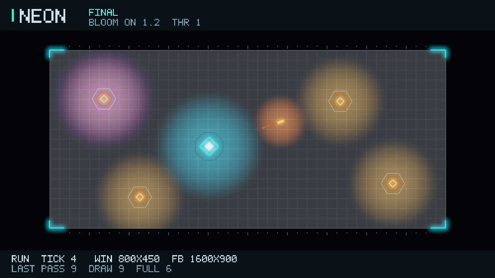
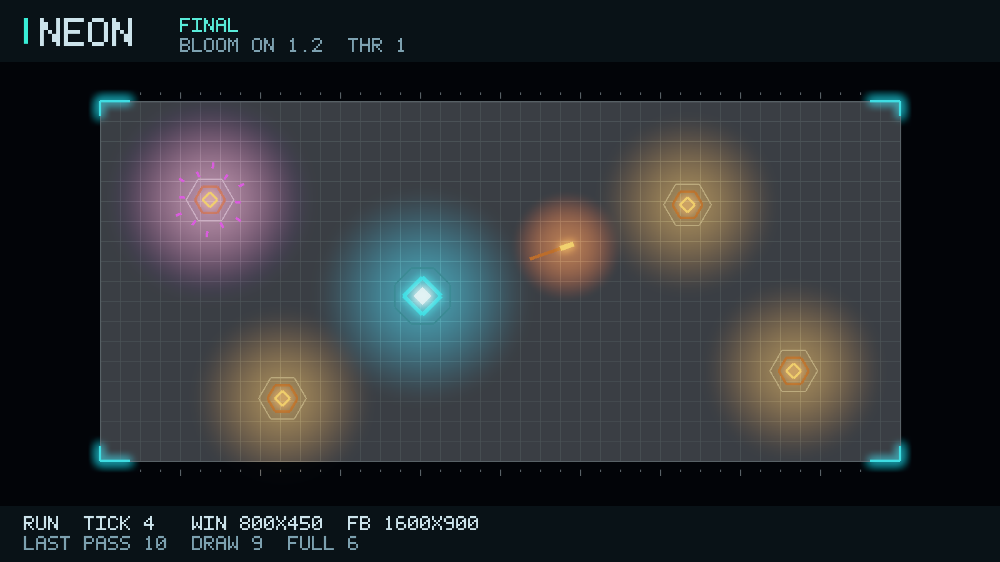
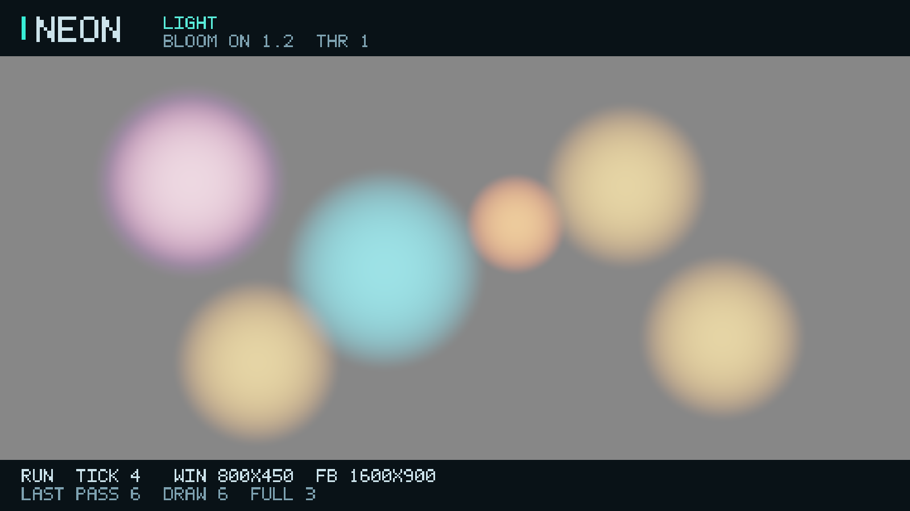
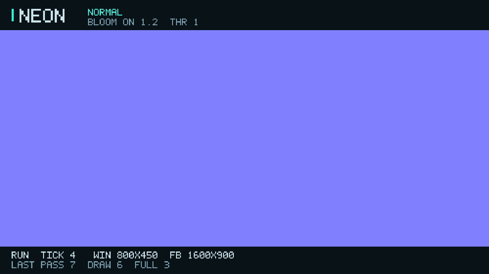
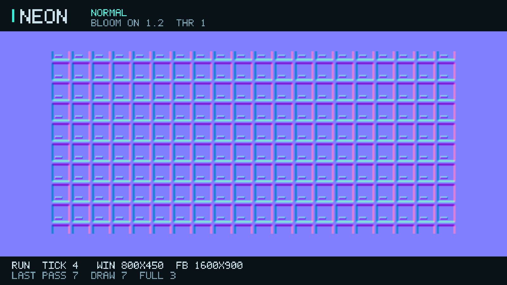
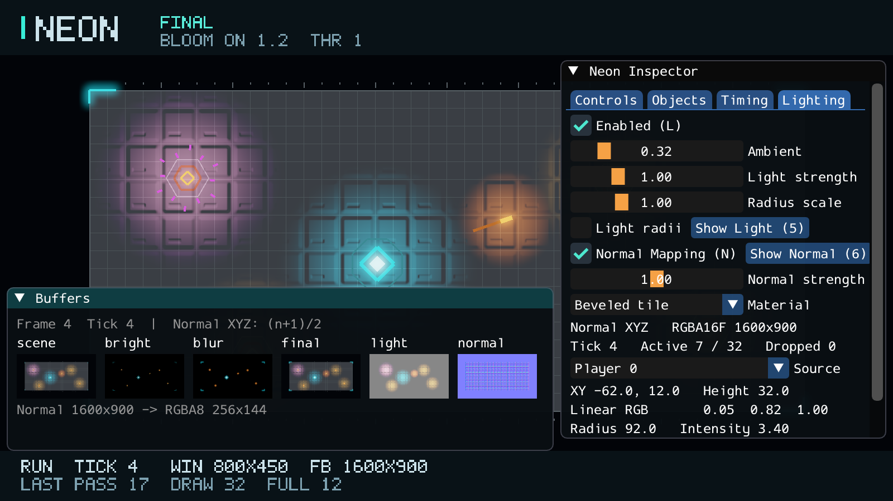
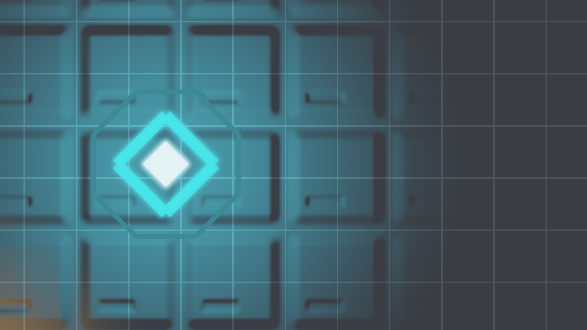
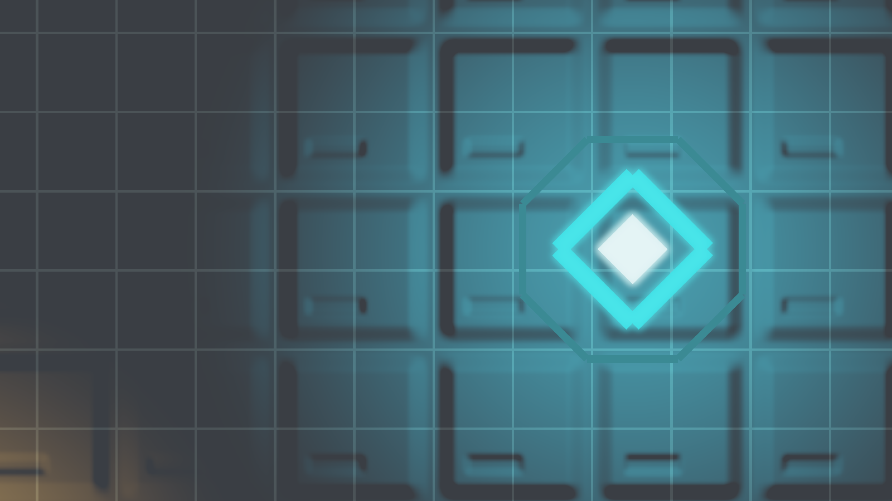

# M7.4a · Neon 地板法线材质与方向光照

用 WASD 让青色 Player 横穿同一块地板。在光源经过倒角前后，可以看到朝向光源的一侧变亮。中继器、飞行的 Bolt 和逐渐消退的 Burst 也按各自的位置照亮地面。暂停后按 **N** 可以在同一 Tick 对照 M7.3 径向光照与法线光照，按 **6** 可以找到刚才看到的那条倒角对应的法线。

## 运行与输入

```sh
cmake -S . -B build/m74a-release -DCMAKE_BUILD_TYPE=Release -DTINY2D_OPENGL_TESTS=ON
cmake --build build/m74a-release --parallel
./build/m74a-release/lab/tiny2d_lab --scene neon --lighting on --normal-mapping on --view final
```

| 操作 | 可观察的结果 |
|---|---|
| L / N | L 切换光照。光照开启后，N 在径向与法线光照之间切换。关闭 Lighting 同时关闭 Normal Mapping。 |
| 1 / 2 / 3 / 4 / 5 / 6 | Scene / Bright / Blur / Final / Light / Normal。当前诊断附件停用时回到 Final。 |
| F2 → Lighting | **Material** 选择 Flat 或 Beveled tile，**Normal strength** 连续调节起伏。面板显示当前光源高度、法线附件格式与源尺寸。 |
| Controls → Buffers | 开启法线时查看六个当前帧缩略图。窗口显示帧号、Tick、Normal 源与 RGBA8 预览尺寸。 |
| P / . / R | 暂停、单步、按原 seed 重置。重置保留显示设置，推进 epoch，清除旧选择，恢复初始 Bolt 和 Burst。 |
| B / F1 | 切换 Bloom / HUD。WASD 移动，空格持续发射。文本捕获与 F2 沿用按键释放门控。拖动材质滑块期间，未暂停的模拟继续推进。 |

CLI 默认为 `--normal-mapping off`。可指定 `--normal-material flat|tile`（默认 tile）、`--normal-strength 0..2`（默认 1）。`--view normal` 要求 Lighting 和 Normal Mapping 均开启。解析完整组选项后、创建窗口之前检查依赖关系，可自由调整选项顺序。

## 材质、坐标与可重复采样

二维几何可以保留简单轮廓，同时让每个像素对不同方向的光有不同响应。M7.4a 的地板仍是同一矩形，表面朝向写入独立的附件。Neon 负责 Tick、RNG、位置及弹丸生命周期。显示侧的 `NormalMaterial2D` 只包含材质种类与强度，材质生成不读取模拟的种子或 RNG。Albedo 与 Emission 继续由原有几何建立。

世界 +X 向右，+Y 沿场景向下，+Z 指向观察者。平坦面为 (0, 0, 1)。世界空间法线可以直接与世界空间的入射方向求点积。切线空间贴图则以表面的切线、副切线、法线为局部基底，旋转或翻转的表面需要把两个向量变换到同一基底后才能得到夹角。本实现覆盖轴对齐的 Neon 地板。

程序化材质在 32×32 世界单位内重复。CPU 在 64×64 个 texel 中心构造高度场。离砖边 0.75 到 5 单位之间，高度平滑升至 3.5，两轴边缘相乘形成圆滑的角部。在局部 x 为 6–19、y 为 21–26 的区域，再渐进切入最深 1.25 单位的定位槽。台面中央有大片平坦区域，定位槽的非对称位置也便于检验纹理 Y 方向。

在 texel 两侧各取一步（0.5 世界单位），用中心差分求高度偏导，边缘周期环绕。CPU 将 $(-\partial_x h,-\partial_y h,1)$ 归一化后生成基础贴图。R/G 分别存储最接近 $128+127n_x$ 和 $128+127n_y$ 的字节，B 存储最接近 $255n_z$ 的字节。128 可精确表示零倾斜。列随世界 +X 增加，行随世界 +Y 增加。这些字节是向量分量，sRGB 解码会改变它们的方向，因此上传使用线性 GL_RGBA8。

地板矩形与 Albedo 共用 `Picture::floorOrigin` 和 `floorSize`。顶点着色器传递世界位置，片元按 `world / 32` 重复、双线性采样。采样后解码 R/G，乘以强度，再与 Z 一起归一化。强度 1 重建原始斜率，2 将斜率翻倍，0 得到平坦法线。Flat 材质和强度 0 都只需清除法线附件。相机移动、缩放、改变窗口尺寸和 backing scale 均沿同一投影定位地板与材质。[材质生成](../lab/src/NormalMaterial.cpp) · [法线采样](../lab/assets/shaders/normal.frag) · [地板投影](../lab/assets/shaders/normal.vert)

## 从 NormalBuffer 到屏幕

| Lighting | Normal Mapping | SceneColor 的来源 |
|---|---|---|
| Off | Off | 原 World Pass 直接写入 SceneColor。 |
| On | Off | Albedo、Emission 和 M7.3 径向 Light 交给 SceneCompose。 |
| On | On | Albedo、Emission → Normal → 方向 Light → SceneCompose。 |

Normal Pass 先将全分辨率 RGBA16F 附件清为 (0, 0, 1, 1)。程序化材质只在地板矩形上绘制一次，直接写入带符号的 XYZ。Light Pass 从同一像素取出法线，再次归一化以消除半精度存储带来的长度误差。光源中心与采样点均在同一世界坐标系。对位置 $p$、半径 $r$、高度 $h$ 的光和表面点 $x$，使用

$$
f(x)=\max(0,1-\lVert x-p\rVert^2/r^2)^2,\qquad
\ell=\operatorname{normalize}(p_x-x_x,p_y-x_y,h).
$$

M7.3 的距离权重 $f$ 继续控制照明范围。方向模式将每个直接光贡献再乘以 Lambert 因子 $\max(0,n\cdot\ell)$。正对光源时接近 1，背向时为 0。所有演示光源默认高出表面 32 世界单位，高度和半径均校验在 [1/1024, 4096]。每盏点光占两个 vec4，`centerInvRadius` 保存中心 XY、倒数半径和高度。`radiance.rgb` 保存线性颜色乘强度。颜色通道上限为 1，强度上限 32，列表最多接受 32 盏。径向变体与方向变体由同一份着色器源码编译，径向程序只有原先的距离项。[灯参数与校验](../lab/src/Lighting.cpp) · [两种光照公式](../lab/assets/shaders/light.frag)

环境光单独累加。合成遵循 $SceneColor=Albedo\times Light+Emission$，自发光几何的足迹保持黑色 Albedo。HDR 的直接光、环境光和自发光均保留大于 1 的分量，提亮与高斯模糊读取合成后的 SceneColor。Final 沿用原显示变换，再绘制 HUD、轮廓和 Inspector。[HDR 合成](../lab/assets/shaders/compose.frag)

**Normal XYZ encoded for visualization; not scene radiance.** 主 Normal 视图和第六个缩略图都读取真实法线附件，映射为 $0.5(n+1)$。平面显示为 (0.5, 0.5, 1)，负 X 会降低红通道，正 Y 会提高绿通道。Reinhard 压缩的是非负光能量，不能保留有符号的方向含义。普通 HDR 视图继续使用既有 Reinhard 与 sRGB 输出。ImGui 绘制缩略图时按 framebuffer 约定翻转 V。[向量显示着色器](../lab/assets/shaders/normal_display.frag)

## 资源、恢复与测量口径

Pipeline 在所属且 current 的 OpenGL Context 中唯一持有附件、程序和材质纹理。第一次启用法线时生成、上传一次贴图并编译程序。改变尺寸会重建目标，材质资产在 Pipeline 生命周期内复用。原尺寸停用法线可保留已分配附件与缩略图以便再次打开，驻留资源继续计入预算。尺寸变化时先检查预算、尺寸并构造完整替换组，成功后交换并推进 generation。零尺寸暂停借用和绘制。异常时 RAII 回收临时资源，下一次成功 resize 可继续绘制。

五个全尺寸 HDR 附件为 SceneColor、Albedo、Emission、Light、Normal。Bright、Ping、Pong 各为每轴向上取半的 RGBA16F。设 framebuffer 为 $W\times H$，六张缩略图打开后的存储为

$$
8\left(5WH+3\lceil W/2\rceil\lceil H/2\rceil\right)
+6\cdot4W_tH_t+64\cdot64\cdot4\text{ bytes}.
$$

缩略图沿最长边缩到最多 256 像素并维持宽高比。预算按实际驻留组合计算，上限 256 MiB。上式包含 16,384 B 的材质纹理。默认 framebuffer、驱动内部开销、字体、查询对象和 resize 瞬间同时存在的新旧组另计。Normal 写入时在单元 0 读材质。Light 写入时复用单元 0 读 Normal。SceneCompose 延续单元 0/1/2。各 Pass 的采样纹理与当前写入附件独立。

缩略图在尺寸与模式确定后借出，仅用于当帧。Pipeline 先完成该帧转换再提交 ImGui draw data。Normal 主画面直接可用，打开预览才为缩略图分配 RGBA8。关闭映射后禁止借用 Normal 预览。`FrameState` 和现有批处理守卫负责恢复读写 FBO、viewport、blend、sRGB、激活的 texture unit 及单元 0–2 的纹理与 sampler。GPU 对象在所属 Context 仍为 current 时销毁。[目标组与 Pass](../lab/src/Pipeline.cpp) · [状态守卫](../lab/src/FrameState.cpp) · [当帧预览](../lab/src/Inspector.cpp)

Normal 追加为 Pass 13，原 0–12 保留。查询池的容量由 8 帧槽 ×（14 个 Pass + 1 个整体绘制区间）× 2 个时间戳得出，共 240 个查询名称。回收先查 available，记录发起帧、Tick 和 epoch，完整帧历史按发起 ID 保存。CPU 工作包含逻辑准备及提交，与 GPU 执行区间分别记录。仅有用于 GPU 数值验收或截图的运行做像素读回。[计时及 CSV](../lab/src/Metrics.cpp) · [异步查询池](../engine/include/tiny2d/TimestampQueries.h)

## 实际画面与像素读回

第一行比较同一 seed 71、Tick 4 和 1600×900 framebuffer 的场景。第二行直接显示该配置的缓冲数据。正常运行时，点光沿着玩家与弹头移动，倒角的受光面随之改变。

| M7.3 径向 | M7.4a 平坦 | M7.4a 程序化 |
|---|---|---|
|  |  |  |
|  |  |  |



同一块倒角的特写使用生产 Neon、Picture 和 Pipeline。两次都从 seed 71 开始，分别按住左或右 16 Tick。相机与材质相同，原有 Bolt、Burst 和 Relay 状态相同。截图来自完成合成和 Bloom 后的 GL_BACK。为便于在同一位置比较，特写将相机中心固定在 (−61.25, 12.25)，视野宽 180 世界单位并关闭 HUD。

| 玩家位于左侧 | 玩家位于右侧 |
|---|---|
|  |  |

独立数值夹具固定世界采样点 (2.75, 14.25)，NormalBuffer 读回约 (−0.77002, 0, 0.63770)。表中红色直接光强度 8、半径 48、到采样点的水平距离 12、环境光 0.2。CPU 使用读回的法线和独立双精度算式求期望。最后一列来自另一次 SceneColor 附件读回，此处红色 Albedo 为 0.5，自发光为 3。

| 光源相对 X / 高度 | 方向因子 | Light 红通道实测 | CPU 期望 | SceneColor 红通道实测 |
|---|---:|---:|---:|---:|
| −12 / 5 | 0.95606 | 6.92188 | 6.92226 | 6.46094 |
| +12 / 5 | 0 | 0.19995 | 0.20000 | 3.09961 |
| +12 / 32 | 0.32672 | 2.49609 | 2.49726 | 4.24609 |

GPU 测试还逐像素检查法线长度，在相反斜面检查 X 符号，在偏心刻槽检查 Y 方向。更改材质和强度后比较整幅 Albedo 与 Emission，切换 Bloom 后比较整幅法线附件。在新的相机位置、zoom、奇数和 1×1 framebuffer 再次采样同一世界点。测试也从 ImGui 实际显示区域读回标记与下一帧的平坦值。[像素记录](data/m74a/pixels.log) · [GPU 数值与恢复测试](../tests/test_m74a_gl.cpp) · [Inspector 与 Cocoa 交互测试](../tests/test_m72_gl.cpp)

## 自动化与历史回归

| 配置 | M7.3 已有清单 | M7.4a 本次结果 |
|---|---:|---:|
| Debug · OpenGL ON | [48](data/m74a/baseline-debug.txt) | [50/50](data/m74a/ctest-debug.log) |
| Release · OpenGL ON | [48](data/m74a/baseline-release.txt) | [50/50](data/m74a/ctest-release.log) |
| Release · OpenGL OFF | [27](data/m74a/baseline-off.txt) | [28/28](data/m74a/ctest-off.log) |

原有清单中的测试名称、顺序与断言保留。新增独立的 M74a_NormalMaterialsCPU 和 M74a_NormalLightingGL。CPU 测试检查整张纹理的单位长度、编码误差、周期边界、非法参数、CLI 及暂停/单步。两条 seed 71 的输入序列经过 180 个固定 Tick，逐帧比较 RNG、槽位游标、寿命、generation、Albedo 与 Emission。真实 GL 测试另检查材质上传参数错误、Normal 附件和整组分配中途失败、不同 Context、绘制异常后恢复。搬迁 CLI 测试会损坏隔离副本中的法线 shader，验证径向模式可独立运行、法线模式报告编译错误、恢复文件后可显示 Normal。[CPU 测试](../tests/test_m74a_cpu.cpp) · [搬迁与 shader 故障](../tests/m71_relocated.cmake)

首轮完整 Release 有一次 M72InspectorGL 的静止光标恢复断言失败。该次日志未记录原生坐标，无法追溯确切原因。测试夹具现先等待 Cocoa 窗口取得焦点，并从 GLFW 确认 hover 与目标坐标，然后执行原来的失焦、恢复和重新点击断言。连续五次都读到 GLFW 与 ImGui 坐标 (522,112)，随后两套完整 GL 构建均通过。实际 Cocoa 自动重复、F2 释放门控、文本输入 6/N、滑块拖动时模拟推进、选取 epoch 与 GPU 历史乱序回收也在此次回归中运行。[初次失败](data/m74a/ctest-release-initial.log) · [五次重验](data/m74a/focus-repeat.log)

Lighting Off 的四张 M7.1 PNG（Scene、Bright、Blur、Final）与历史文件逐字节一致。Lighting On、默认 Normal Mapping Off 的 M7.3 Final、Light、Bloom Off、Tick 18 弹道画面也逐字节一致。Inspector 的新增控件与第六预览由本次实际绘制和读回单独检查。M7.3 地板固定点在玩家移动前后的蓝通道仍为 0.554688、0.06073。Sandbox 三角形、立即绘制 500 sprites、批量 500 sprites、批量 5000 多纹理的末帧 Draw 分别为 1、500、1、5，Survivor 启动后检测到了独立进程的可见窗口。[PNG 校验](data/m74a/captures.log) · [原有像素测试实测](data/m74a/m73-pixels.log) · [历史入口实测](data/m74a/legacy.log)

## Release 性能实测

同一台 Apple M5 Pro、macOS 26.7.3、OpenGL 4.1 Metal 90.5，八组串行运行同一个 Release 二进制。seed 71、Final、Bloom 1.2、HUD 开启，每组实际完成 1320 帧 / 1320 Tick。预热前 120 帧，随后 1200 帧取最近秩 p50/p95/p99。A 为原径向光照，B 为法线开启且使用 Flat，C 为程序化材质，D 在 C 上打开 Lighting Inspector 和全部六个预览。A–C 关闭 Inspector。两种逻辑窗口尺寸为 800×450 与 1120×630。

| 实际 framebuffer | 配置 | 整帧 CPU p50 / p95 / p99（µs） | Draw 中位数 | 上传中位数（B） | HDR / RGBA8 预览（B） |
|---|---|---:|---:|---:|---:|
| 1600×900 | A | 146.208 / 179.916 / 197.792 | 9 | 149,696 | 54,720,000 / 0 |
| 1600×900 | B | 147.209 / 190.708 / 219.458 | 9 | 151,280 | 66,240,000 / 0 |
| 1600×900 | C | 156.750 / 201.834 / 235.000 | 10 | 152,864 | 66,240,000 / 0 |
| 1600×900 | D | 232.375 / 303.625 / 333.917 | 32 | 203,848 | 66,240,000 / 884,736 |
| 2240×1260 | A | 150.084 / 217.875 / 268.291 | 9 | 149,120 | 107,251,200 / 0 |
| 2240×1260 | B | 153.334 / 246.083 / 323.709 | 9 | 150,704 | 129,830,400 / 0 |
| 2240×1260 | C | 149.084 / 229.625 / 286.916 | 10 | 152,288 | 129,830,400 / 0 |
| 2240×1260 | D | 236.791 / 383.417 / 450.958 | 32 | 206,740 | 129,830,400 / 884,736 |

带法线的六组在首帧用 53.792–56.042 µs 生成基础纹理，各上传一次 16,384 B。此固定驻留量另加在表中附件数上。所有 9600 个采样帧的 CPU 法线准备和材质上传均为 0。Flat 只清缓冲，Normal Draw 为 0。程序化材质每帧用四个按顶点 ID 生成的顶点画一次地板，Normal 的 batch 顶点上传为 0。上传总数还包括 HUD 的 Pass / Draw 数字几何、光源数组及可见的 ImGui 顶点和索引，故即使场景相同也可能变化。

C 的 Normal Pass CPU p50 在两种分辨率分别为 8.750、8.166 µs。D 每帧另做六次预览转换，加上 GUI 构建与提交，工具相关 CPU p50 分别为 76.750、79.626 µs。Bloom 汇总逐帧相加提亮和两次模糊，工具汇总逐帧相加 GUI build、预览与 GUI 提交，再对各自的帧序列求分位数。整帧独立计时，从事件轮询后至截图、swap 与 CSV 写入前。两种分辨率下 C 与 A 的整帧中位数差异方向不同，应结合单独 Pass 和尾部分位数解读这一次对照。

本机 GL_TIMESTAMP 返回 0 个有效位，八组在全部采样帧均为 unavailable，有效 GPU 时间样本为 0。上述 µs 描述 CPU 工作和提交。完整记录包含每个配置的 Normal、Light、SceneCompose、Bloom、GUI 与预览的 p50/p95/p99、应用层上传字节和查询结果。[逐项分位数](data/m74a/quantiles.md) · [逐帧压缩 CSV、运行日志和脚本](data/m74a/) · [系统、可执行文件与 shader 哈希](data/m74a/environment.txt)

## 复现命令

从仓库根目录运行。OpenGL ON 的 CTest 需要当前 macOS 图形会话。CPU 法线套件本身不创建窗口或 GL Context。性能采样与截图分别执行。

```sh
cmake -S . -B build/m74a-debug -DCMAKE_BUILD_TYPE=Debug -DTINY2D_OPENGL_TESTS=ON
cmake -S . -B build/m74a-release -DCMAKE_BUILD_TYPE=Release -DTINY2D_OPENGL_TESTS=ON
cmake -S . -B build/m74a-off -DCMAKE_BUILD_TYPE=Release -DTINY2D_OPENGL_TESTS=OFF
for config in debug release off; do
    cmake --build "build/m74a-$config" --parallel
    ctest --test-dir "build/m74a-$config" --output-on-failure
done
build/m74a-release/lab/tiny2d_m74a_gl docs/media/m74a
sh docs/data/m74a/capture.sh
python3 docs/data/m74a/measure.py run
python3 docs/data/m74a/measure.py summarize
sed 's@build/m73-release@build/m74a-release@' docs/data/m73/legacy.sh | sh
swiftc docs/data/m73/window-smoke.swift -o build/m74a-release/window-smoke
build/m74a-release/window-smoke build/m74a-release/Tiny2DSurvivor.app/Contents/MacOS/Tiny2DSurvivor
```

## 人工验收与下一阶段接口

建议在主设备交互核对三处细节。移动 Player 穿过一道倒角，观察同一位置左右两侧的变化。暂停后在 Flat、不同强度及径向模式间对照。在文本框输入 6，切换 F2、失焦再返回，并在窗口缩放、最小化和跨显示器时检查地板细节与拾取位置。这些操作的手感及不同设备观感需由人工确认。

法线只描述接收点的局部朝向。挡在光路中间的另一段墙面不会改变这个点的法线，因而也不会通过点积产生投影。M7.4b 若要处理遮挡，需要提供可查询的遮挡几何和同一世界空间下每盏灯到接收点的可见度。可见度应乘在该灯的直接光项上，再累加到 LightBuffer。环境光、Emission 与随后 Bloom 的合成契约可沿用。
