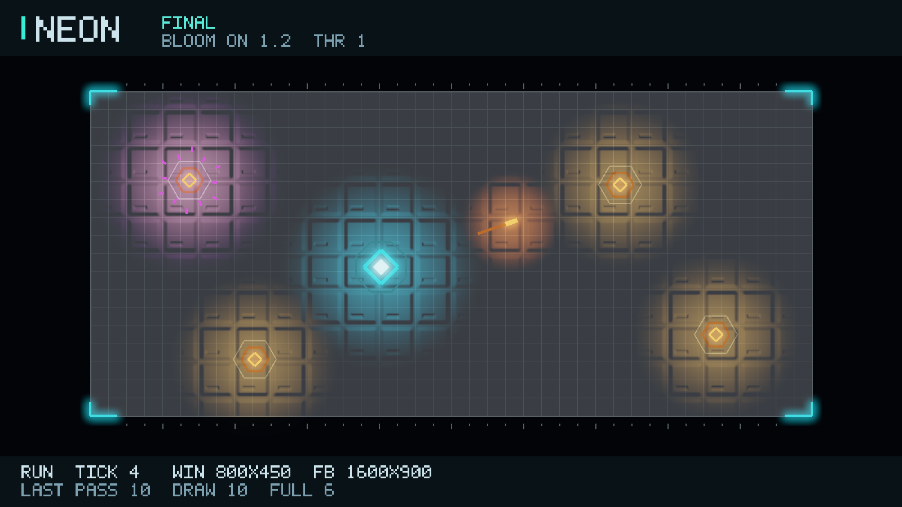
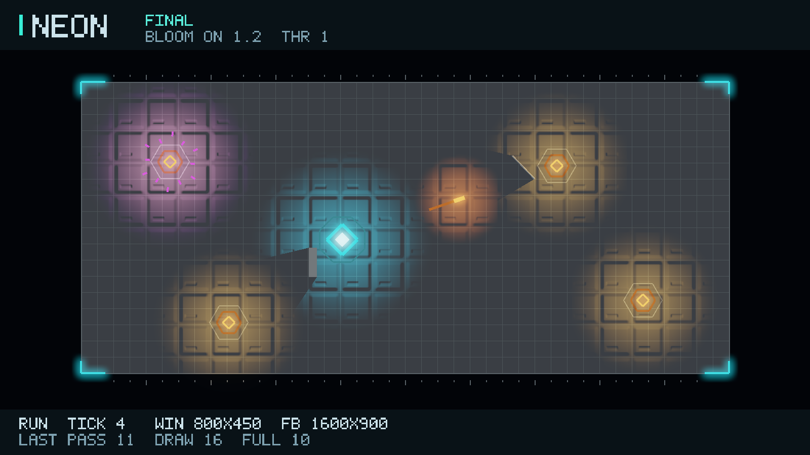
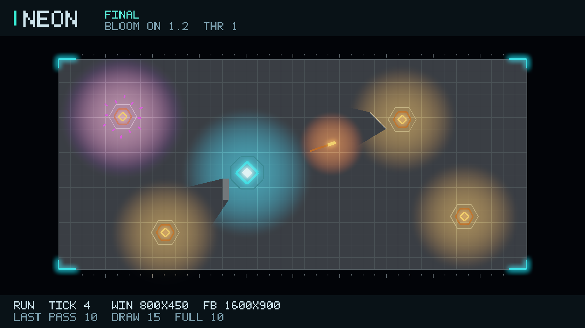
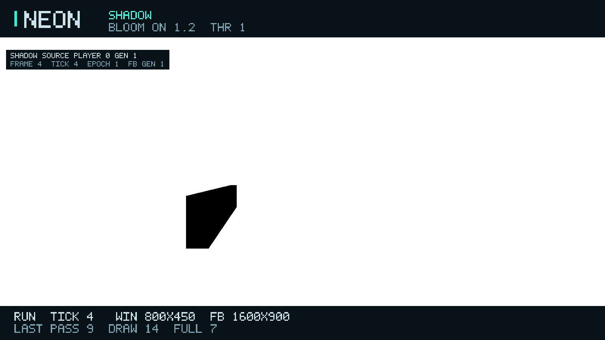
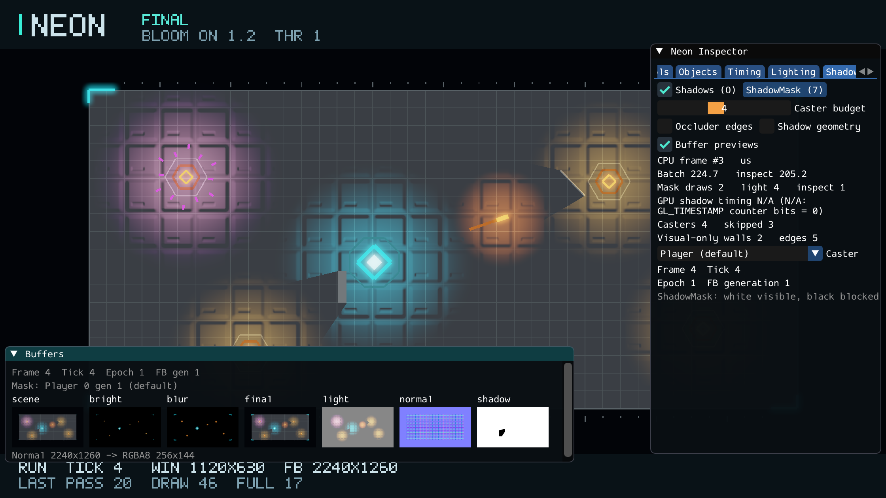
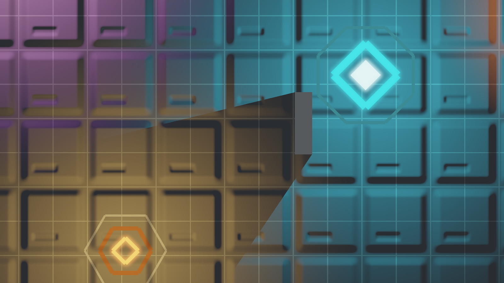
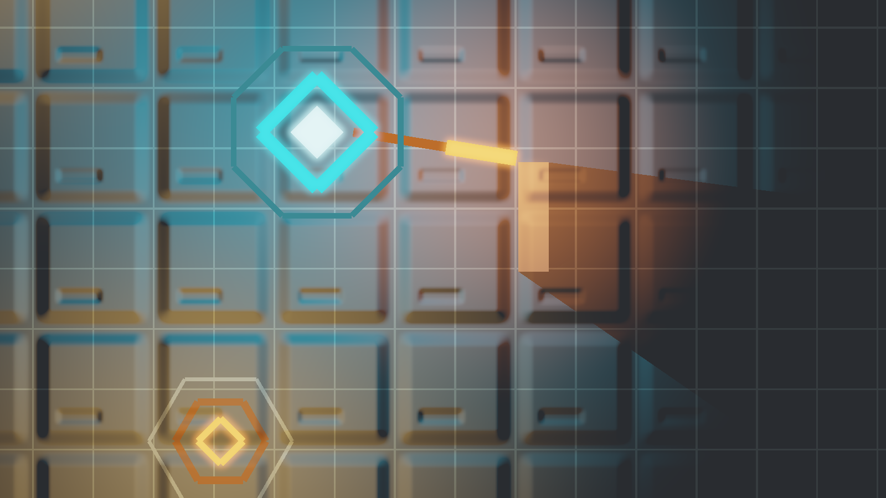

# M7.4b · Neon 逐灯二维遮挡阴影

按住 **A**，让青色 Player 从短墙右侧经过墙顶，再移到左侧。墙后会失去玩家灯的青光，仍能收到另一侧 Relay 的琥珀色光。按 **P** 暂停后，可以在同一 Tick 切换 **O**、**N** 和 **B**，依次观察可见度、地板朝向和高亮扩散的作用。

## 运行与操作

从仓库根目录构建并启动交互演示。

```sh
cmake -S . -B build/m74b-release -DCMAKE_BUILD_TYPE=Release -DTINY2D_OPENGL_TESTS=ON
cmake --build build/m74b-release --parallel
build/m74b-release/lab/tiny2d_lab --scene neon --seed 71 --size 800x450 \
    --lighting on --normal-mapping on --shadows on --shadow-lights 4 --occluders demo \
    --view final --bloom on --inspector on --previews all
```

| 操作 | 观察点 |
|---|---|
| WASD / 空格 | 移动玩家光源 / 发射。墙体仅用于渲染，玩家可穿过。进入实体墙时该灯的直接光熄灭，离开后恢复。 |
| O / N / B / L | 分别切换 Shadows、Normal Mapping、Bloom 和 Lighting。保持 Lighting 开启，关掉 N 仍可查看径向点光的投影。 |
| 1 / 2 / 3 / 4 / 5 / 6 / 7 | Scene、Bright、Blur、Final、Light、Normal、ShadowMask。关闭对应效果后，依赖该效果的视图回到 Final。 |
| F2 / Controls → Shadows | 切换 Inspector、打开阴影功能。带阴影启动时默认选中 Shadows 页。 |
| Shadows → Caster / Caster budget | 可选 Player、Relay、Bolt 或 Burst 中当前实际投影的灯。预算增至 8 可给动态光源留出名额。 |
| Occluder edges / Shadow geometry | 在 Scene、Final 或 Light 上叠加墙边和当前灯实际投影的三角网，用于检查轮廓。 |
| Buffer previews | 查看本帧可用的缩略图。打开 Normals 和 Shadows、选中有效光源时共有七张。 |
| P / . / R / F1 | 暂停、单步、按原 seed 重置、切换 HUD。全屏 ShadowMask 保留来源标注。 |

默认 `--shadows off --shadow-lights 4 --occluders demo`。Shadows Off 的场景没有新增墙体。`--occluders none` 可在 Shadows On 时保留逐灯流程并去掉墙体。`--shadow-lights` 接受十进制整数 1–8。`--view shadow` 需要同时开启 Lighting 与 Shadows。解析器在建窗前检查完整参数组合。[CLI 和显示状态](../lab/src/Neon.cpp) · [Inspector](../lab/src/Inspector.cpp)

## 几何与可见度

**局部朝向与远处遮挡。** 地板倒角改变接收点的世界空间法线 $n(x)$。把墙放到光源和该点之间，两端的位置和局部法线都可以保持不动，光路却已经中断。为此渲染器分别求方向因子 $D_i(x)$ 与可见度 $V_i(x)$。只有 XY 平面的线段相交关系参与可见度。模型假设墙足够高且完全不透明，采用硬边。灯的 `height` 只用于 Lambert 方向。墙高、越墙照明、半透明和软阴影属于这一模型之外的现象。

`OccluderList` 顺序存储至多 16 个只读 `Occluder2D` 和 64 条有向边。每项保留唯一 ID、边起点索引及边数。线段独立双面遮挡。矩形展开为四边，凸多边形按数值 XY 的逆时针绕序闭合。屏幕世界 +Y 向下，判断绕序以坐标叉积为准。每个非端点必须严格落在每条有向边的左侧，可同时排除自交、凹点和退化形状。坐标必须有限且在 ±1,000,000 内，边长和凸体边的支撑高度至少约 $10^{-5}$ 世界单位。重复 ID、无效尺寸和超预算插入均在写入前失败。演示在地板内部放置矩形 $(-95,20)+(8,29)$ 及线段 $(106,-71)\rightarrow(128,-48)$，共 2 个 visual-only occluders、5 条边。它们来自只读静态布局，写入 Albedo，未注册游戏 Collider。[数据结构及校验](../lab/src/Occlusion.h) · [演示布局](../lab/src/Occlusion.cpp) · [墙体与叠加线框](../lab/src/Presentation.cpp)

**有界投影。** 将光源 $L$ 移到局部原点，以 $a=A-L$、$b=B-L$ 表示墙边。将凸体面向光源的入射边投到墙后，可覆盖沿该边进入实体后的整条光路，接收点落在墙前时保留可见。双面线段从任一侧投影。必要时交换两端，使 $a\times b>0$。对局部接收点 $p$，其投影区域是以下三个半平面与 $[-r,r]^2$ 的交集。

$$
a\times p\geq0,\qquad p\times b\geq0,\qquad
(b-a)\times(p-a)\leq0.
$$

前两项限定穿过端点的两条射线之间的角度，第三项把光源与边之间的前景排除在外。实现以正方形为初始凸多边形，逐平面裁剪，交点用双精度求解，再用三角扇填充。每条边最多产生七个顶点的凸区、五个三角形。单灯顶点上限为 $64\times15=960$。裁剪范围刚好覆盖圆形有效半径的外接框。框外保持白色，圆外的直接光权重为零，故该处的遮罩值不影响画面。该范围也解释了调试视图中可能出现的方形截边。

线段端点和接收点均按闭区间处理，接触容差为 $10^{-7}$ 世界单位。灯在凸体内或贴到某条边时，直接将支持框全部写黑。若源在该边延长线上且未接触，精确共线仅留下零面积投影。光栅化时，恰过顶点、沿边或零面积的情况受像素覆盖规则影响。重叠阴影均写同一黑值，给出并集。测试参考函数以有限线段 $[L,x]$ 检查相交、端点与共线区间，并检查灯是否位于实体内。它不生成投影三角形。[投影及射线参考实现](../lab/src/Occlusion.cpp)

## 逐灯 HDR 合成

选灯按 Player、Relay、Bolt、Burst 的优先级稳定遍历，同类按原 LightList 顺序。列表容量仍为 32。预算分配后，Light Pass 处理其余灯，每盏灯在整条路径中贡献一次。

$$
L(x)=A+\sum_{i\in U} C_i f_i D_i+
           \sum_{j\in S} V_j(x)C_j f_j D_j,
\qquad SceneColor(x)=Albedo(x)L(x)+Emission(x).
$$

$C_i$ 含颜色与强度，$f_i=\max(0,1-\|x-L_i\|^2/r_i^2)^2$。开启法线时 $D_i=\max(0,n(x)\cdot\widehat{(L_{ix}-x_x,L_{iy}-x_y,h_i)})$，径向模式取 1。$U$ 和 $S$ 分别是普通灯及投影灯。Ambient $A$ 只由基础 Light Pass 写入一次。若先求和，再对总值乘某一灯的遮罩，会同时删掉该点本应保留的环境光和其他方向来的光。下表中的红蓝夹具专门检测这种错误。[基础灯](../lab/assets/shaders/light.frag) · [逐灯可见度](../lab/assets/shaders/shadow_light.frag)

| 阶段 | 读取 | 写入与行为 |
|---|---|---|
| Albedo / Emission / Normal | 世界几何，Normal 启用时单元 0 的材质贴图 | 生成表面反射色、自发光和可选的世界空间法线。 |
| Light | 普通光源数组，方向模式单元 0 的 NormalBuffer | 写 RGBA16F LightBuffer，每个像素从 Ambient 开始。 |
| ShadowBatch，每盏投影灯 | 有界 CPU 三角网，无采样器 | 绑定同一块 RGBA8 ShadowMask、关闭 sRGB 和混合，清 1，绘 0。 |
| ShadowBatch，同一盏灯 | 单元 1 的 ShadowMask，方向模式单元 0 的 NormalBuffer | 切换到 LightBuffer。全屏片元使用同一 framebuffer 像素的遮罩和法线，返回该灯的直接光。 |
| ShadowInspect，按需 | 当前选中灯的有界三角网 | 当帧再生成一次选中灯的遮罩，记录其来源。 |
| SceneCompose | 单元 0/1/2 的 Albedo、Light、Emission | 计算线性 HDR SceneColor。提亮和两次模糊读取合成后的能量。 |
| Preview / Output | 对应 HDR 附件、法线或选中灯的 ShadowMask | ShadowMask 使用线性 0–1 灰度。Normal 映射 $(n+1)/2$。普通场景沿用 HDR 显示变换。 |

累积时 RGB 采用 `GL_FUNC_ADD` 和因子 `GL_ONE, GL_ONE`。Alpha 采用 `GL_FUNC_ADD` 和 `GL_ZERO, GL_ONE`，保留目标的 1。片元着色器只读取法线和遮罩。对同一附件同时做纹理采样与光栅写入会形成反馈循环，采样值取决于未定义的读写顺序。这里先完成遮罩绘制，换绑 LightBuffer 后才采样它。已有光照由固定功能混合器读取。Compose 完成后 Bloom 可以包含明亮的 Emission，阴影对其没有乘法项。[Pass 实现](../lab/src/Pipeline.cpp) · [合成着色器](../lab/assets/shaders/compose.frag) · [遮罩预览](../lab/assets/shaders/shadow_display.frag)

## 生命周期、状态与来源

Pipeline 在所属 current Context 中唯一持有目标组。首次开启 Shadows 才配置遮罩附件、着色器、VAO 和流式 VBO。VBO 为八盏灯和一次检查预留不重叠的顶点范围。只上传本帧有效三角形。同尺寸停用后复用已驻留附件，计数保留其真实字节。缩略图按需分配。尺寸变化先校验上限和预算，再构造替换组，全部成功后交换并推进 framebuffer generation。失败会释放未安装的临时资源，旧名称和旧尺寸仍有效，绘制等待匹配尺寸的成功重试。零 framebuffer 或最小化暂停有限帧推进。[RenderTarget2D](../engine/src/Renderer/RenderTarget2D.cpp) · [目标组](../lab/src/Pipeline.cpp)

启用 Normal、Shadows 和七预览时，$W\times H$ framebuffer 的预算字节为

$$
8\left(5WH+3\left\lceil W/2\right\rceil\left\lceil H/2\right\rceil\right)
+4WH+7(4W_tH_t)+64\times64\times4 .
$$

依次为 HDR 附件、全尺寸遮罩、缩略图、法线材质。缩略图最长边至多 256 像素、保持宽高比。预算上限 256 MiB，同时受 `GL_MAX_TEXTURE_SIZE` 约束。VBO、GUI、默认 framebuffer、驱动内部存储及替换瞬间共存的新旧组有独立开销。帧状态守卫保存读写 FBO、viewport、VAO、array buffer、程序、激活纹理单元及 0–2 号纹理和 sampler、sRGB、深度和裁剪状态等，并恢复颜色写掩码、混合启用位、RGB/Alpha 的 equation 和 factors。OpenGL 4 单独保存各 draw buffer 的混合配置。加法在当前 LightBuffer 上生效，批渲染继续使用原有混合约定。[状态守卫](../lab/src/FrameState.cpp)

Inspector 在模拟更新后解析本帧的来源。选择键包括 `epoch + ObjectKind + slot + generation`，还要属于本帧 caster 集。预算变化、子弹消亡、槽位复用或重置均可使显式选择失效。默认 follow Player 在面板中有标识。四个灯可以共享同一块 scratch，但最后使用它的灯可能与选中灯不同。只有请求全屏 ShadowMask 或其可见缩略图时才进入 ShadowInspect，用选中灯重建后同时记录 frame、Tick、epoch 和 framebuffer generation。无有效来源时显示 N/A。缩略图来自当帧转好的 RGBA8 附件，ImGui 的 V 坐标从 1 到 0。隐藏 Inspector 或折叠预览时不会为了缩略图重建或转换。[选择与预览](../lab/src/Inspector.cpp) · [帧边界](../lab/src/main.cpp)

## 真实像素与移动证据

单灯夹具用一块反射率 0.5 的地面、红光和挡墙。墙前保留直接光，墙后或光源半径外只保留环境光 0.25。添加自发光红分量 6 后，墙后 SceneColor 的对应分量为 6.125。双灯夹具在同一场景加入蓝灯，直接读取 129×97 的 RGBA16F LightBuffer，采样点为世界 $(12,3)$。

| 红灯位置、强度、半径 | 蓝灯位置、强度、半径 | Ambient | 目标 HDR 实测 RGBA |
|---|---|---|---|
| $(−20,0)$，3，54 | $(26,6)$，4，48 | 0.25 | **(0.25, 0.25, 3.56836, 1)** |

红光路径通过墙，蓝光路径可见。这一读回还同时检查了 HDR 大于 1、目标 Alpha 保留，以及单灯遮罩的独立性。GPU 测试将预算缩至 1 时，蓝灯转入基础 Light Pass，目标像素仍保留同样的蓝光。开启法线后从真实 NormalBuffer 读取 $n$，按 CPU Lambert 计算复核蓝分量。无墙的双灯路径还将整幅 LightBuffer 与 Shadows Off 比较。每盏灯累加后存回半精度可能产生额外舍入，夹具允许每通道绝对误差 0.008。

CPU/GPU 对照取圆内样本，中心和周围四角的独立射线答案须一致才纳入统计，以避开有争议的边界像素。三组实际逐点一致的数量如下。

| 光源 | 遮挡样本 | 可见样本 |
|---|---:|---:|
| 红灯 $(−20,0)$ | 145 | 694 |
| 蓝灯 $(26,6)$ | 118 | 548 |
| 移动后的红灯 $(20,0)$ | 205 | 633 |

独立 CPU 套件覆盖凸体校验、容量、近共线、光源接触、交叉/非交叉、重叠并集、极端有限坐标与可重复的投影顶点。相同输入的两次 180 Tick 模拟比较 RNG、槽位游标、Player、Bolt、Burst 的轨迹和寿命。真实 GL 测试覆盖开启/停用、VBO 失败、附件和缩略图分配中途失败、预算、错误 Context、旧名称回收、1×1 / 奇数尺寸、更换选择、状态恢复和下一帧绘制。[HDR 像素读回日志](data/m74b/pixels.log) · [CPU 测试](../tests/test_m74b_cpu.cpp) · [GPU 测试和取景夹具](../tests/test_m74b_gl.cpp) · [Cocoa 输入回归](../tests/test_m72_gl.cpp) · [损坏 shader 的搬迁夹具](../tests/m71_relocated.cmake)

| Shadows Off，Normal On | Shadows On，Normal On | Shadows On，Normal Off |
|---|---|---|
|  |  |  |

| Player 的线性 ShadowMask | Inspector 与当前七预览 |
|---|---|
|  |  |

| Tick 0，Player 位于墙右侧 | Tick 36，Player 已移至左侧 |
|---|---|
|  |  |

移动特写固定相机中心 $(−115,43)$、视野宽 235 世界单位，半径倍率 1.5、Ambient 0.16，关闭 HUD。seed 71 的 Player 从 $(−62,12)$ 连续向左移动 36 Tick。观察 $(-120,49)$，就 Player 和 Relay 2 而言，开始时只有 Relay 2 的路径畅通，结束时两条路径均畅通。PNG 和动画均由生产 Neon / Picture / Pipeline 的真实 GL 后缓冲读回产生。CLI 全景截取 Tick 4，逻辑窗口 800×450。Inspector 使用 1120×630。动态特写为 800×450 逻辑窗口。[37 帧动态演示](media/m74b/player-motion.webp) · [精确截图参数与历史 PNG 比较](data/m74b/capture.sh)

## 基线与回归

PR #14 在 2026-11-23 16:15:55（北京时间）合并。获取最新 main 后验证交付 HEAD `5f1d007cc954853c77b2911ee9ca80516088df9a` 是 `01416891212ea39315ca34fbca0d1bace274d5ec` 的祖先，本分支从该 main 建立。本次采集画面与性能使用提交 `4e4ae32bbc009c63c4ec404b6aa5ea7a5b19f255` 的 Release Lab。两张移动特写和 37 帧动画使用测试提交 `0564c1638c331035d8301510b7e47f86b64aaa20` 的取景程序，该提交将单墙和重叠墙的断言分开。全景、Mask、径向/法线对照和动画为 1600×900，Inspector 为 2240×1260。[基线 PR](https://github.com/Graham1019/Tiny2D-Engine/pull/14) · [系统、编译器和二进制哈希](data/m74b/environment.txt)

| 配置 | M7.4a 基线 | M7.4b 实测 |
|---|---:|---:|
| Debug · OpenGL ON | 50/50 | [52/52](data/m74b/ctest-debug.log) |
| Release · OpenGL ON | 50/50 | [52/52](data/m74b/ctest-release.log) |
| Release · OpenGL OFF | 28/28 | [29/29](data/m74b/ctest-off.log) |

Shadows Off 的 15 张历史 PNG 经 `cmp` 和 SHA-256 校验逐字节一致，涵盖 M7.1 四视图、M7.3 四种照明对照、M7.4a 的平坦与起伏材质、两幅 NormalBuffer、两张相反方向照明特写及六预览 Inspector。M72InspectorGL 保留原生焦点、鼠标位置前置条件与原断言，新增 O/7 输入捕获及失焦恢复，并从 ImGui 显示区域读回切源前后的遮罩与 resize 后的当帧结果。四种 Sandbox 的最后一帧分别为 1、500、1、5 Draw。独立 Survivor 的进程确有可见窗口。[历史截图校验与 GPU 读回](data/m74b/captures.log) · [旧入口记录](data/m74b/legacy.log)

## 性能口径与定位

ShadowBatch 为追加的 Pass 14，ShadowInspect 为 Pass 15，保留 M7.4a 的 0–13。GPU 查询名称上限为 $8\times(16+1)\times2=272$。一个连续时间戳对覆盖完整 ShadowBatch。调试重建使用独立的一对。结果按发起 frame ID 归档，保留 Tick、epoch 与回收帧。查询槽满时跳过测量，尚未 available 的结果留待以后轮询。时间戳有效位为零时显示 N/A。[统计与帧归属](../lab/src/Observation.h) · [有界异步查询池](../engine/include/tiny2d/TimestampQueries.h)

A、B、C、D 均使用同一 Release 二进制和 seed 71，保持 Final、HUD、Bloom 及程序化 Normals 开启。A 关闭 Shadows，B 开启 Shadows 但场景无墙，C 加入 demo 墙、预算 4，D 在 C 上开启 Inspector 和七预览。四配置各跑两种尺寸。每组完成 1320 帧 / 1320 Tick，1–120 为预热，121–1320 用最近秩求 p50/p95/p99。CSV 逐帧记录 CPU 时间、各 Pass 真实 draw、fullscreen、几何顶点上传、驻留 HDR/LDR 和查询状态，支持从数据重算。[原始 CSV、日志和复算脚本](data/m74b/)

判断代价先看每帧事件数。A 与 B 的差值包含清 mask、FBO 切换、四次全屏加法及驱动提交。B 与 C 可以观察非空投影的顶点上传、mask draw 和额外墙体几何。C 与 D 还包含调试重建、七次转换和 ImGui。CPU 的 `geometry_us` 测投影构建，`mask_submit_us` 包含绑定、清除、非空网格上传/提交，`light_submit_us` 测单灯提交。GPU 时间戳可用时，ShadowBatch 给出整个投影灯阶段的执行时长。要进一步区分像素填充与 CPU 提交，可在相同 draw 数下比较两个 framebuffer 尺寸，同时查看顶点字节、CPU 分段及有能力的 GPU 的执行时间。驱动可能在提交中阻塞，CPU 分段不能独立分解 GPU 光栅化和片元执行。整帧 CPU 截止于截图、swap 和 CSV 写入之前，这些分位数不能直接换算显示 FPS。

### Apple M5 Pro 实测

macOS 26.7.3，OpenGL 4.1 Metal 90.5。下表前三个分位数为整帧 CPU 微秒。Batch、Inspect 均列出各自提交区间的 p50（µs），计数为每帧中位数。所有八组都有完整的 1,200 个测量帧。硬件查询返回 0 个有效位，9,600 个测量帧中有效 GPU 时间样本为 0。

| framebuffer | 配置 | CPU p50 / p95 / p99（µs） | Batch / Inspect（µs） | Draw / 全屏 | 遮罩重建（常规 + 调试） | 阴影顶点上传（B） |
|---|---|---:|---:|---:|---:|---:|
| 1600×900 | A | 151.084 / 190.208 / 211.291 | — / — | 10 / 6 | 0 + 0 | 0 |
| 1600×900 | B | 436.625 / 527.792 / 590.125 | 50.666 / — | 14 / 10 | 4 + 0 | 0 |
| 1600×900 | C | 345.834 / 426.458 / 478.750 | 179.208 / — | 16 / 10 | 4 + 0 | 168 |
| 1600×900 | D | 589.667 / 697.833 / 763.084 | 181.500 / 126.875 | 44 / 17 | 4 + 1 | 288 |
| 2240×1260 | A | 151.958 / 231.750 / 303.167 | — / — | 10 / 6 | 0 + 0 | 0 |
| 2240×1260 | B | 458.167 / 644.041 / 782.667 | 46.333 / — | 14 / 10 | 4 + 0 | 0 |
| 2240×1260 | C | 369.958 / 533.500 / 660.166 | 206.583 / — | 16 / 10 | 4 + 0 | 168 |
| 2240×1260 | D | 612.583 / 869.959 / 1002.333 | 191.250 / 132.833 | 44 / 17 | 4 + 1 | 288 |

默认配置 C 每帧四次清遮罩，其中只有两盏灯产生非空网格，需要两次 Mask Draw，四盏灯各有一次加法 Draw。活跃灯中位数 7，投影 4，剩余 3 盏保留基础照明。两种分辨率的几何准备 p50 为 2.583 / 2.416 µs，提交遮罩为 134.126 / 165.124 µs，提交单灯为 39.876 / 37.625 µs。Inspector 关闭时额外调试重建和预览转换均为零。D 的七个预览每帧都可见，额外一次 Player 重建上传 120 B。比较 A/C 还包含两面演示墙体。

**为何无墙的 B 在本次整帧测量中比 C 慢？** B 的 Output CPU p50 为 224.042 / 261.958 µs，C 的同一段为 11.125 / 10.834 µs。反过来，非空投影出现后，C 的遮罩提交区间明显增加。时间被记在不同的 OpenGL 调用区间，驱动提交或同步开销可能影响其归属。这里可以定位昂贵的 CPU 提交区间，并确认几何计算占用较小。独立的 GPU 光栅化和着色耗时仍待有有效时间戳的设备测量。[各 Pass 及上传量分位数](data/m74b/quantiles.md)

| framebuffer | 五个全尺寸 HDR 与三个半尺寸 HDR（B） | B/C/D 的 RGBA8 ShadowMask（B） | D 的七张 RGBA8 预览（B） | 法线材质（B） |
|---|---:|---:|---:|---:|
| 1600×900 | 66,240,000 | 5,760,000 | 1,032,192 | 16,384 |
| 2240×1260 | 129,830,400 | 11,289,600 | 1,032,192 | 16,384 |

## 复现与人工验收

```sh
cmake -S . -B build/m74b-debug -DCMAKE_BUILD_TYPE=Debug -DTINY2D_OPENGL_TESTS=ON
cmake -S . -B build/m74b-release -DCMAKE_BUILD_TYPE=Release -DTINY2D_OPENGL_TESTS=ON
cmake -S . -B build/m74b-off -DCMAKE_BUILD_TYPE=Release -DTINY2D_OPENGL_TESTS=OFF
for config in debug release off; do
    cmake --build "build/m74b-$config" --parallel
    ctest --test-dir "build/m74b-$config" --output-on-failure
done
sh docs/data/m74b/capture.sh
python3 docs/data/m74b/measure.py run
python3 docs/data/m74b/measure.py summarize
```

CPU 套件自身无需 Context。完整 OpenGL 套件、性能取样和截图在 macOS 原生图形会话运行。生成动画的采集脚本使用 `img2webp`。自动化读回覆盖确定性采样点，主设备人工验收仍需观察连续移动、切换灯时的相应边界、暂停时切换 O/N/B、缩放与跨屏高 DPI。可选即将过期的 Bolt 或 Burst 后单步，检查失效与 N/A。其他 GPU 的填充成本和时间戳有效位需要在对应设备实测。

现有接口用只读快照传递灯位置、颜色、半径和稳定身份。后续粒子系统可按预算提取少量光源，或将发光粒子几何加入 Emission。这种扩展继续使光照、投影预算与模拟生命周期解耦。当前适用范围为有限线段与严格凸的不透明墙体。处理高度或半影需要额外几何/采样模型，更大量的灯可在有 GPU 实测后评估限制单灯像素覆盖范围的收益。
