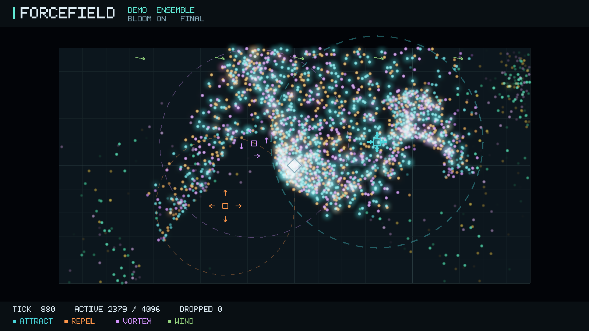
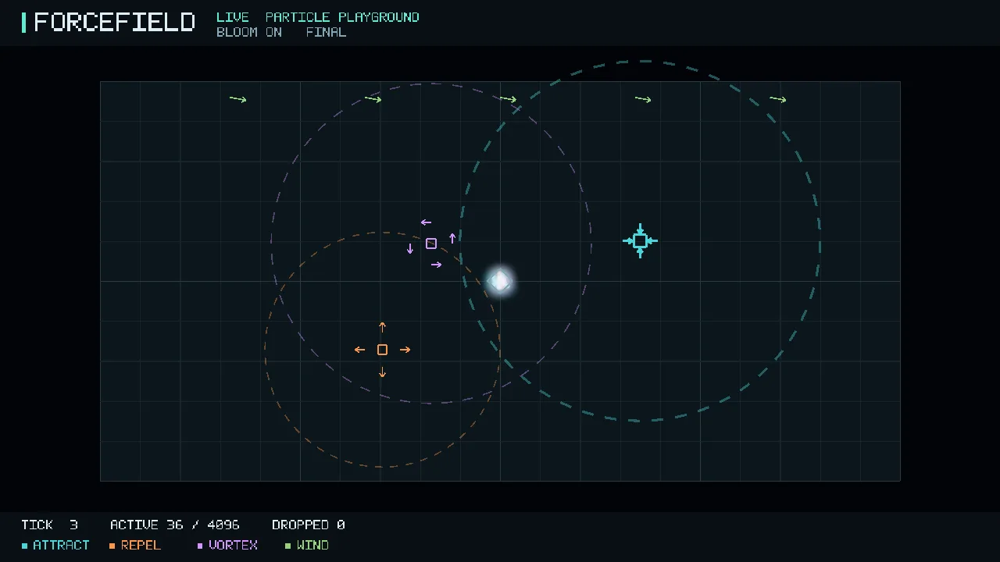

# M8.1 · Particle Forcefield Playground

从 **Forces** 选择 Vortex，按 **P** 暂停，把旋涡中心拖到发射器旁，再按 **.** 单步。旧粒子的速度会随新力场逐步弯转。按 **B** 可以在同一 Tick 对照亮核和周围的光晕。



## 运行

```sh
cmake -S . -B build/m81-release -DCMAKE_BUILD_TYPE=Release -DTINY2D_OPENGL_TESTS=ON
cmake --build build/m81-release --parallel
build/m81-release/lab/tiny2d_lab --scene particles --seed 71 --size 1120x630
```

| 参数 | 含义 |
|---|---|
| `--scene neon\|particles` | 无参数进入 Neon。粒子场景默认打开 Lighting 和 Bloom。 |
| `--particle-capacity N` | 1–8192 个槽位，默认 4096。 |
| `--particle-rate N` | 每秒请求 0–60000 个，默认 720。空格额外请求 128 个，每 Tick 的 Burst 上限 512。 |
| `--particle-steady N` | 取值 0–capacity。每 Tick 回收后补足目标，覆盖普通发射与 Burst。指定 0 可测空载。 |
| `--particle-script none\|demo` | 默认 none。demo 每 180 Tick 依序演示吸引、排斥、旋涡、风和四场组合，900 Tick 循环。 |
| `--frames N --seed N --capture PATH --metrics PATH` | 有限模式每个可绘制帧一步，Inspector 与计时默认关闭。capture 读最后一帧 GL_BACK，metrics 写每个 CPU 帧和异步退休的 GPU 帧。 |
| `--size WxH --view scene\|bright\|blur\|final\|light` | 尺寸是 GLFW 逻辑坐标。Light 需要 Lighting。第 6/7 视图在本场景没有相应材质与投影灯。 |



[吸引](media/m81/attractor.png) · [排斥](media/m81/repulsor.png) · [旋涡](media/m81/vortex.png) · [全局风](media/m81/wind.png) · [同 Tick 关闭 Bloom](media/m81/bloom-off.png) · [Inspector](media/m81/inspector.png)

## 模拟、所有权与提交顺序

`ParticleSimulation` 独占槽位、空闲栈、LCG、发射余数、场数组和计数。独立静态库只需要向量数学。每个 Tick 先完整校验输入，再应用整份 emitter / fields 修改。现存粒子按槽号升序加龄，达到 lifetime 即失活入栈。初始分配从槽 0 开始，同时死亡的槽按 LIFO 逆序复用。每次实际出生都增加 generation。外部通过 `epoch + slot + generation` 重新解析，Reset 更新 epoch，恢复原始配置和 Seed。拒绝的出生增加 Dropped，保留 RNG 序列。每个成功出生按位置 X/Y、方向、速度、寿命、色调顺序恰好消费六个 32 位 LCG 输出，取高 24 位生成浮点数。

普通发射器以整数余数累加 rate 并按 60 分配。新生粒子在出生 Tick 以 age 0 积分一次，lifetime 为 1 时，下个 Tick 的积分前回收。实际寿命在标称值减去其五分之一（向下取整）至标称值之间。力场按槽号求和，以固定 1/60 s 进行半隐式 Euler 积分。damping=0.995 表示每步更新速度后保留 99.5%。总加速度上限 1500 世界单位/s²，限速 350 世界单位/s。世界边界为 X ±320 和 Y ±160，越界距离镜像回场内，法向速度反号。

径向场以 `max(0, 1 − distance/radius)²` 衰减，沿 `delta / sqrt(distance² + epsilon²)` 作用，其中 epsilon = max(0.25, 0.025 × radius)。吸引与排斥方向相反。旋涡取切向，世界 +Y 向下，顺时针在中心右侧指向下方。风只取单位方向与强度，零方向产生零加速度。半径 1–640，强度 0–100000，最多八场。每 Tick 槽扫描为 O(capacity)，力场求值为 O(active × enabledFields)，上限 8192 × 8。按同一门控得到的 Tick 输入可以在同一编译环境逐字段重演。

`ParticleRenderSnapshot` 在帧循环开始前预留容量，按活动槽序写出两个 vec4 布局的 8 个 float，依序是中心 X/Y、直径、age/lifetime、线性 RGB、发光强度。Pipeline 仅在同步 draw 内借用。首次非空绘制才安装 move-only Renderer，初始化临时资源全部成功后才交给 Pipeline。一个静态四顶点 strip、一个 8192 槽位的动态 VBO 和 divisor=1 的属性支持一次 `glDrawArraysInstanced`。每次上传仅占 `count × sizeof(ParticleInstance)`，此构建为 32 B/实例。零实例跳过创建、上传和 Draw。Resize 仅影响渲染目标。

开启 Lighting 时，`ParticleEmission` 在 Emission 清理与普通几何之后加法写入 RGBA16F，随后由原 SceneCompose 计算 Albedo × LightBuffer + Emission。关闭 Lighting 时写入 HDR Scene，两条路径都进入原 Bright、Blur 和 Output。片元阶段用局部半径和年龄调制线性辐亮度。RGB 的混合因子为 ONE / ONE，Alpha 为 ZERO / ONE，二者方程均为 ADD。粒子程序不采样纹理。混合保护与 FrameState 恢复调用方状态。网格来自 world/albedo，力场标记来自 debug，HUD 与 Inspector 在显示侧提交。场景使用环境光，无逐粒子点光源。

`ParticleApp` 负责独立场景分发、时钟与有限帧。`ParticlePresentation` 绘制场景并接收待应用编辑，`ParticleInspector` 提供参数页。两场景共享用于绘制字形、线段和标记的 quad 函数，以及原 Inspector 的 ImGui/GLFW backend、焦点回调、Cocoa 重复事件和释放门控。鼠标逻辑点直接交给 Camera2D 的 viewportToWorld。拖拽偏移保留，GUI 按下后移出仍归 GUI，失焦会结束正在进行的拖拽。场景参数在下一次 Tick 应用，显示参数可在暂停时调整。

## 自动化与像素证据

三组 CTest 全部通过。Debug · GL ON 为 **56/56**，Release · GL ON 为 **56/56**，Release · GL OFF 为 **30/30**。15 张 M7 参考 PNG 的完整文件逐字节一致。Sandbox 四组分别为 **1 / 500 / 1 / 5** 次 Draw，Survivor 的 600 帧 smoke 和 CoreGraphics 可见窗口检查通过。[Debug](data/m81/ctest-debug.log) · [Release](data/m81/ctest-release.log) · [关闭 GL 测试](data/m81/ctest-off.log) · [Inspector 焦点、Cocoa 重复与有限输入记录](data/m81/inspector-tests.log)

在 RGBA16F 中，单粒子中心 RGB 实测为 (4, 3, 2)，两粒子重叠后红通道为 8，单独设置的目的 Alpha 保持 0.375。Bright 红通道采样为 6.72266。粒子几何外的同一像素在关闭和开启 Bloom 后，显示红通道分别为 0.00784 和 0.61961；再次读回 Emission 全图时数值相同。Lighting Off 的 HDR Scene 红通道仍能达到 8。

M81_ParticleSimulationCPU 核对活跃与死亡槽的所有粒子字段、发射器、场参数、RNG、余数、空闲栈和句柄。覆盖输入原子性、回收、满池、强度极值、零距离、边界、出生 Tick、暂停、单步和 Reset。30 Hz 与 120 Hz 调度在相同 Tick 得到一致状态。独立测试的动态链接记录在环境文件中。

M81_ParticleInstancingGL 读取浮点附件与显示缓冲，测试重叠能量、非整数目的 Alpha、Bright Extract 和 Bloom、Lighting Off、属性步进与真实生成图元数。夹具注入驱动存储错误和坏 shader，检查半成品释放、恢复后的重试和调用者 GL 状态，并测试异 Context、1×1 与奇数尺寸。M81_ParticleFiniteCLI 比较完整 Lab 在相同和不同 seed 下生成的 PNG。M81_ParticleInspectorGL 把键盘、鼠标和焦点事件送入同一个 UI 路径。M72CPU 用可控制的 timestamp backend 检查追加的 GPU interval、异步退休及 CSV 行列对应。

[真实 HDR 数值与批处理对照](data/m81/pixels.log) · [历史 PNG、Sandbox 与 Survivor 窗口检查](data/m81/regress.log) · [环境与构建配置](data/m81/environment.txt)

## Release 性能

Apple M5 Pro，macOS 26.7.3，原生 OpenGL 4.1。每组 1320 帧，前 120 帧预热，仅统计第 121–1320 帧。固定 Seed 71、容量 8192、同一输入脚本 none、四场开启、Lighting / Bloom / HUD 开、Inspector 关。steady 只改变目标活跃数。下表尺寸来自每一行的实际 framebuffer；所有行均检查 tick=frame、Dropped=0、粒子数、Pass draw 总和和上传字节。时间分位数按 nearest rank 计算，单位 µs。力场、快照和上传三列各列出 p50。

| framebuffer | 粒子 | 整帧 CPU p50 / p95 / p99 | 力场 | 快照 | 上传 | 粒子 / 总 Draw | 实例上传 B |
|---|---:|---:|---:|---:|---:|---:|---:|
| 1600×900 | 0 | 165.17 / 212.88 / 258.21 | 0.00 | 0.00 | 0.00 | 0 / 9 | 0 |
| 1600×900 | 1024 | 203.17 / 251.75 / 272.54 | 14.42 | 6.21 | 1.25 | 1 / 10 | 32768 |
| 1600×900 | 4096 | 243.67 / 289.42 / 305.38 | 45.58 | 10.50 | 2.71 | 1 / 10 | 131072 |
| 1600×900 | 8192 | 290.88 / 331.17 / 365.79 | 81.58 | 14.46 | 3.96 | 1 / 10 | 262144 |
| 2240×1260 | 0 | 170.17 / 231.21 / 271.67 | 0.00 | 0.00 | 0.00 | 0 / 9 | 0 |
| 2240×1260 | 1024 | 203.58 / 255.67 / 296.92 | 13.88 | 6.17 | 1.33 | 1 / 10 | 32768 |
| 2240×1260 | 4096 | 252.67 / 290.92 / 340.04 | 46.12 | 10.83 | 2.88 | 1 / 10 | 131072 |
| 2240×1260 | 8192 | 313.42 / 359.33 / 408.12 | 81.75 | 15.17 | 4.71 | 1 / 10 | 262144 |

八组的 GL_TIMESTAMP 查询有效位均为 0，9600 个测量帧的有效 GPU 样本总数为 0，GPU 时间记为 N/A。CPU 帧区间从 pollEvents 后到提交完成，截图、swap 及 CSV 写入位于区间外。驱动可以在提交时阻塞，因此这些数字只能描述本机的 CPU 成本。Force 是 Fixed Update 的子区间。Snapshot 只测紧凑数组提取；Upload 只测 glBufferSubData 和错误检查。零实例跳过上传，零负载的极短 force 区间包含取时器开销。控制台中的 pass 时长是 CPU 提交时间。

同一 GL 夹具额外绘制普通 BatchRenderer 四边形（容量 2048、单纹理）和实例化粒子。0 / 1024 / 4096 / 8192 个四边形的普通批处理实测 draw 为 0 / 1 / 2 / 4，动态顶点字节为 0 / 147456 / 589824 / 1179648。实例化路径为 0 / 1 / 1 / 1 draw，上传 0 / 32768 / 131072 / 262144 B。此实验比较提交计数与上传量；GPU 执行时间、呈现 FPS 与帧率收益均待相应实验测量。

每行配置、CPU/GPU 记录和预热帧保存在相应的 CSV.gz。完整分位表涵盖 fixed update、force、snapshot、upload、HDR compose、Bright、横纵 Blur 和 Output。[八组原始数据及运行日志](data/m81/) · [可重算的 p50 / p95 / p99](data/m81/quantiles.csv)

## Mac 人工验收

使用上方的交互命令。演示脚本会接管模拟输入，手动调节时使用默认的 `--particle-script none`。以下各项留给真实设备上的人工试玩。

- [ ] **四类力场。** 在 Forces 选中前四个槽，依次只启用一个。观察吸引汇聚、排斥分流、旋涡偏转。切换 Clockwise 验证弯曲方向反转。设置 Wind Direction XY 并改变方向，观察全域偏移；风面板只提供对全局风有意义的参数。
- [ ] **坐标与焦点。** 选择 Vortex，从中心按下左键拖拽，再以 WASD 微调。拖动期间切换到另一应用再返回，验证松手重按才能重新开始拖动。选中 Particles 下的 Move emitter 后确认同样可以移动发射器。
- [ ] **Inspector 输入隔离。** 拖动 Radius 或 Initial speed 滑块，按住左键移出面板，确认世界中的中心没有跟随。结束控件交互、松键后重新按 WASD 或空格，确认移动和 Burst 恢复。按 F1 / F2 分别切换 HUD / Inspector。
- [ ] **固定步。** 按 P，记录 Tick，拖动中心或改变发射率，观察下一 Tick 提交的提示。按一次 . 只前进一 Tick，再次单步验证修改已生效。按 R 检查原始发射器和四个力场恢复；重复 Reset 并单步，对比同 Tick 的画面。
- [ ] **HDR 显示。** 保持同一暂停 Tick，切换 B 比较中心外光晕，再切换 L。按 1–4 对照 Scene / Bright / Blur / Final，开灯按 5 检查环境光。按 6/7 查看不可用提示。
- [ ] **压力、Retina 与计时。** 加 `--particle-capacity 8192 --particle-steady 8192` 启动，Timing 页核对 8192 个实例、262144 B、一个粒子 Draw。观察连续运动及拖拽，缩放窗口并在可用时跨屏，检查画面与鼠标中心。在 timestamp bits=0 的机器核对 GPU time N/A、有效样本 0。另以 steady 0 验证两项粒子提交计数归零。
- [ ] **历史场景。** 用默认入口和 `--scene neon` 启动，核对 WASD/空格、N/O 以及 7 的原交互。再运行 `build/m81-release/tiny2d_sandbox --scene survivor-demo`，检查可见窗口及一局实际操作。

## 复现与边界

```sh
for config in debug release off; do
    case "$config" in
        debug) kind=Debug; gl=ON ;;
        release) kind=Release; gl=ON ;;
        off) kind=Release; gl=OFF ;;
    esac
    cmake -S . -B "build/m81-$config" -DCMAKE_BUILD_TYPE="$kind" -DTINY2D_OPENGL_TESTS="$gl"
    cmake --build "build/m81-$config" --parallel
    ctest --test-dir "build/m81-$config" --output-on-failure
done
sh docs/data/m81/regress.sh
sh docs/data/m81/capture.sh
python3 docs/data/m81/measure.py run
python3 docs/data/m81/measure.py summarize
```

源码验证在本机 macOS 图形会话执行。WebP 由 Tick 3 至 120 的真实 GL_BACK 截图每三 Tick 取样一次，按 20 帧/s 编码，表示确定性状态的连续运动。每张截图来自独立有限运行，展示动画的播放速率由编码时基决定。截图脚本的 WebP 编码需要本机的 img2webp / webpmux。GUI 手感、跨显示器拖动以及其他驱动与架构仍待实际设备验收。同 Seed 的逐字段重演限定在相同编译环境；其他数学库的三角函数和浮点实现可能不同。

后续 M8.2 可沿用当前的 shader 资源事务边界，在单独的 Shader Gallery 中验证新程序，再替换旧程序并保留编译诊断。跨设备比较粒子 GPU 成本时，应在时间戳有效位数大于零的驱动上补采 GPU 时间戳，并记录实际绘制面积与重叠程度。
