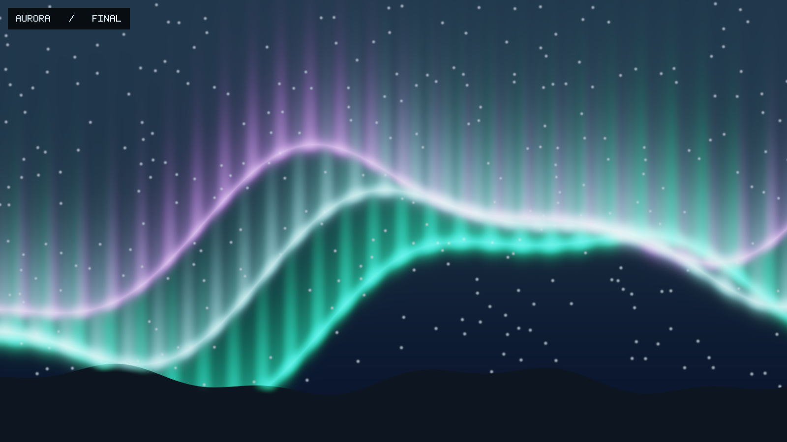
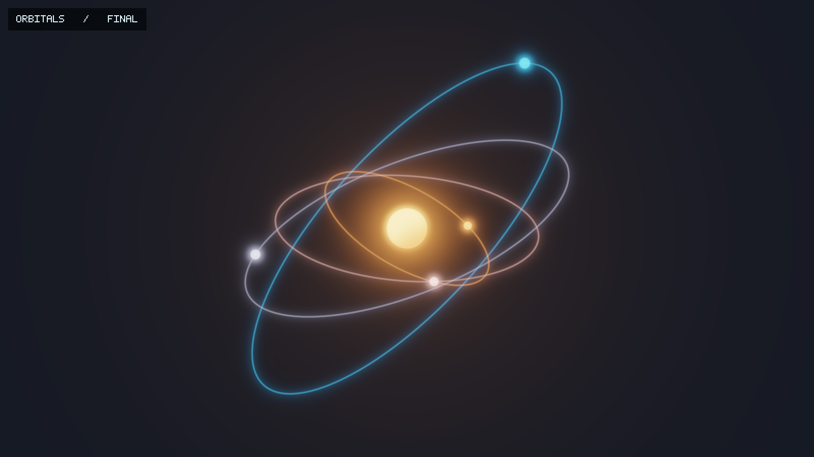
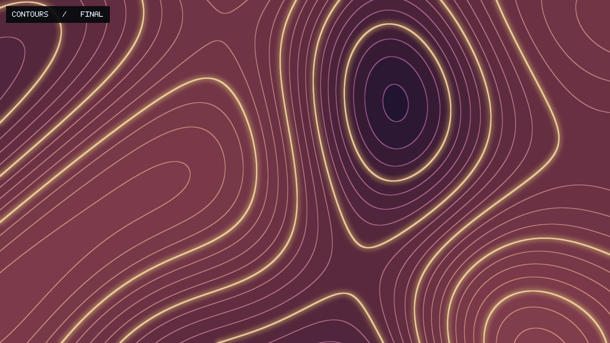
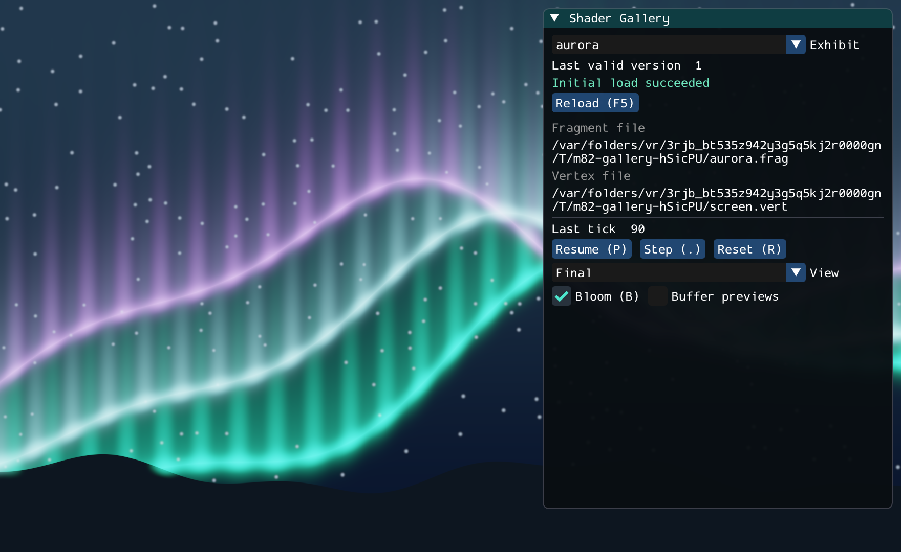
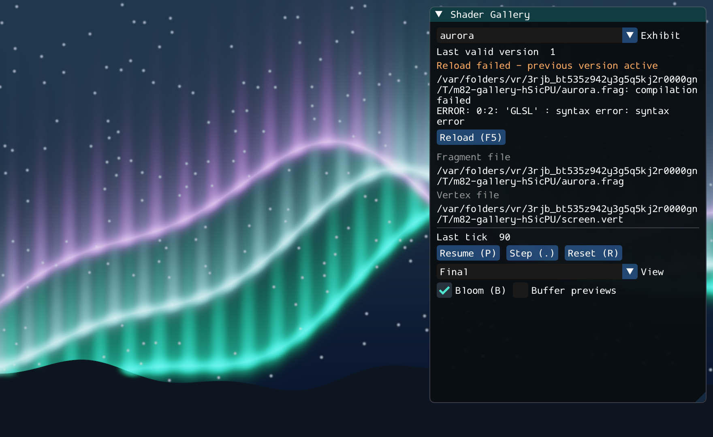
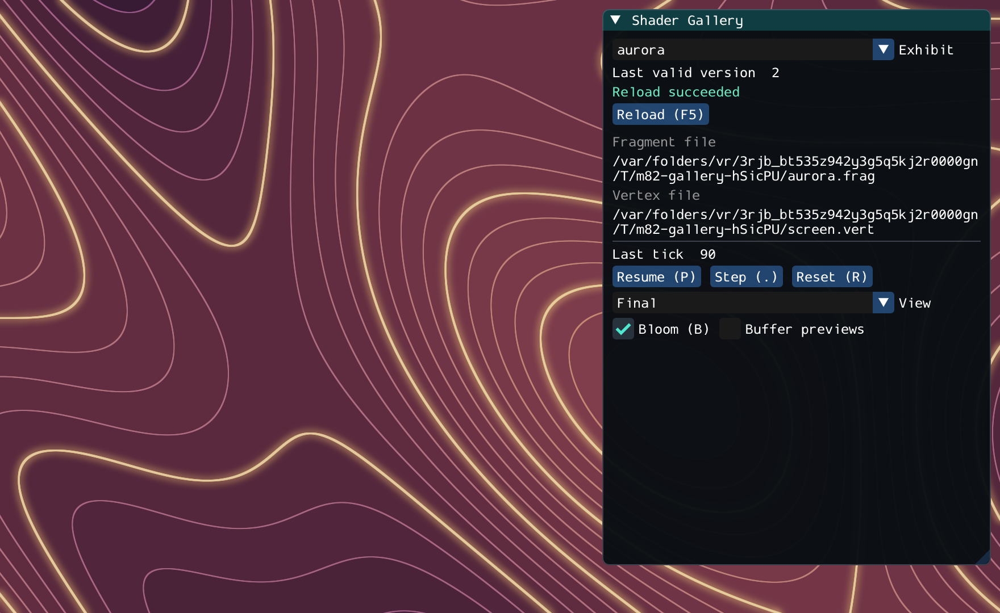

# M8.2 · Shader Gallery & Safe Hot Reload

在 Shader Gallery 中按 **P** 冻结画面，修改 Inspector 所列片元文件，再按 **F5**。编译失败时可以在同一 Tick 对照旧画面和驱动报错。修复后再按一次 F5，面板里的版本号和画面会一起更新。

| Aurora · 极光帘 | Orbitals · 椭圆轨道 | Contours · 动态等高线 |
|---|---|---|
|  |  |  |

三张图均来自 Release 的 GL_BACK，Tick 1320、1600×900、Bloom 开。Aurora 将沿曲线衰减的光帘叠加在星点上，Orbitals 依椭圆参数移动四颗星体，Contours 对动态高度场取等值线，用屏幕导数控制线宽。

## 构建与交互

```sh
cmake -S . -B build/m82-release -DCMAKE_BUILD_TYPE=Release -DTINY2D_OPENGL_TESTS=ON
cmake --build build/m82-release --parallel
build/m82-release/lab/tiny2d_lab --scene shaders --effect aurora --size 960x540
```

- **Exhibit** 切换 aurora、orbitals、contours。默认展品为 aurora。**F5** 或 **Reload** 重新读取当前展品的顶点和片元文件。界面列出两个绝对路径。标准构建读取可执行文件旁的 `assets/shaders/gallery/`，重新构建会从仓库复制着色器。
- **P / . / R** 控制暂停、单步和回到 Tick 0。Reset 保留当前展品及已安装的着色器版本。**1–4** 选择 Scene、Bright、Blur、Final。**B** 切换 Bloom，**[ / ]** 调节强度，**F1 / F2** 切换 HUD 和 Inspector。编辑控件占用键盘时可直接点击 Reload。
- **有限帧** 每个可绘制帧前进一 Tick，启动时固定三个程序，运行中仅使用已载入的版本。相同初始文件、同一设备、相同参数及 Tick 可以复现画面。展品动画使用 Tick，三个内置效果均不使用随机种子。

```sh
build/m82-release/lab/tiny2d_lab --scene shaders --effect orbitals --size 800x450 \
  --frames 90 --view final --capture /tmp/orbitals.png --metrics /tmp/orbitals.csv
```

## 源码与所有权

独立入口由 `main` 分派到 `runShaders`。默认入口继续运行 Neon，粒子入口继续运行 ParticleApp。展厅沿用 Inspector 的 GLFW/ImGui 焦点与按键释放处理，只有 Gallery 读取 F5 的按下沿。窗口先于 Pipeline 和 ShaderGallery 构造，最后销毁。三个展品各自持有 Program、成功版本、最近结果及错误文本。热重载发生在帧边界和主线程上，触发方式为手动。[场景循环](../lab/src/ShaderApp.cpp) · [Inspector](../lab/src/ShaderPanel.cpp) · [资源定位](../sandbox/src/ShaderAssets.cpp)

1. `ShaderReloadManager` 先检查主线程与构造时保存的 GLFW Context，再从固定绝对路径读入两份源码。首次安装成功记为 v1。若启动时缺少可用程序，命令行报告失败文件或驱动日志并退出。
2. 临时候选复用 `ShaderProgram` 和 `GLObject` 的 RAII。驱动逐阶段编译、链接。Manager 在候选上反射全部 active uniforms，要求可定位的独立 `float uTime` 与 `vec2 uResolution`，各一个值。数组、类型错误、额外活动参数、依赖用户顶点属性及缺少 location 0 的 `fragColor` 均会被拒绝。
3. 校验通过后提交候选并递增版本。如果原程序正在使用，将其绑定迁移到候选。外部程序的绑定保持原值。文件、编译、链接或反射失败会释放临时对象，留下原程序、版本和诊断。错误 Context 或线程在 GL 工作前抛出异常。所有 GL 对象在所属 Context 仍有效时由主线程释放。[事务实现](../lab/src/ShaderReloadManager.cpp) · [编译和链接](../engine/src/Renderer/ShaderProgram.cpp) · [GL 对象生命周期](../engine/src/Renderer/GLObject.cpp)

编辑合同是 GLSL 330 Core、使用 `gl_VertexID` 的全屏三角形、`layout(location=0) out vec4 fragColor`，输出非负线性 RGB 与 Alpha 1。3.3 接口可反射 uniform 类型、活动顶点属性和片元输出位置。颜色空间和任意用户代码的数值语义需由着色器作者保证。内置展品的格式、范围及显示转换由实际像素验证。[展品源码](../lab/assets/shaders/gallery/)

`ShaderGalleryPass` 使用编号 **17**，接在 `ParticleEmission` **16** 之后。每帧清理全尺寸 RGBA16F Scene 后绘制一个三角形，时间取 `tick / 60` 秒，分辨率取实际附件像素尺寸。原有亮部提取和双向模糊按视图、预览与 Bloom 需求运行，Output 使用原 Reinhard 映射和 sRGB 编码。整个绘制位于既有 FrameState 作用域内。CSV 在 M8.1 的最后一列 `valid_gpu_samples` 后追加 `shader_gallery_us`、`gallery_effect`、`shader_version`，异步 GPU 行携带发起帧的展品和版本。[Pipeline](../lab/src/Pipeline.cpp) · [GL 状态恢复](../lab/src/FrameState.cpp) · [CSV 序列化](../lab/src/Metrics.cpp)

## 错误恢复与像素

下图是同一真实 Context、Tick 90、同一份临时 aurora.frag 的三次 GL_BACK 读回。测试先注入语法错误，再把合法等高线片元代码写入同一路径，以便观察恢复。失败前后整张 RGBA16F 逐值相等，提交 v2 后有超过 20% 的像素至少一个 RGB 通道变化大于 0.1。

| 初始 v1 | 编译失败，继续显示 v1 | 修复成功，显示 v2 |
|---|---|---|
| [](media/m82/reload-before.png) | [](media/m82/reload-failed.png) | [](media/m82/reload-recovered.png) |

驱动夹具在 129×97 读回 RGBA16F 和 GL_BACK。表中的 Bloom 变化比例按显示 RGB 任一通道相差超过 0.01 计，动画变化比例按 Tick 90 与 150 之间线性 HDR 任一通道相差超过 0.02 计。关闭 Bloom 时，三个展品相对 Reinhard+sRGB 参考值的最大绝对显示误差均小于 0.002。[像素读回日志](data/m82/pixels.log)

| 展品 | 线性 RGB 峰值 | 同 Tick 切换 Bloom | 前进一秒的 HDR 变化 |
|---|---:|---:|---:|
| Aurora | 6.13672 | 46.82% | 48.35% |
| Orbitals | 8.78906 | 24.83% | 2.49% |
| Contours | 3.73242 | 94.93% | 88.80% |

驱动测试还覆盖阶段语法错误、可编译但无法链接的程序、优化掉的 Uniform、类型与数组不匹配、额外采样器、用户顶点属性、错误输出位置、文件消失、异 Context 和工作线程拒绝、六次失败/成功交替、旧 GL 名称释放与最终销毁。resize 覆盖奇数尺寸、1×1、零尺寸挂起和恢复，检查调用者的 Program、读写 FBO、VAO、VBO、纹理、混合、裁切及 viewport。从另一 Context 借用程序时，异常展开也恢复调用者的 GL 状态。输入测试把 F5 送入 GLFW/ImGui 路径，验证长按只触发一次。独立 CLI 测试从其他工作目录运行移动后的程序，在已输出 CPU 帧时替换磁盘上的 shader，360 帧截图仍与基线逐字节一致，重启后读取到替换内容。[GL 测试](../tests/test_m82_gl.cpp) · [有限帧 CLI 测试](../tests/m82_finite.py) · [异步指标与列序测试](../tests/test_m72_cpu.cpp)

## 原生构建与回归

基线为 PR #16 的合并提交 `675d92999c818ee2d21685750980432bb0200fcf`，其祖先包括 M8.1 Head `00547d850965486748fcf27948c91342ccc2e101`。构建环境为 macOS 26.7.3 arm64、Apple Clang 21、CMake 4.4.3。Debug GL、Release GL 和 Release 关闭 GL 测试分别通过 **58/58、58/58、30/30**。Release 构建复跑全部 15 张 M7 PNG 并逐字节比对。Sandbox 的 triangle、500 个 immediate sprites、500 个 batch sprites、5000 个 multitexture sprites 分别得到 **1 / 500 / 1 / 5** 次 Draw。CoreGraphics 检测到独立 Survivor 可见窗口；GL 套件另含普通和极端难度的两组 600 帧 Survivor smoke 及 M8.1 粒子测试。[构建输出](data/m82/build.log) · [历史回归](data/m82/regress.log) · [Debug GL](data/m82/ctest-debug.log) · [Release GL](data/m82/ctest-release.log) · [Release 关闭 GL 测试](data/m82/ctest-off.log)

## Release 性能

Apple M5 Pro，OpenGL 4.1 Metal - 90.5。逻辑 800×450，实际 framebuffer 1600×900，Final、Bloom 和 HUD 开启，Inspector 关闭。每组 1320 帧，前 120 帧预热，下面以剩余 1200 帧的 nearest-rank 分位数统计，单位 µs。CPU 整帧从事件轮询后计至提交，截图、swap 和 CSV 写入位于区间外。三个展品每帧均为六次 Draw。时间戳查询已开启，本机报告 GL_TIMESTAMP 有效位数为 0，3600 个测量帧均无有效 GPU 耗时样本。

| 展品 | 整帧 CPU p50 / p95 / p99 | Gallery Pass CPU p50 / p95 / p99 |
|---|---:|---:|
| Aurora | 63.750 / 84.083 / 109.458 | 10.875 / 16.833 / 26.334 |
| Orbitals | 63.292 / 85.000 / 105.500 | 10.875 / 16.875 / 23.875 |
| Contours | 62.500 / 84.375 / 111.125 | 10.292 / 17.083 / 22.958 |

原始记录包括每帧尺寸、Tick、版本、Pass 和时间戳可用性，可直接复算。[Aurora CSV.gz](data/m82/aurora.csv.gz) · [Orbitals CSV.gz](data/m82/orbitals.csv.gz) · [Contours CSV.gz](data/m82/contours.csv.gz) · [完整分位表](data/m82/quantiles.csv) · [采集与复算脚本](data/m82/measure.py)

## Mac 主设备人工验收

可在临时目录测试文件编辑。以下命令使用独立可执行文件与资源副本。保留当前终端，启动后在窗口和同一终端之间切换。

```sh
stage=$(mktemp -d)
cp build/m82-release/lab/tiny2d_lab "$stage/"
cp -R build/m82-release/lab/assets "$stage/"
frag="$stage/assets/shaders/gallery/aurora.frag"
cp "$frag" "$stage/aurora.original"
"$stage/tiny2d_lab" --scene shaders --size 960x540 &
```

- [ ] **展品与 HDR**。从 Exhibit 依次选择三种效果，观察运动和轮廓。暂停后按 1–4 检查四个视图，在 Final 按 B 对比亮部周围的光晕。
- [ ] **失败保留**。选择 Aurora 并暂停，记下版本和 Tick。在上述终端执行 `printf '\nM82_invalid_token\n' >> "$frag"`。回到窗口按 F5，核对错误路径、驱动诊断、相同版本与相同画面。
- [ ] **修复替换**。执行 `cp "$stage/assets/shaders/gallery/contours.frag" "$frag"`，回到窗口按 F5。核对同一展品、同一 Tick 出现等高线、版本加一且诊断清除。再执行 `cp "$stage/aurora.original" "$frag"`，点击 Reload 验证极光恢复。
- [ ] **输入与时钟**。长按 F5 后核对仅增加一个版本。切换应用再回来，松开重按；按 P、.、R 分别核对暂停、单步和回到 Tick 0。切换展品再回来，确认每个展品分别保留自己的成功版本。
- [ ] **窗口与 Retina**。缩放、最小化、恢复；有不同缩放比例的显示器时跨屏。观察轨道形状、等高线宽度和 Inspector 可读性，打开 Buffer previews 核对小图。
- [ ] **有限帧与历史入口**。运行上方 orbitals 的有限帧命令并打开结果图。分别启动默认 Lab、`--scene particles` 和独立 Survivor，在主设备检查 Neon 控制、粒子拖拽及一局 Survivor 操作。

## 复现自动化

```sh
ctest --test-dir build/m82-release --output-on-failure
build/m82-release/lab/tiny2d_m82_gl docs/media/m82
RELEASE_DIR=build/m82-release sh docs/data/m81/regress.sh
python3 docs/data/m82/measure.py run
python3 docs/data/m82/measure.py summarize
```

Debug 使用 `-DCMAKE_BUILD_TYPE=Debug -DTINY2D_OPENGL_TESTS=ON`；关闭真实 GL 测试的 Release 使用 `-DCMAKE_BUILD_TYPE=Release -DTINY2D_OPENGL_TESTS=OFF`，各用独立构建目录。构建日志保留了链接器忽略重复 libtiny2d_game.a 的提示。
