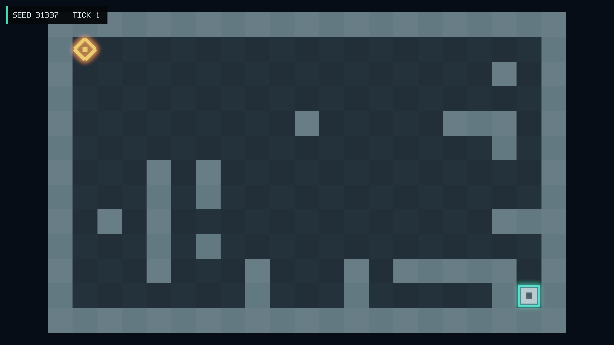
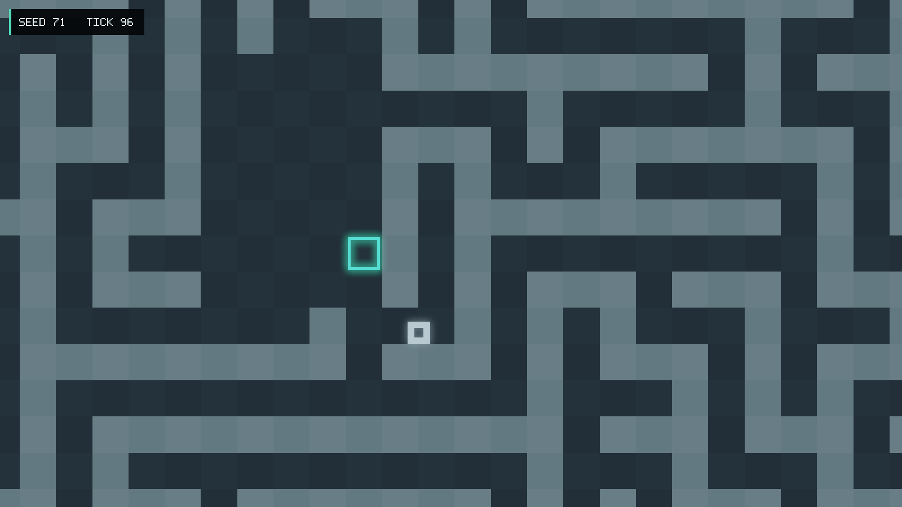

# M9.1 · 种子地图与墙体碰撞

在 Map Lab 中，青绿色方框标出出生点，橙色菱形标出出口，白色方块是玩家。WASD 移动时，玩家会在墙前停下，沿墙的位移仍可继续。Inspector 显示当前地图所有可达地板的数量，以及从出生点到出口最少要走几格。

## 构建与运行

```sh
cmake -S . -B build/m91-release -DCMAKE_BUILD_TYPE=Release -DTINY2D_OPENGL_TESTS=ON
cmake --build build/m91-release --parallel
build/m91-release/lab/tiny2d_lab --scene map --seed 71 --map-size 64x40 --size 960x540
```

`--map-size` 指定格数，`--size` 指定逻辑窗口大小。地图默认 64×40，每格 16 世界单位。按 **P** 暂停，**.** 在暂停时前进一个 Tick，**R** 用当前 Seed 重建。**1–4** 选择 Scene、Bright、Blur、Final，**B** 切换 Bloom，**F1 / F2** 切换 HUD 和 Inspector。在 Inspector 的 Map 页输入无符号 32 位 Seed，点击 **Regenerate**。在 Scene 或 Final 的地图上点击方格，可在 Collision 页查看坐标与类型。[命令行解析与控制](../lab/src/Neon.cpp) · [地图入口](../lab/src/MapApp.cpp) · [Inspector](../lab/src/MapInspector.cpp)

```sh
build/m91-release/lab/tiny2d_lab --scene map --seed 71 --map-size 96x64 \
  --map-script walk --size 800x450 --frames 90 --view final --bloom on \
  --inspector off --gpu-timing on --capture /tmp/map-walk.png --metrics /tmp/map-walk.csv
```

有限帧模式每个可绘制帧推进一 Tick，只消费显式脚本。默认 `none` 提供零位移，`walk` 每 36 Tick 依次切换东、东南、南、西南、西、西北、北、东北，周期为 288 Tick。交互模式默认跟随玩家。有限帧 walk 使用固定镜头轨迹，方便比较不同地图和分辨率下的同一可见范围。[脚本](../engine/src/World/MapSession.cpp) · [相机](../lab/src/MapPresentation.cpp)

## 地图数据与连通性

`tiny2d_world` 持有 CPU 数据。TileMap 将 Wall 与 Floor 存在一个连续数组中，索引为 `y * width + x`。Spawn 与 Exit 是两个不同的 Floor 坐标。生成器接受 5–128 列、5–96 行，上限 12,288 格。构造时先验证维度，再做乘法，并检查 TileSize、世界范围、数组长度、枚举值和端点。越界 `tile` 抛出异常，越界 `isWalkable` 返回 false。坐标转换用 `floor(world / tileSize)`，第 i 格中心为 `(i + 0.5) * tileSize`。非有限世界坐标和超出整数表示范围的转换会报错。[TileMap 接口](../engine/include/tiny2d/TileMap.h) · [坐标实现](../engine/src/World/TileMap.cpp)

1. 生成从全墙开始。Spawn 选内侧奇数坐标，两轴分别取 31、19 与最后一个合法奇数的较小者。每次调用创建私有 SplitMix64，从输出高 32 位用乘高位映射选择候选下标。候选顺序固定为东、西、南、北。
2. 迭代 DFS 从 Spawn 走到间隔两格的未访问奇数格，同时挖掉两者之间的墙。每次新增的地板都连到已有分量。奇数格构成的矩形网格本身连通，栈清空时，所有奇数格都已接入。
3. 默认再挖 8 个矩形房间，各自以一个已访问奇数格为中心，裁到边界内。至多打开 12 个额外墙格，每个候选的相对两侧已有 Floor。这两种操作只扩展同一连通分量。最外圈始终封闭。
4. Exit 选取离 Spawn 曼哈顿距离最大的奇数格角点，平局取较小坐标。默认地图的曼哈顿下界为 48 步。独立 BFS 只看最终 TileMap，按东、西、南、北遍历。提交条件为所有 Floor 可达、访问范围避开外围、出口距离大于零。Inspector 的最短路长度以四邻接步数计。[生成器及 BFS](../engine/src/World/MapGenerator.cpp)

设 N 为格数。DFS、连接候选收集、BFS 的时间和临时空间均为 O(N)。房间半径每轴为 1–3 格，数量上限 64。初始 Seed、尺寸及生成参数完全确定输出。渲染与 Inspector 只借用结果，PRNG 在生成返回时即销毁。小图可能被默认房间覆盖为同一布局。[生成参数](../engine/include/tiny2d/MapGenerator.h) · [多 Seed 与逆向 BFS 测试](../tests/m91_map_generation.cpp)

## 固定 Tick、候选替换与碰撞

MapSession 拥有地图、生成参数、连通性、玩家运动结果、暂停标志、Tick 和 Epoch。初始 Epoch 为 1，Tick 为 0。每 Tick 为 1/60 秒，速度 120 世界单位/秒，轴向步长为 2，双轴输入每轴乘以 `1/√2`。相反方向按键互相抵消。[会话接口](../engine/include/tiny2d/MapSession.h) · [固定步进](../engine/include/tiny2d/FixedTimestep.h)

Reset 与 Regenerate 均先生成候选、执行 BFS 并验证出生 AABB。成功后在帧边界替换，玩家回到 Spawn 中心，Tick 归零，Epoch 加一，保留暂停状态。Lab 同时清空选中格与旧地图的历史采样。候选失败时保留此前地图、位置、Tick 和 Epoch。地图引用的生命周期截至下一次成功替换。[替换实现](../engine/src/World/MapSession.cpp) · [命令应用](../lab/src/MapApp.cpp)

玩家的 AABB 为 10×10，合法接触允许边或角相切。碰撞入口验证中心、正半尺寸、有限位移和起始盒占用，地图外视为实心。先沿 X 扫掠，再在解算后的 X 上沿 Y 扫掠。每轴沿运动方向检查即将跨过的格线，只查询横截面覆盖的行或列，遇到第一面墙便停止。设墙面坐标为 b、运动符号为 s、该轴半尺寸为 h，接触中心取 `b - s*h`。边界计算使用 double。若转回 float 后侵入墙体，用 `nextafter` 向合法一侧移动一个可表示值，固定容差为零。贴墙反向移动会立即脱离，零位移保持原位。每轴扫描由地图尺寸和首次阻挡限定，极大有限位移也会检查中间墙。查询计数包括起始合法性检查。既有 Scene 对象成对重叠检测独立运行。[TileCollision](../engine/src/World/TileCollision.cpp) · [CPU 碰撞案例](../tests/m91_tile_collision.cpp)

## 可见格、HDR 与测量口径

Camera2D 将逻辑视口的上下角变换到世界坐标。以横轴为例，取半开区间 `[floor(left/t), ceil(right/t))`，裁到 `[0,width)`，纵轴同理。每个可见格构造一个 Quad，准备成本 O(V)，V 为裁剪后的格数。固定可见世界高度为 224 单位，宽度随窗口宽高比变化。渲染器复用 Picture 和容量为 2048 的 BatchRenderer，以共享白色纹理和顶点色绘制。既有 World Pass 先提交 Tile，再绘制标记与玩家到 RGBA16F Scene。Bright、水平和垂直模糊、Output 沿用 Pipeline。调试边框、HUD 和 Inspector 在 Output 之后绘制，Pass 编号沿用 0–17。[可见范围与图元](../lab/src/MapPresentation.cpp) · [提交与显示](../lab/src/Pipeline.cpp)

Total 是整图格数，Visible 是裁剪后的格数，Submitted 是实际提交的 Tile Quads。Tile Draw Calls 与 Tile Vertex Upload Bytes 仅计地板和墙批次。每格四个顶点共 144 字节。CSV 在 M8.2 末列后追加地图字段，生成与 BFS 只在首次显示或成功切图的帧记录。Fixed Update 包含 Collision。Visible Tile Prepare 计可见格 CPU 构造。整帧 CPU 从事件轮询后到渲染提交完成，截图、Swap 与 CSV 写入在区间外。GPU 耗时取驱动时间戳有效样本。[CSV 实现](../lab/src/Metrics.cpp) · [采集与复算](data/m91/measure.py)

## 真实运行与验证记录

### 自动化与历史回归

构建使用 macOS 26.7.3 arm64、Apple Clang 21 和 CMake 4.4.3。三项地图 CPU 测试程序只链接系统 C++ 运行库和 libSystem。生成测试覆盖 5×5、6×7、17×25、64×40、96×64、128×96，各取 32 个 Seed，逐格重建对照，再从出口用独立 BFS 检查每个 Floor 和最短距离。三组标准尺寸均有 32 张不同布局，相对于 Seed 0 的平均格子差异分别是 24.82%、24.34%、24.15%。5×5 的默认参数会填满内部区域，32 个 Seed 只得到一种布局。[运行环境与动态链接](data/m91/environment.txt) · [CPU 专项记录](data/m91/cpu.log)

碰撞套件在三种 TileSize 下完成 5,553 次合法起点的全墙枚举对照，并单测面接触、窄路、角点、反向、外部实心边界、极端浮点尺度与非法输入。会话套件逐 Tick 对照 30/60/120 Hz 下的 360 个状态，覆盖暂停、单步、出生点失败回滚和 80 次重建。[碰撞测试](../tests/m91_tile_collision.cpp) · [会话测试](../tests/m91_map_session.cpp)

| 最终构建 | CTest 通过 |
|---|---:|
| [Debug，GL ON](data/m91/ctest-debug.log) | 63 / 63 |
| [Release，GL ON](data/m91/ctest-release.log) | 63 / 63 |
| [Release，GL OFF](data/m91/ctest-off.log) | 33 / 33 |

三项新 CPU 套件也通过了 AddressSanitizer 和 UndefinedBehaviorSanitizer。两项新 GL 套件覆盖实际绘制与有限帧 CLI。GL 读回验证地板、墙与玩家边缘，逻辑尺寸 192×128 对应 framebuffer 384×256。全图 12,288 格提交 6 批，测试还覆盖相机平移、空视口、Debug/HUD 隔离、Bloom、外部 GL 状态、错误 Context、resize 与资源释放。相同输入的 96 Tick 状态和 PNG 字节相同，Seed 72 和 Seed 71 的中央地图像素不同。[Sanitizer 记录](data/m91/sanitizers.log) · [真实 GL 测试输出](data/m91/opengl.log) · [像素断言](../tests/m91_map_gpu.cpp) · [有限帧验证](../tests/m91_finite.py)

历史 Release 回归重新采集的 15 张 PNG 全部逐字节一致。Sandbox 四项 Draw Calls 为 1 / 500 / 1 / 5。完整套件包含普通及极端难度 Survivor 各 600 帧、M8.1 粒子模拟与输入、M8.2 Gallery 编译失败回滚与有限帧隔离。[历史截图与 Draw 记录](data/m91/regress.log)

### 真实 OpenGL 截图



上图使用 Seed 31337。下图使用 64×40、Seed 71，在固定行走输入的第 96 Tick 从 Back Buffer 读回。此布局有 1,290 格地板，全部从 (31,19) 可达，至出口 (1,1) 的最短路径为 80 步。图像保留应用的显示映射与 HUD。[Inspector 实际画面](media/m91/inspector.png) · [截图命令](data/m91/capture.sh) · [采集与 SHA-256](data/m91/captures.log)



### Release 测量

六组运行使用 Seed 71、walk、Final、Bloom on、Inspector off、GPU timing on。逻辑窗口为 800×450 和 1120×630，对应实际 framebuffer 1600×900 和 2240×1260。每组丢弃前 120 帧，统计第 121–1320 帧，分位数用 nearest-rank。有限帧相机每 480 Tick 在 x=504 至 600 间往返，y=312。采集脚本逐帧核对六组摄像机坐标和可见格数一致。生成与 BFS 单列启动事件，每次启动各采样一次。[逐帧原始 CSV 与运行日志](data/m91/) · [完整分位数](data/m91/quantiles.csv)

| 地图 | 实际 framebuffer | 生成 / BFS（µs，各 1 次） | 固定更新 / 碰撞 p50（µs） | 可见格准备 p50（µs） | CPU 帧 p50 / p95 / p99（µs） |
|---|---|---:|---:|---:|---:|
| 64×40 | 1600×900 | 29.75 / 21.75 | 0.21 / 0.17 | 2.25 | 92.21 / 121.88 / 144.21 |
| 64×40 | 2240×1260 | 28.54 / 21.17 | 0.21 / 0.17 | 2.33 | 94.00 / 153.96 / 191.08 |
| 96×64 | 1600×900 | 60.00 / 47.50 | 0.21 / 0.17 | 2.29 | 89.33 / 116.25 / 129.29 |
| 96×64 | 2240×1260 | 61.25 / 49.46 | 0.29 / 0.25 | 2.33 | 95.83 / 141.67 / 175.58 |
| 128×96 | 1600×900 | 127.00 / 119.50 | 0.25 / 0.21 | 2.25 | 91.54 / 121.08 / 146.08 |
| 128×96 | 2240×1260 | 122.17 / 89.62 | 0.33 / 0.29 | 2.46 | 95.42 / 138.25 / 168.25 |

整图格数从 2,560 增至 12,288，同一镜头轨迹的六组运行每帧均可见并提交 375–390 格。Tile 每帧 1 次 Draw，上传 54,000–56,160 字节。Apple M5 Pro 报告 `GL_TIMESTAMP` 有效位 0，六组有效 GPU 样本均为 0，GPU 耗时为 N/A。表中 CPU 数据衡量主线程的准备和提交耗时。

### 复现

```sh
ctest --test-dir build/m91-release --output-on-failure
RELEASE_DIR=build/m91-release sh docs/data/m81/regress.sh
sh docs/data/m91/capture.sh
python3 docs/data/m91/measure.py run
python3 docs/data/m91/measure.py summarize
```

Debug GL 与 Release GL OFF 分别用独立目录配置为 `-DCMAKE_BUILD_TYPE=Debug -DTINY2D_OPENGL_TESTS=ON` 和 `-DCMAKE_BUILD_TYPE=Release -DTINY2D_OPENGL_TESTS=OFF`。

## Mac 主设备人工验收

以下各项待主设备人工确认。用本文第一条交互命令启动，录入结果时记录机器、系统、实际 framebuffer 与 Seed。

- [ ] **地图与重建**。按 P 暂停。如面板已隐藏，按 F2 打开 Inspector。在 Map 页记录 Seed、Epoch、Spawn、Exit、Floor、Reachable、最短路，核对 Floor 与 Reachable 相等。点地图上的墙，再在 Collision 页核对所选格。输入另一个 Seed 后点击 Regenerate，观察布局变化、Epoch 增一、Tick 为 0、玩家回到 Spawn，旧选中状态已清空。面板显示最近一次更新前的快照，下一显示帧可读到本次操作结果。再输入原 Seed，对照最初布局与统计。
- [ ] **正面与角点**。在 Collision 页打开 Show collider，恢复模拟，用 WASD 分别撞水平和垂直墙面。在持续推墙时观察停止位置与 X/Y hit。斜推到墙角，检查边框与墙相切。改按反向键，应当立即离开。
- [ ] **沿墙与窄路**。找一段长墙，同时按压向墙和沿墙的两个方向，观察只有沿墙分量继续。走过一格宽通道，确认角色能通过，没有跳到墙后。
- [ ] **时钟与 Reset**。按 P 后记住 Tick 和位置，按住一个畅通方向几秒，再轻按一次句号，检查只增加一 Tick 并移动一步。松开再单步一次，核对位置。按 R，验证相同 Seed、Epoch 增一、Tick 归零、玩家位于出生中心，仍保持暂停。
- [ ] **Inspector 捕获与焦点**。进入 New seed 输入框，键入数字并试按移动键，确认位置与视图保持稳定。按住方向键切到另一应用，在外部松开再切回，观察玩家静止。重新按键应能移动。F1/F2 分别隐藏并恢复 HUD 和面板。
- [ ] **HDR 与显示层**。在出生点附近暂停，按 1–4 观察 Scene、Bright、Blur 和 Final，按 B 检查高亮标记附近的光晕。切换调试框并打开 Display 页预览，确认标记进入亮部、调试边框和面板停留在显示层。5–7 应保持当前视图。
- [ ] **Retina 与窗口恢复**。在 Scene 或 Final 选一块墙，拖动窗口边缘，再最小化、恢复并重新点选。有两种缩放比例的显示器时跨屏再试。核对鼠标指向、选格外框、地图格形状、玩家和 Inspector 的清晰度。Timing 页对照 Total、Visible、Submitted 和当前 GPU 时间戳状态。
- [ ] **历史入口**。依次启动默认 Lab、`--scene particles`、`--scene shaders` 和独立 `Tiny2DSurvivor.app`。在 Neon 移动并切换 Bloom，在粒子场景拖动，在 Gallery 切换展品并按 F5，在 Survivor 完成一段移动与战斗操作。

## M9.2 接口与局限

导航可直接借用当前 Epoch 的 `TileMap`，通过 `isWalkable` 与 `cardinalOffsets` 建立距离场或前驱表，在 Epoch 变化时重算。当前 BFS 交付可达总数与出口最短距离，遍历临时数据随调用结束释放。随机增益可另持自己的 PRNG 状态和显式 Tick 输入，让地图种子只负责地形。现有碰撞处理无旋转的 AABB 与静态格墙。动态刚体、敌人导航、可破坏地形及持久化 Snapshot/Replay 留待后续里程碑。
