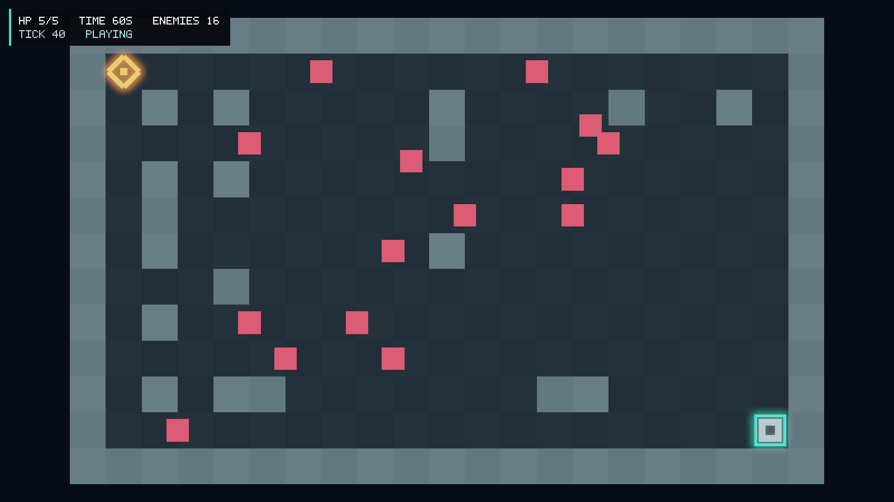
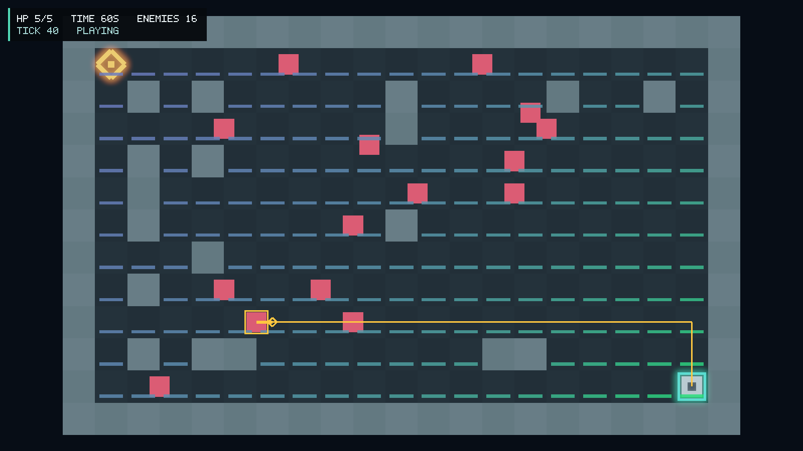
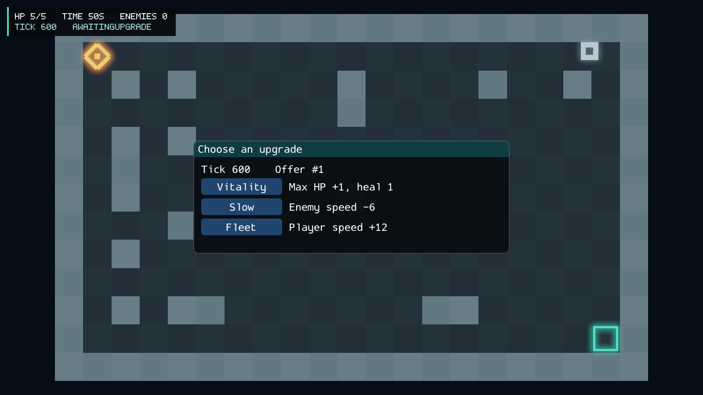
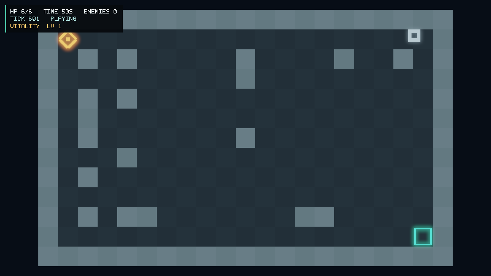

# M9.2 · 敌人导航与随机增益

Navigation Lab 中，白色玩家穿行于 Seed 决定的地图，红色敌人沿可通行的四邻接路线追踪玩家。默认 16 个敌人共享一张指向玩家的距离场。玩家有 5 HP，目标是存活 3,600 Tick（60 秒）。每过 600 Tick 可从随机候选中选择一种增益。M9.1 已通过用户在 Mac 主设备上的六项人工验收，PR #18 已于 2026-11-24 合并。M9.2 开发基线为 `6ccc811d8255e383fc80942b374fd5ce0f9d2279`，它包含验收提交 `f79185319eb30cf5f54e920c559a395ff687195f`。M9.2 等待源码 Review 与主设备人工验收。[M9.1 合并记录](https://github.com/Graham1019/Tiny2D-Engine/pull/18)

## 运行与操作

```sh
cmake -S . -B build/m92-release -DCMAKE_BUILD_TYPE=Release -DTINY2D_OPENGL_TESTS=ON
cmake --build build/m92-release --parallel
build/m92-release/lab/tiny2d_lab --scene navigation --seed 71
```

WASD 移动，P 暂停，句号在手动暂停时推进一 Tick，R 使用当前 Seed 重置。F1 切换 HUD，F2 切换 Inspector，B 切换 Bloom，1–4 对应 Scene、Bright、Blur、Final。World 页可修改 Seed 并点击 Regenerate。Navigation 页可以选择敌人槽号、显示距离场、路径与碰撞边框。Upgrades 页显示等级与生效参数。Timing 页显示 CPU 耗时和驱动的时间戳能力。选择增益使用独立按钮面板，关闭 Inspector 和 HUD 后仍然可以选择。[交互入口](../lab/src/MapApp.cpp) · [导航面板](../lab/src/NavigationInspector.cpp)

```sh
build/m92-release/lab/tiny2d_lab --scene navigation --seed 71 --map-size 64x40 \
  --nav-enemies 16 --nav-script walk --nav-choice first --nav-debug all \
  --size 800x450 --frames 680 --capture /tmp/m92.png --metrics /tmp/m92.csv
```

默认地图 64×40、TileSize 16。可选尺寸 5–128 列、5–96 行，`--nav-enemies` 范围 0–256。`none` 提供零位移，`walk` 每 36 Tick 按 M9.1 的固定八方向表改变输入。有限帧每个可绘制帧推进一 Tick，到终局后冻结 Tick，持续绘制到请求帧数。选择策略 `first`（默认）或 `last` 在下一次模拟前应用当前 Offer。以 Seed 71、零敌人为例，第 600 帧显示选择框，第 601 帧已应用选择并完成 Tick 601。GUI 的真实输入只用于交互模式。CSV 及标准输出可核对实际 Tick、Phase、敌人数及最近一次选择。`--nav-debug off|path|field|all` 用于重现调试画面。[参数解析](../lab/src/Neon.cpp) · [Tick 与控制边界](../lab/src/NavigationApp.cpp)

## 距离场与通行性

CPU 库 `tiny2d_world` 在不可变行优先 TileMap 上构建 NavigationGrid。每格一个字节记录中心可容纳角色及四条有向出边。玩家与敌人的半宽、半高均为 5 世界单位。先在每个中心调用 `canOccupyTiles`，验证对应的 10×10 AABB 可以放置。再分别从中心到相邻中心执行 `moveAgainstTiles`，解算结果准确达到终点才记入出边。因此相同地板布局可以因体积而产生不同连通分量。[导航网格](../engine/src/World/NavigationGrid.cpp) · [M9.1 连续碰撞](../engine/src/World/TileCollision.cpp)

DistanceField 初始将所有距离写为 −1。合法目标入队并赋值 0。扩展格子 v 时，依次检查是否存在合法边 u→v，把首次发现的前驱 u 赋值为 d(v)+1 并入队。边权均为 1，FIFO 按距离层推进，第一次发现对应最短距离。每个正距离节点都能沿一条合法出边走到距离减一的节点，重复这一过程即可到达目标。查询后继时按东、西、南、北依次取第一条满足条件的出边，平局与 RNG 无关。非法目标得到全 −1，合法但断开的格子也为 −1，可用网格的 enterable 区分墙与断开的地板。[反向 BFS 与后继选择](../engine/src/World/DistanceField.cpp)

设 N 为地图格数、E 为合法边数，E ≤ 4N。建图执行 N 次中心检测和至多 4N 次单格扫掠。若单次检测或扫掠的最大成本为 C，建图时间为 O(NC)。TileCollision 以二分查找确定覆盖行列，再检查覆盖格；C 取决于地图尺寸和 AABB 跨越的格数。重建距离场为 O(N+E)，包括初始化整个距离数组。图、距离和迭代队列总空间 O(N)。每个敌人选一步最多查四邻，M 个敌人的后继查询为 O(M)。共享的前提是障碍物不变、角色通行形状相同、目标一致。对于零个敌人，场仍为 Inspector 和出生点校验而存在。相同条件下的逐敌人正向 BFS 对照见下方性能记录。

### 缓存与运动

图缓存键包含 Epoch、Seed、宽、高、TileSize 和敌人半尺寸。距离场再以玩家目标 Tile 为键。创建世界时生成初始场，之后每个实际 Tick 在玩家运动结束后调用一次 refresh。一次实际 Tick 内玩家运动后仍在原 Tile，就增加一次复用计数。建图次数、建场次数和复用数在 Epoch 内累计，访问/展开节点数来自最近一次 BFS。图与场均拥有自己的数组，查询、渲染、暂停都不会触发重建。[共享缓存](../engine/include/tiny2d/GridNavigator.h) · [刷新与步进](../engine/src/World/GridNavigator.cpp)

每个敌人持有位置、Epoch、稳定槽号和可选 Waypoint。有合法已承诺路段时先走到其终点，即使玩家刚换格也在下一个格中心再选路。需要对齐时逐步走向当前中心。每步位移预算为速度乘 1/60，裁到剩余距离，至多完成当前一段，多余预算舍弃。每次位移交给连续碰撞解算；非法初始 AABB 抛错，不可达时清除旧段并保持原位。到达目标中心后等待下一次目标变化。上述约束避免了墙角切线穿墙和超调。窄路中的多个敌人允许重叠，没有群体分离或敌人间刚体碰撞。[28 格折返窄路与移动目标测试](../tests/m92_enemy_motion.cpp)

## 生存规则与两个随机流

`tiny2d_game::NavigationSession` 组合唯一的 MapSession。后者拥有地图、玩家位置、手动暂停、Epoch 及唯一的 Tick。默认玩家速度 120 世界单位/秒，敌人速度 60。MapSession 接受经过有限值及范围校验的显式步进速度，原调用入口保持 120。[地图会话](../engine/src/World/MapSession.cpp) · [导航生存会话](../game/src/NavigationSession.cpp)

出生点按行优先枚举。令 D 为出生格到同一可达分量最远格的路径长度，候选需距离至少 `clamp(floor(D/2), 1, 36)` 且角色 AABB 与玩家没有正面积重叠。候选无放回抽取，槽号从 0 依次分配，整个 Epoch 内固定且活动。小地图候选少于请求时只创建现有候选数，World 页和终端报告请求数、实际数及原因。[生成逻辑](../game/src/NavigationSession.cpp)

每次步进先检查阶段，由 MapSession 校验有符号数字轴并解算玩家运动，刷新目标距离场，按槽号依次移动敌人，随后处理接触伤害。AABB 在两个轴上均有正长度交集才受伤，恰好共边合法。每 Tick 最多扣 1 HP，同 Tick 多个接触取首个槽。受击于 t 后，下一次可受击 Tick 为 t + Guard 时长（初始 36）。HP 归零进入 GameOver，存活到 3,600 Tick 进入 Victory，这两项判定都先于生成新 Offer。[接触、终局与 Offer 顺序](../game/src/NavigationSession.cpp)

| ID | 增益 | 每级效果 | 上限 |
|---:|---|---|---|
| 0 | Fleet | 玩家速度 +12 | 4 级，168 单位/秒 |
| 1 | Slow | 敌人速度 −6 | 4 级，36 单位/秒 |
| 2 | Vitality | 最大 HP +1，当前 HP 回复 1 | 3 级，最大 HP 8 |
| 3 | Guard | 之后受击的无敌时长 +12 Tick | 3 级，72 Tick |

地图保留原生成器私有流。出生与增益各自使用 SplitMix64 无符号回绕状态，初态分别为 `uint64(seed) ^ 0x535041574e000000` 和 `uint64(seed) ^ 0x5550475241444500`。每个选择推进一次状态，取混合输出高 32 位，乘剩余候选数，再取乘积高 32 位作为区间下标。两处均使用部分 Fisher–Yates，从前往后把选中的元素交换到当前位置，最后一个单元素也消费一个字。增益先按稳定 ID 筛除满级类型，再抽最多三个。全满时跳过，Offer Serial、RNG 都保持当前值，下一次检查仍加 600 Tick。Seed 71 的第一组依次为 Vitality、Slow、Fleet，此时增益 RNG 状态为 `2ff6b47ebf23b986`。[整数抽样](../game/src/NavigationRandom.h) · [生成与选择](../game/src/UpgradeSystem.cpp)

Playing 每到 Offer 边界便切换到 AwaitingUpgrade。这个阶段冻结 Tick 和双方角色，暂停单步也会被拒绝。选择事件包含 Epoch、Offer Serial 和 UpgradeId，三者均匹配且该项仍有效才能更新等级、应用属性并返回 Playing。过期、越界和重复选择均无副作用。选择独立于固定步进；进入等待或接受选择时清空 Lab 的固定步长累积，恢复时保留手动暂停标志。[会话状态机](../game/src/NavigationSession.cpp) · [Lab 时间累积控制](../lab/src/NavigationApp.cpp)

Reset 重新使用当前 Seed，恢复相同地图、敌人、两个初始随机流、HP、属性与零 Tick，保留手动暂停并增加 Epoch。Regenerate 在旧 MapSession 的副本上建立新地图、导航图、距离场与敌人，全部验证后以不抛异常的移动赋值替换整个会话。失败保留此前世界，包括待选 Offer。成功替换清除旧身份、Waypoint、Offer、最近 Choice 及调试采样历史。[重建路径](../game/src/NavigationSession.cpp) · [帧边界历史处理](../lab/src/MapApp.cpp)

## OpenGL 画面与提交

地图沿用 M9.1 的 Camera2D、可见 Tile 裁剪及 World Pass。可见敌人共用批绘制四边形。玩家与敌人进入 HDR Scene，随后经过 Bright、Blur 和 Output。距离条、路径、边框、HUD、ImGui 位于输出之后，开启观察图层不改变 HDR。距离条近绿、远紫、不可达粉红。金色路径先标出已承诺段，再最多跟随 256 个距离严格减一的后继。历史 Pass 0–17 保留原编号，导航 CSV 列接在 M9.1 列表之后。[显示准备](../lab/src/NavigationPresentation.cpp) · [Pass 提交](../lab/src/Pipeline.cpp) · [CSV](../lab/src/Metrics.cpp)

下列画面取自 Release Lab Back Buffer，使用 Seed 71、21×13、逻辑窗口 800×450。前两张均为 16 个敌人的第 40 Tick，后两张使用零敌人和 walk 输入，便于观察独立的选择与应用边界。[截图命令](data/m92/capture.sh)

| 实际追踪 | 同一 Tick 的路径与距离条 |
|---|---|
|  |  |

| Tick 600，等待选择 | Tick 601，已应用 Vitality |
|---|---|
|  |  |

## 验证与历史回归

| 套件 | 观察点 |
|---|---|
| M92_NavigationCPU | 已知矩阵、独立扫掠体积 BFS、不可达、体积封门、合法递减后继、缓存及 Epoch |
| M92_EnemyMotionCPU | 28 格折返长路逐格到达、转角无穿墙、移动中换目标、过冲、非法出生及跨 Seed 对照 |
| M92_UpgradeCPU | 14 次黄金选择、四种封顶、3/2/1/0 个候选、旧序号、错误 ID 与重复选择的原子拒绝 |
| M92_NavigationSessionCPU | 在 30/60/120 Hz 三个独立调度器上逐 Tick、逐控制事件比较完整状态，测试 0/16/256 请求数、重建、冷却与终局同 Tick 优先级 |
| M92_NavigationGL | 真实 HDR、默认 framebuffer、预期玩家/敌人像素及路径中点、距离标记、缩放、错误 Context、GL 状态与归属资源释放。通过 ImGui 验证 F2 隐藏 Inspector 后仍可选择，按下期间失焦后的旧释放无效 |
| M92_NavigationFiniteCLI | 全应用有限帧验证同 Seed、输入、选择得到相同 PNG；改变 Seed 改变画面，选择 Fleet 与 Vitality 产生可测位移和像素差异，GameOver 后继续绘帧时 Tick 冻结 |

[导航 CPU](../tests/m92_navigation.cpp) · [敌人运动](../tests/m92_enemy_motion.cpp) · [增益 CPU](../tests/m92_upgrade.cpp) · [会话 CPU](../tests/m92_navigation_session.cpp) · [OpenGL 与按钮输入](../tests/m92_navigation_gl.cpp) · [有限帧 CLI](../tests/m92_finite.py)

三项 M9.1 与四项 M9.2 CPU 测试均通过 ASan / UBSan（7/7）。M9.1 Seed 71 仍有 1,290 个地板，出口距离 80，地图指纹 `de25ba54c55fec8b`。独立编译基线及当前 MapSession，对 3 个尺寸、3 个 Seed 各运行 3,600 Tick，32,400 条记录逐条相同。比较项包括精确坐标浮点位模式、Tick、Epoch、碰撞轴与格子查询数。[Sanitizer 日志](data/m92/sanitizers.log) · [基线复算脚本](data/m92/check_map_regression.py) · [回归摘要](data/m92/map-regression.log)

| 完整构建 | 实际通过 |
|---|---:|
| [Debug · GL ON](data/m92/ctest-debug.log) | 69 / 69 |
| [Release · GL ON](data/m92/ctest-release.log) | 69 / 69 |
| [Release · GL OFF](data/m92/ctest-off.log) | 37 / 37 |

Release 重采的 15 张 M7 历史 PNG 全部与基线逐字节相同，四项 Sandbox Draw Calls 为 1 / 500 / 1 / 5。两组 GL 套件均覆盖普通和极端难度 Survivor、Particle Simulation / Instancing / Inspector / Finite CLI、Shader Gallery / Hot Reload / Finite CLI，以及地图生成、碰撞、步进、GL 和有限帧。独立 Survivor App 的可见窗口也已验证。[历史回归原始记录](data/m92/regress.log) · [CPU 专项输出](data/m92/cpu.log) · [真实像素与输入测试](data/m92/opengl.log)

普通生存运行使用默认 64×40、Seed 71、16 个敌人，输入 walk、自动选首项。实际第 600 帧生成 Offer 时玩家余 2 HP，同 Tick 选择 Vitality。第 702 Tick 进入 GameOver，渲染持续到第 1,320 帧，终局期间 Tick、场重建数和缓存复用数均保持在 702、52 和 651。该行程与下节固定负载的性能夹具可分别复现。[普通生存逐帧 CSV](data/m92/survival.csv.gz) · [截图、选择事件与运行摘要](data/m92/captures.log)

## Release 性能记录

在 Apple M5 Pro 上，独立压力夹具从生产会话取得 Seed 71 的敌人槽、位置与共享场，随后用 MapSession、GridNavigator、TileCollision 和 Lab Pipeline 推进并绘制。负载固定为 0、16、64 或 256 个活动敌人。夹具没有接触扣血、Offer 或终局分支。相机固定在出生中心 (504,312)，可见世界高度为 224，Final、Bloom 开、HUD 与 Inspector 关闭。每组绘制 1,320 帧，前 120 帧预热，余下 1,200 帧按 nearest-rank 取分位。CPU 帧计入目标更新、敌人运动、可见格准备和渲染提交，Swap、CSV 写入和启动建图在区间外。敌人更新时间包含扫掠碰撞。GPU 时间戳有效位为 0，18 组有效样本均为 0，GPU 时间为 N/A。[环境](data/m92/environment.txt) · [独立压力夹具](../tests/benchmark_m92.cpp) · [逐帧压缩 CSV 与完整分位数](data/m92/)

主 framebuffer 为 1600×900，下表列出移动目标的实测 CPU 时间（µs）。建场分位数只取测量期内有重建事件的帧。静止目标两张地图各建场 1 次、复用 1,320 次，测量期内建场事件数为 0。计数包含初始出生场。

| 地图 | 敌人 | 建场 / 复用 | BFS p50/p95/p99 | 敌人更新 p50/p95/p99 | 碰撞 p50 | CPU 帧 p50/p95/p99 |
|---|---:|---:|---:|---:|---:|---:|
| 64x40 | 0 | 100 / 1221 | 22.08 / 26.08 / 40.21 | 0.00 / 0.04 / 0.04 | 0.00 | 74.75 / 106.79 / 140.17 |
| 64x40 | 16 | 100 / 1221 | 21.33 / 27.42 / 31.08 | 1.62 / 2.42 / 3.08 | 1.17 | 79.08 / 105.75 / 132.29 |
| 64x40 | 64 | 100 / 1221 | 21.54 / 25.38 / 29.62 | 6.33 / 7.92 / 11.96 | 4.75 | 85.33 / 110.00 / 125.29 |
| 64x40 | 256 | 100 / 1221 | 20.96 / 25.17 / 26.00 | 23.46 / 28.12 / 30.62 | 17.54 | 105.17 / 131.50 / 151.71 |
| 128x96 | 0 | 25 / 1296 | 89.58 / 107.79 / 108.25 | 0.00 / 0.04 / 0.04 | 0.00 | 70.88 / 93.88 / 157.04 |
| 128x96 | 16 | 25 / 1296 | 92.08 / 101.83 / 102.71 | 2.04 / 3.21 / 4.12 | 1.54 | 73.21 / 95.42 / 162.92 |
| 128x96 | 64 | 25 / 1296 | 87.88 / 96.00 / 111.00 | 8.00 / 10.46 / 12.25 | 6.12 | 80.33 / 99.46 / 163.50 |
| 128x96 | 256 | 25 / 1296 | 90.54 / 103.12 / 107.58 | 27.83 / 33.38 / 38.54 | 21.87 | 102.29 / 144.46 / 191.62 |

64×40 地图有 2,560 个节点，1,290 个可达。128×96 地图有 12,288 个节点，6,049 个可达。移动输入下，各敌人数的全程建场次数相同；两种地图在测量期分别实际重建 93 和 24 次。256 敌人、移动目标、1600×900 时，两张图的单次建图 CPU 时间分别为 279.54 和 1,570.46 µs。两者的 Tile 上传中位数都是 1 Draw / 54,000 B；敌人上传中位数分别为 1 Draw / 21,168 B、1 Draw / 1,152 B。活动数包含镜头外敌人，上传量只统计可见敌人。

补测 128×96、256 敌人、2240×1260，静止目标的 CPU 帧 p50/p95/p99 为 107.92 / 139.17 / 166.71 µs，移动目标为 116.67 / 190.25 / 263.54 µs。各组的启动建图、首次 BFS、每场重建、敌人碰撞、可见格准备、Draw 和上传字节均能从逐帧文件复算。[完整汇总](data/m92/quantiles.csv) · [采集与复算](data/m92/measure.py)

**逐敌人搜索对照。** 在同一通行图和初始敌人槽上，每隔 80 Tick 取一次玩家目标，共 16 次。共享侧计实测建场时间与所有首步查询，正向 BFS 侧复用预分配队列、访问代号和第一步数组，发现目标即停。共享侧的展开数是实际出队节点数，正向侧的展开数是出队并检查邻居的节点数。两侧都排除静态建图。下表为移动目标、256 敌人的 16 次总和，CPU 单位为 µs。[独立正向 BFS 源码](../tests/benchmark_m92_search.cpp) · [逐次原始行](data/m92/search.csv) · [所有负载汇总](data/m92/search-summary.csv)

| 地图 | 共享建场 / 正向搜索 | 共享展开 / 正向展开 | 共享 CPU / 正向 CPU | 首步一致 |
|---|---:|---:|---:|---:|
| 64×40 | 14 / 4,096 | 18,060 / 1,922,666 | 267.54 / 17,950.28 | 4,096 / 4,096 |
| 128×96 | 13 / 4,096 | 78,637 / 17,531,589 | 1,073.33 / 154,995.74 | 4,096 / 4,096 |

上述对照使用固定的敌人起点，专门比较相同查询的首步与搜索工作量。渲染夹具中的敌人每 Tick 移动，两个实验的建场次数分别按各自采样序列统计。零敌人时正向侧搜索数为零，共享侧仍维护世界初始场和玩家目标场。

```sh
python3 docs/data/m92/measure.py run --build build/m92-release
python3 docs/data/m92/measure.py summarize
sh docs/data/m92/capture.sh
```

## Mac 主设备人工验收

以下各项留给主设备操作者。请记录机器、系统、Seed、逻辑窗口和实际 framebuffer，勾选时记下复现条件或异常帧。

- [ ] **绕墙和窄路**。用 21×13、16 个敌人的场景，在 Navigation 页启用 Planned path、Distance field 和 Colliders，选择可见敌人。观察金线沿通道绕转角，红色边框始终留在地板内。允许多个红色方块重叠。
- [ ] **目标更新与缓存**。停在一个格内轻按方向键，观察 Target Tile、Field 与 Cache reuses；跨格后核对 Field 增一。暂停并观察多帧，检查计数固定。观察已处于路段中间的敌人如何到达格中心，再转向新的目标。
- [ ] **增益冻结与选择**。用 Seed 71、零敌人启动。临近 Tick 600 时按 F2 隐藏 Inspector，检查三个按钮出现、Tick 冻结。切换 P、尝试句号，检查仍停在 600。按住按钮时切出应用，在外部释放后切回，旧释放应无效。重新点击 Vitality，应只应用一次，HP 变为 6/6。若处于手动暂停，继续单步验证下一 Tick。
- [ ] **伤害与终局**。用 21×13 地图、16 个敌人静止等待追踪，核对 HUD 每次只减 1 HP，连续贴身有冷却间隔。GameOver 后观察 Tick 和位置不变。用零敌人完成五次选择并生存到 Tick 3,600，检查 Victory，且没有第六次 Offer。
- [ ] **Reset 与重建**。暂停后按 R，核对 Epoch 加一、Tick 归零、恢复初始 HP/速度、同 Seed 地图与敌人回到初始槽位。再由 World 页更换 Seed，检查旧路线和已选记录清空，仍保持手动暂停。用 5×5 和 256 个请求验证数量不足的报告。
- [ ] **显示、Retina 与焦点恢复**。切换 1–4 及 B，观察红色敌人亮部和显示层路径。拖动窗口、最小化再恢复；如有不同缩放比例的显示器，跨屏检查图元、文字和按钮位置。按住方向键离开再释放，返回后必须重新按键才能继续移动。
- [ ] **历史入口**。打开默认 Neon、Particles、Shaders、Map 和独立 Survivor，检查各自的移动、Bloom、交互、热重载或游戏操作。

## M10 交接边界

| 权威数据 | 所有者与恢复要求 |
|---|---|
| 地图与角色时间 | MapSession 的 Seed、MapParameters（含尺寸、TileSize、房间与额外连接预算）、Epoch、Tick、手动暂停、玩家精确浮点位置。地图可按当前生成算法与这些参数重建 |
| 游戏阶段与受伤 | NavigationPhase、HP、下一次可受击 Tick；最近受伤槽可恢复 Inspector/调试观测。最大 HP、玩家/敌人速度及 Guard 时长由四种等级唯一决定 |
| 敌人 | 请求数、活动槽序列及各槽的 Epoch、slot、精确位置、可选 Waypoint。活动集合等于向量内所有槽，整局不回收。已承诺的 Waypoint 必须保存，否则中途换目标可能改变下一 Tick 的移动 |
| 随机与选择 | 出生 RNG 状态、增益 RNG 状态、各等级、下一次 Offer Tick、Offer Serial、当前候选的顺序与数量、其 Epoch/Serial、最近一次生效 Choice。待选状态由阶段及当前 Offer 标识 |
| 派生数据 | 根据地图、Epoch、通行体积重建 NavigationGrid，根据玩家目标格重建 DistanceField。建图计数、CPU 时间、GPU Program/纹理、窗口尺寸、Inspector 状态和显示选项均独立于模拟 |

未来 Replay 应按 Epoch 与 Tick 记录每一步的移动轴，并对同一 Tick 发生的 Pause、Step、Choice、Reset、Regenerate 记录确定顺序。Choice 还需携带 Epoch、Serial 与 ID。恢复冻结帧时保留当前候选；重新抽取将消费不同的随机数。当前交付提供 CPU 可读、可逐字段比较的状态边界，文件格式、持久化与时间倒带留待 M10。地图和障碍物在一个 Epoch 内保持静态，全体敌人采用同一种 AABB 和一个目标；敌人的路径在格中心离散转弯，当前预算到达中心后不会在同一 Tick 花完余量。[权威状态接口](../game/include/tiny2d_game/NavigationSession.h) · [增益状态接口](../game/include/tiny2d_game/UpgradeSystem.h)
