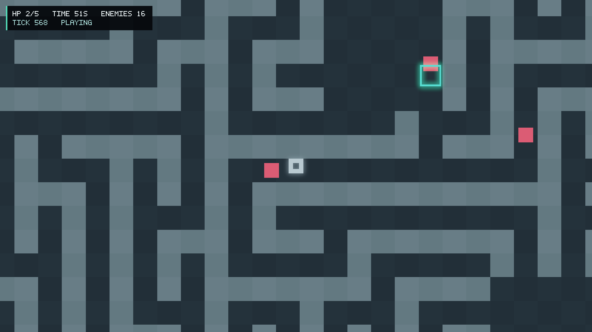
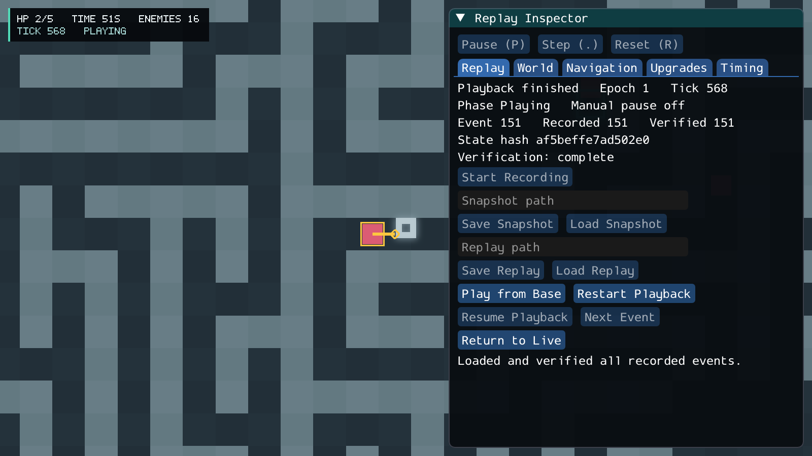

# M10.1 · Snapshot 与确定性 Replay

Seed 71、16 个敌人的 Navigation 会话在 Tick 37 保存时，16 个敌人各有一个未走完的 Waypoint。独立进程直接恢复这 16 段运动，验证随后的 666 个事件，在 Tick 702 重现 GameOver。最后一个事件的权威状态指纹为 `a83ea20adfe7606c`，两端保存的完整 Snapshot 文件逐字节相等。[运行记录](data/m101/cross-process/cross-process.log) · [逐事件记录](data/m101/cross-process/A/verification.csv.gz)

开发基线为 `5b5ca9bb1c972788e67b299e2f8dabd9ac1a0c7d`。PR #19 已合并，已验收 Head `9bcf0c285fc4d58bf45fee60537af74b77836f14` 为该提交的祖先。M9.2 七项 Mac 主设备人工验收已通过。M10.1 的实现按 A（Snapshot）、B（Replay）、C（Lab 与证据）组织。主设备验收清单位于文末。[M9.2 PR](https://github.com/Graham1019/Tiny2D-Engine/pull/19) · [路线图](lab-roadmap.md)

## 使用

```sh
LAB=build/m101-release/lab/tiny2d_lab
CPU=build/m101-off/tiny2d_m101_evidence
OUT=$(mktemp -d)

"$LAB" --scene replay --inspector on
"$LAB" --scene replay --seed 71 --map-size 64x40 --nav-enemies 16 --nav-script walk \
  --frames 37 --snapshot-out "$OUT/mid.snap"
"$LAB" --scene replay --snapshot-in "$OUT/mid.snap" --nav-script walk --nav-choice first \
  --frames 200 --record "$OUT/walk.replay" --snapshot-out "$OUT/end.snap"
"$CPU" verify "$OUT/walk.replay"
"$LAB" --scene replay --replay "$OUT/walk.replay" --frames 200 \
  --capture "$OUT/play.png" --metrics "$OUT/play.csv" --snapshot-out "$OUT/play.snap"
cmp "$OUT/end.snap" "$OUT/play.snap"
```

打开 Replay Inspector 后可输入 Snapshot 和 Replay 路径，执行保存、加载、开始/停止录制、从 Base 播放、暂停观看、下一事件、重新开始及返回 Live。手动暂停模拟时，单步仍可产生事件。等待选择时，Offer 窗口可独立显示。播放期间仍可调整显示参数。有限帧 Live 在每帧处理已到期的选择后推进模拟，播放端每帧至多消费一个事件，因此有 Choice 的录像可能比其录制帧数长一帧。CPU 命令 `verify` 验证全部事件，`snapshot PATH` 直接检查快照。[Lab 控制](../lab/src/ReplayApp.cpp) · [命令行解析](../lab/src/Neon.cpp) · [无窗口验证器](../tests/m101_evidence.cpp)

加载文件时，Seed、地图参数和敌人数来自文件。显式指定这些参数会报错。`--snapshot-in` 可配合新的输入脚本和 `--record`；`--replay` 自带 Base 和输入，不能同时指定这些选项或选择脚本。Snapshot 和 Replay 只保存到新文件。CLI 识别输入、输出、截图及 CSV 之间的路径冲突，包括已存在文件的硬链接。交互式文件错误显示在 Inspector，旧会话仍可使用。

## 权威状态与恢复事务

| 所有者 | Snapshot 保存的数据 | 恢复时验证或重建 |
|---|---|---|
| MapSession | Seed、完整 MapParameters、行优先 Tiles、Spawn、Exit、地图指纹、Epoch、Tick、手动暂停、TileMoveResult | 当前 Rules 生成同 Seed/参数地图，检查封闭和连通，并逐格验证内容、端点及指纹。movement.position 是玩家唯一坐标，保留 hitX、hitY、tilesQueried |
| NavigationSession | Phase、HP、VulnerableAt、NextOfferTick、请求敌人数、出生最小距离、LastDamageSlot、出生 RNG、活动槽顺序以及每槽 Epoch、位置、Waypoint | 验证出生池容量及流状态、连续槽身份、AABB、轴向路段及实际通行边。换目标后仍完成原路段。覆盖小格地图目标不可达时中途清空 Waypoint，以及极大格子一个浮点步长内的位置停滞 |
| UpgradeSystem | Fleet、Slow、Vitality、Guard 等级、独立 RNG、Serial、可选 Offer 的身份/候选顺序，以及最后 Choice | 受击、HP、阶段及 600 Tick 调度交叉校验；由等级推导速度、最大 HP 和冷却。用局部 RNG 校验候选顺序和有界的历史可选等级，完整还原文件中的 Offer |
| 派生缓存和观测 | 通行图、距离场、性能计数、窗口/UI、GL 对象及 GPU 查询独立保存在运行实例中 | 新 GridNavigator 根据恢复地图、敌人尺寸和玩家当前目标格建图及 BFS。同 Epoch 的旧图也会失效。GPU 所有权遵循现有 Pipeline |

`captureSnapshot() const` 返回纯值 DTO。由文件解码产生的 DTO 先经过预算、字段和语义检查，再构造独立候选会话。恢复可直接设置历史 Tick、Pause、Offer 和敌人位置，无需运行任何前置模拟 Tick。候选完成缓存重建及路段验证后，`restoreSnapshot` 以编译期确认的无异常移动赋值提交。失败时，当前 Session、当前位置和已构建的图均保持有效。在 Tick 600，停在待选、手动暂停或已选后的状态都有独立身份；同 Tick 致命接触优先于 Offer 和 Victory。[地图 DTO](../engine/include/tiny2d/MapSnapshot.h) · [导航 DTO](../game/include/tiny2d_game/NavigationSnapshot.h) · [恢复实现](../game/src/NavigationSnapshot.cpp)

### 文件约定

两种文件使用相同的 24 字节头，所有多字节数字为 little-endian。首版只接受 Format 1、Rules 1。布局变化应更新 Format；地图生成、移动、出生或增益等会改变重放结果的规则变化应更新 Rules。读取器遇到未知版本会给出诊断。[二进制基本类型](../game/src/BinaryCodec.h)

| 偏移 | 长度 | 内容 |
|---:|---:|---|
| 0 | 4 | Snapshot 为 ASCII `T2SN`，Replay 为 `T2RP` |
| 4 | 4 | Format Version，u32 |
| 8 | 4 | Simulation Rules Version，u32 |
| 12 | 4 | Payload Length，u32，必须等于剩余文件长度 |
| 16 | 8 | Payload 全字节的 FNV-1a 64 |

Snapshot Payload 依次编码地图、世界运行状态、导航状态、按槽排列的敌人和增益。数组有明确计数。Tile、枚举、选项存在标记及布尔使用 u8，布尔仅允许 0/1。坐标和 TileSize 使用 IEEE 754 binary32 位模式，主机须满足编译期浮点要求。Tile 数量在 128×96 的尺寸约束内先核对乘积及剩余字节，敌人数先核对 256 上限和剩余字节。读取会检查未知枚举、NaN/Inf、截断、额外尾部及异常尺寸。Snapshot 文件上限为 1 MiB。[Snapshot 编解码](../game/src/SnapshotCodec.cpp)

Replay Payload 包含 u32 Base 长度、完整 Snapshot 文件、u32 事件数量、事件序列、最终 u64 状态 Hash。每事件按顺序存储 `Sequence、BeforeEpoch、BeforeTick、Type、Payload、AfterEpoch、AfterTick、ExpectedHash`，其中序号、时标、Hash 均为 u64。每事件占 49–73 字节，Advance/ManualStep 为 51 字节。Decode 先检查 32 MiB 文件上限、最多 100,000 个事件及最小记录长度，再为事件分配空间。Recorder 达到上限后结束追加，已有前缀可保存。[Replay 编解码](../game/src/ReplayCodec.cpp)

`stateHash` 对规范 Snapshot Payload 计算 FNV-1a 64，初值 14695981039346656037、乘数 1099511628211。文件校验和面向传输损坏，没有密码学认证能力。独立逐字段比较器按内容比较数组和可选字段，浮点比较精确位模式；跨进程测试还比较每条事件后的完整规范字节。确定性证据限于相同 Rules 和本次测试的受支持构建/浮点环境，跨编译器及跨架构一致性仍待独立验证。[字段比较器](../game/src/SnapshotCompare.cpp)

写盘时在目标同目录建立临时文件，完成写入及 fsync，逐块回读校验，再以硬链接原子发布到尚未占用的名字。已有文件和符号链接均受保护。读文件先检查实际打开的文件类型、大小及读入期间的截断/增长。磁盘空间、权限、链接操作及目标重名错误均可报告。[文件 I/O](../game/src/SnapshotFile.cpp)

## 事件、播放与运行实例

Sequence 从 1 递增，Base 位于事件位置 0。Epoch 标记地图历史身份，Tick 表示该 Epoch 内的模拟位置。多次同 Tick 操作依靠 Sequence 保持顺序。生产输入在固定步实际消费时进入 Dispatcher，因此一个渲染帧可能产生多次 Advance，也可能没有事件。[事件与 Recorder/Player 接口](../game/include/tiny2d_game/Replay.h) · [生产 Dispatcher](../game/src/Replay.cpp)

| 命令 | 生效条件和结果 |
|---|---|
| AdvanceTick | Playing 且手动暂停关闭，消费两个数字轴（每轴 −1/0/+1）并调用生产 fixedUpdate |
| ManualStep | Playing 且手动暂停开启，以录制的轴调用生产 step 一次，继续手动暂停 |
| SetPaused | 目标布尔与当前不同，立即设置，同 Tick 生效 |
| ChooseUpgrade | 正在等待，Epoch、Offer Serial 和 ID 匹配；生产 choose 应用一次，Tick 不动，保留手动暂停 |
| Reset | 按当前 Seed/参数重建，Epoch 加一，Tick 归零，保留手动暂停 |
| Regenerate | 使用记录的 Seed 和完整参数重建，采用 Reset 的 Epoch/Tick 规则 |

Recorder 对成功改变权威状态的事件保存 before/after 时标和预期 Hash。拒绝、重复 Pause、终局后的 Advance 及过期 Choice 不追加。录制和验证均使用候选会话调用同一个生产 Dispatcher。ReplayPlayer 先直接恢复 Base，再顺序校验序号、Before、命令许可、After、事件 Hash 及最后的文件尾 Hash。首次失败报告两端时标和 Hash，光标停在最后验证成功的边界。观看时的 Playing、Paused、Finished、Error 由播放器持有；真实 WASD、模拟暂停和 Choice 不能改变历史。普通 Navigation 未开启录制时直接向生产会话派发，无逐 Tick Snapshot/Hash 成本。

Lab 复用 Map 帧循环、Navigation 绘制与 HDR Pipeline。加载、从 Base 开始播放、回到 Live 和更换 Epoch 时，以独立 runtime revision 失效历史选择及旧查询，清空 History、FixedTimestep 余量和待处理操作，更新墙钟采样起点并门控已按住的键。异步 GPU 样本进入 History 前同时检查 Epoch 和 revision。历史 Epoch 原样恢复，录制中的 Offer/敌人身份仍然可用。Pass 编号保持 0–17，Metrics 在 M9.2 CSV 末尾追加 runtime_revision、event_sequence、recorded_events、verified_events、state_hash、replay_mode。[共享帧循环](../lab/src/MapApp.cpp) · [History](../lab/src/Observation.h) · [CSV](../lab/src/Metrics.cpp)

## 跨进程与 OpenGL 证据

录制进程将 Base、Replay、最终 Snapshot 和逐事件规范 Snapshot 写盘。独立验证进程直接读取 Base，逐事件核对字段及字节，最后再比较独立保存的最终文件。三组共 1,929 个事件。逐事件 CSV 保留序号、事件类型、前后 Epoch/Tick、预期 Hash、规范文件字节数和一致标记。[采集脚本](../scripts/m101_replay_evidence.py) · [验证器源码](../tests/m101_evidence.cpp) · [三组跨进程输出](data/m101/cross-process/cross-process.log)

| 实验 | 输入与结果 | 可复现样本 |
|---|---|---|
| A 任意 Tick | Seed 71，16 敌人，Tick 37 有 16 个已承诺路段。重放 666 个事件，至 Tick 702 GameOver，HP 0/6，最终 15 个 Waypoint | [Base](data/m101/cross-process/A/base.snap) · [Replay](data/m101/cross-process/A/events.replay) · [逐事件](data/m101/cross-process/A/verification.csv.gz) · [最终快照](data/m101/cross-process/A/final.snap) |
| B 同 Tick 控制 | 零敌人，Tick 600 待选时 HP 5/5。先 Pause 再选 Vitality，Tick 仍为 600，HP 6/6，手动暂停仍开。随后 ManualStep、Resume，至 Tick 650，53 个事件通过 | [待选](data/m101/cross-process/B/base.snap) · [已选](data/m101/cross-process/B/chosen.snap) · [Replay](data/m101/cross-process/B/events.replay) · [逐事件](data/m101/cross-process/B/verification.csv.gz) |
| C 跨 Epoch | Epoch 1 和 2 各至 Tick 600，Reset 和 Regenerate 保持序号连续，拒绝旧 Offer。最终 Epoch 3、Seed 2026、45×29、Tick 8，1,210 个事件通过，Hash 为 `55e161974af4fc2f` | [Base](data/m101/cross-process/C/base.snap) · [Replay](data/m101/cross-process/C/events.replay) · [逐事件](data/m101/cross-process/C/verification.csv.gz) · [最终快照](data/m101/cross-process/C/final.snap) |

实验 D 分别注入截断、Format 77、异常 Payload Length、损坏校验和、Tick 3601、错误预期事件 Hash。最后两项重新计算外层校验和。Tick 3601 被语义验证拒绝；第三个 AdvanceTick 的预期 Hash 为 `19a0d7c544682215`，实际为 `19a0d7c544682214`，两端均为 Epoch 1、Tick 40。播放器保留序号 2 已验证状态，再次 Next 仍停止。六次错误加载后原 Live 的规范字节均与加载前一致。[损坏注入与诊断](data/m101/cross-process/rejections.log)

实验 E 在真实 OpenGL Lab 运行三个独立进程，比较连续模拟、从 Tick 417 的磁盘 Snapshot 续录，以及从磁盘 Replay 播放。三个进程均采用 800×450 逻辑窗口、Final、Bloom 开、Inspector 与 GPU Timing 关。比较 Tick 418–568 的全部 151 个时标和 Hash，再比较三份最终 PNG 及 Snapshot 字节。Inspector 图单独采集。[GL 实验程序](data/m101/gl_evidence.py) · [运行记录与 SHA-256](data/m101/gl.log) · [151 组事件 Hash](data/m101/gl-events.csv)





## CPU 与 GL 回归

| 构建 | 范围 | 日志 |
|---|---|---|
| Debug · GL ON | 77/77，通过实际 GLFW/OpenGL 输入、读回和应用 CLI | [完整输出](data/m101/ctest-debug.log) |
| Release · GL ON | 77/77，覆盖历史场景与 M10.1 播放器 | [完整输出](data/m101/ctest-release.log) |
| Release · GL OFF | 43/43，含 M10.1 六项 CPU 套件 | [完整输出](data/m101/ctest-off.log) |
| ASan + UBSan | 13/13，含 M9.1 三项、M9.2 四项、M10.1 六项 CPU 套件 | [Sanitizer 输出](data/m101/sanitizers.log) |

SnapshotCPU 和 CodecCPU 覆盖 Tick 0、运动、冷却、暂停、同 Tick Offer/Choice、GameOver/Victory、多次 Reset/Regenerate、0/16/256 敌人、最大地图、两个 RNG 和四种等级。逐字段及规范字节比较在直接恢复后持续数百 Tick。损坏用例覆盖位模式、长度、结构预算、候选顺序、槽序、非法 Waypoint 和事务失败。[Snapshot CPU](../tests/m101_snapshot.cpp) · [Codec CPU](../tests/m101_snapshot_codec.cpp)

EventDispatchCPU、ReplayCPU、ReplayCodecCPU 和 CrossProcessCPU 覆盖不同渲染频率、同 Tick 控制、跨 Epoch、多 Seed、非零起点、终局、插入/删除/重排/替换事件、错误时标、错误 Hash、预算耗尽、版本及截断。ReplayGL 实测恢复前后的 framebuffer 像素，覆盖两种窗口尺寸、原始 GLFW 按键、F2、控制隔离、单事件观看、异步查询 revision、GL 状态恢复、错误 Context 和资源销毁。ReplayFiniteCLI 在独立进程验证截图、规范文件、CSV 前缀、文件冲突与拒绝覆盖。[Replay CPU](../tests/m101_replay.cpp) · [Replay GL](../tests/m101_replay_gl.cpp) · [有限帧 CLI](../tests/m101_finite.py)

M9.1 历史地图运动在 3 种尺寸、3 个 Seed 共 32,400 条记录完全相同，Seed 71 的地图指纹为 `de25ba54c55fec8b`，地板 1,290，出口距离 80。M9.2 与已验收 Head 的独立可执行文件在 0/16/256 敌人、Advance、Pause、Choice、Resume、Reset、Regenerate 共 11,319 个完整权威边界逐条一致。256 敌人、移动目标的共享 BFS 与独立正向搜索在两种地图各有 4,096 个相同首步。黄金增益序列和默认 Tick 702 GameOver 均有原套件及新增回归覆盖。[地图回归](data/m101/map-regression.log) · [导航权威记录生成与比较](data/m101/check_navigation.py) · [导航结果](data/m101/navigation-regression.log) · [BFS 原始行](data/m101/bfs.csv)

15 张 M7 历史 PNG 字节全同，Sandbox 四种配置的最后一帧 Draw 分别为 1 / 500 / 1 / 5；完整 GL 套件重跑 Survivor 普通及极端难度、Particles、Shaders、Map 和 Navigation，另验证独立 Survivor 的可见窗口。[历史渲染与应用运行](data/m101/regress.log)

## Release 性能

以同一 Seed 71 的真实会话测量初始、Tick 37 运动中、Tick 600 待选及终局。每个状态预热 2 次、测量 120 次，按 nearest-rank 计算 p50/p95/p99。每次先独立测量内存捕获、编码、解码、语义验证、建缓存、总恢复和 Hash，再测新文件写入/回读。验证单事件耗时取整批耗时除以实际成功事件数，排除 Base 恢复；录制附加开销为同一份起始状态、相同命令序列的逐样本配对差。平时 32 个 Advance，待选状态为 1 个 Choice 加 32 个 Advance，终局使用 32 个 SetPaused。每个样本的 recorded/replayed/verified 三项数量均相等。[测量夹具](../tests/benchmark_m101.cpp) · [逐样本原始 CSV](data/m101/performance.csv) · [完整分位表](data/m101/quantiles.csv) · [复算脚本](data/m101/quantiles.py)

采集设备为 Apple M5 Pro、arm64、macOS 26.7.3、Apple Clang 21，GL 为 Apple OpenGL 4.1。设备报告 GL_TIMESTAMP 有效位 0，GPU 时间为 N/A。下表列出每组 Snapshot/Replay 大小（字节），以及内存操作的 p50（µs）。语义验证含地图/出生池核对、候选建立、等级与路段验证；缓存时间单独测量新 GridNavigator 的建图与玩家目标 BFS。总恢复含两者及函数边界开销。[环境和 CPU 工具依赖](data/m101/environment.txt)

| 地图 / 敌人 | 边界 (Tick) | Snapshot / Replay B | 捕获 | 编码 | 解码 | 语义验证 | 缓存 | 总恢复 | Hash |
|---|---|---:|---:|---:|---:|---:|---:|---:|---:|
| 64×40 / 0 | 初始 (0) | 2747 / 4419 | 2.42 | 3.42 | 6.58 | 28.08 | 264.75 | 293.67 | 3.42 |
| 64×40 / 0 | 运动 (37) | 2747 / 4419 | 2.29 | 3.29 | 6.33 | 25.71 | 248.67 | 274.58 | 3.21 |
| 64×40 / 0 | 待选 (600) | 2767 / 4505 | 2.29 | 3.33 | 6.38 | 32.71 | 253.38 | 286.71 | 3.29 |
| 64×40 / 0 | Victory (3600) | 2764 / 4404 | 2.29 | 3.33 | 6.38 | 34.04 | 251.67 | 286.54 | 3.25 |
| 64×40 / 16 | 初始 (0) | 3147 / 4819 | 2.58 | 4.21 | 7.42 | 31.92 | 267.50 | 300.42 | 4.04 |
| 64×40 / 16 | 运动 (37) | 3275 / 4947 | 2.33 | 4.12 | 7.04 | 26.46 | 247.96 | 274.50 | 4.00 |
| 64×40 / 16 | 待选 (600) | 3303 / 5041 | 2.38 | 4.25 | 7.21 | 34.21 | 258.33 | 292.33 | 4.12 |
| 64×40 / 16 | GameOver (702) | 3292 / 4932 | 2.33 | 4.12 | 7.04 | 33.04 | 248.50 | 282.21 | 4.04 |
| 64×40 / 256 | 初始 (0) | 9147 / 10819 | 2.88 | 13.54 | 15.21 | 44.38 | 265.62 | 311.46 | 13.00 |
| 64×40 / 256 | 运动 (37) | 11195 / 12867 | 2.92 | 17.25 | 18.00 | 47.04 | 265.71 | 314.46 | 16.54 |
| 64×40 / 256 | 待选 (600) | 11223 / 12961 | 3.17 | 17.75 | 18.29 | 69.08 | 272.04 | 339.50 | 16.83 |
| 64×40 / 256 | GameOver (666) | 11172 / 12812 | 2.83 | 16.54 | 17.21 | 49.08 | 262.92 | 313.12 | 15.83 |
| 128×96 / 256 | 初始 (0) | 18875 / 20547 | 12.33 | 25.92 | 40.42 | 212.04 | 1499.25 | 1707.42 | 25.17 |
| 128×96 / 256 | 运动 (37) | 20923 / 22595 | 11.58 | 27.92 | 40.62 | 182.92 | 1429.96 | 1617.12 | 27.12 |
| 128×96 / 256 | 待选 (600) | 20943 / 22681 | 12.42 | 30.17 | 43.46 | 255.92 | 1488.88 | 1750.96 | 29.12 |
| 128×96 / 256 | GameOver (1041) | 20924 / 22564 | 12.17 | 29.71 | 43.12 | 201.92 | 1485.71 | 1686.96 | 28.83 |

Tick 37 的配对运行每次成功录制、重播、验证各 32 个事件。下列每格为 p50 / p95 / p99，单位为 µs。事件列按每事件计，文件列按每个 Snapshot 计，写盘含同步与发布前的回读校验。

| 地图 / 敌人 | 普通事件 | 录制附加 | 播放验证 | Snapshot 写盘 | Snapshot 读盘 |
|---|---:|---:|---:|---:|---:|
| 64×40 / 0 | 0.86 / 0.97 / 1.12 | 5.75 / 6.37 / 6.93 | 6.58 / 7.16 / 7.33 | 232.79 / 268.42 / 310.21 | 14.88 / 27.46 / 39.29 |
| 64×40 / 16 | 2.04 / 2.39 / 2.76 | 6.64 / 7.39 / 7.75 | 8.64 / 9.47 / 9.88 | 228.12 / 279.46 / 307.33 | 14.67 / 20.42 / 38.71 |
| 64×40 / 256 | 23.79 / 26.94 / 32.53 | 19.84 / 23.20 / 30.38 | 43.50 / 47.07 / 49.92 | 313.50 / 436.17 / 742.29 | 20.50 / 31.04 / 99.12 |
| 128×96 / 256 | 25.77 / 27.35 / 28.69 | 42.28 / 45.45 / 51.66 | 67.02 / 72.13 / 74.12 | 288.67 / 419.79 / 596.21 | 18.33 / 23.54 / 25.58 |

在默认 16 敌人运动样本中，完整状态 Hash 的 p50 为 4.00 µs；128×96、256 敌人时为 27.12 µs。前者总恢复中位数为 274.50 µs，后者为 1,617.12 µs。录制附加时间同时含候选复制、完整状态编码/Hash 和事件追加。基于本轮数据，未来可分别评估不可变地图共享、Checkpoint 间隔或增量 Hash，但每事件一致性仍需保留可复核的验证基准。

```sh
cmake -S . -B build/m101-release -DCMAKE_BUILD_TYPE=Release -DTINY2D_OPENGL_TESTS=ON
cmake --build build/m101-release --parallel
ctest --test-dir build/m101-release --output-on-failure
cmake -S . -B build/m101-off -DCMAKE_BUILD_TYPE=Release -DTINY2D_OPENGL_TESTS=OFF
cmake --build build/m101-off --parallel
ctest --test-dir build/m101-off --output-on-failure

OUT=$(mktemp -d)
mkdir "$OUT/io"
build/m101-release/tiny2d_m101_benchmark "$OUT/io" > "$OUT/performance.csv"
python3 docs/data/m101/quantiles.py "$OUT/performance.csv" > "$OUT/quantiles.csv"
python3 scripts/m101_replay_evidence.py --tool build/m101-off/tiny2d_m101_evidence --out "$OUT/cross-process"
python3 docs/data/m101/gl_evidence.py build/m101-release/lab/tiny2d_lab "$OUT/gl"
python3 docs/data/m101/check_navigation.py
```

## Mac 主设备人工验收

记录机器、系统、构建 Head、逻辑窗口和 framebuffer 尺寸。以下项目由用户在主设备操作后勾选。

- [ ] **快照与位置。** Seed 71、16 敌人时在运动中手动暂停，保存到新路径。记下 Epoch、Tick、Hash 和屏幕上的敌人位置。恢复运动后加载，核对同一 Hash、位置、手动暂停与下一步。用已存在的目标保存，核对错误提示和原文件。
- [ ] **同 Tick 的 Offer。** 加载实验 B 的待选快照，核对 Tick 600、三个候选和 HP 5/5。暂停后选 Vitality，核对 Tick 600、HP 6/6 和 Offer 消失。加载 B 的 chosen.snap，核对手动暂停保留，再单步到 Tick 601。
- [ ] **生产输入与录制。** 开始录制，实际操作 WASD、暂停/单步、同 Tick Choice、Reset 和更换 Seed。停止并保存，用 Load Replay 从 Base 播放。核对每个控制只执行一次，Tick 归零时事件序号继续增长，最终数量与 Hash 一致。
- [ ] **观看控制。** 暂停观看时用 WASD、P、句号和鼠标点击增益，观察模拟 Tick/Hash 固定。Next Event 每次前进一个事件，Restart 回到 Base，Resume 到 Finished；切换 Bloom、HUD、导航显示和 F2 后可找回控制，Return to Live 回到原会话。
- [ ] **首次差异。** 用损坏/截断文件尝试加载。使用证据脚本重现校验和正确但第三个事件 Hash 错误的文件，核对 Sequence、Before/After 和 Hash 诊断。加载失败后原画面、Hash 和下一次控制仍可用。
- [ ] **焦点和显示。** 加载旧 Epoch 后检查旧选择和性能历史被清空；按住移动键切出并松开，返回后需新按下；最小化/恢复和调整窗口后检查地图、角色、按钮与文字。若有不同缩放比例的显示器，跨屏检查 Retina 尺寸变化。
- [ ] **历史场景。** 分别启动 Neon、Particles、Shaders、Map、Navigation 和独立 Survivor，核对原有移动、光效、调试页、热重载、地图操作和玩法。

## M10.2 交接

事件位置的自然定义为已验证的前缀长度。0 对应 Base，位置 k 对应前 k 个事件全部应用后的边界；相同 Epoch/Tick 可以有多个位置。状态 checkpoint 可使用 `{recording identity, event position, NavigationSnapshot}`。前向定位先直接恢复不超过目标位置的 checkpoint，再用同一 Dispatcher 验证后缀。M10.1 文件内只有 Base，随机定位的缓存预算、间隔及淘汰策略留给 Timeline。

从旧位置继续输入时，可保留父 Replay，以该位置已验证的 Snapshot 作为子录制的 Base，子序号从 1 开始。父身份、分叉位置、子身份和独立运行实例 revision 分别保存；记录中的 Epoch/Offer Serial 维持原值。M10.1 交付的 CPU capture/restore、规范状态比较、录制和逐事件前向验证可直接服务这一流程。完整倒带 UI、历史分支与跨平台位级认证另行验收。
