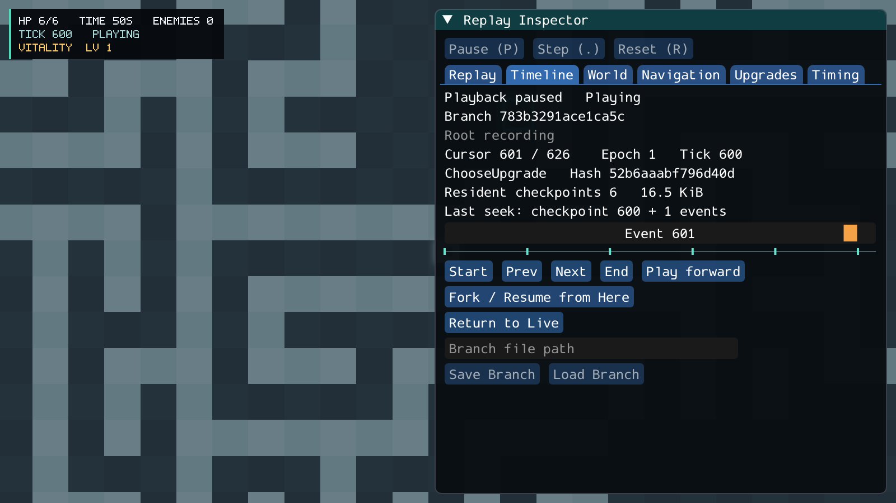
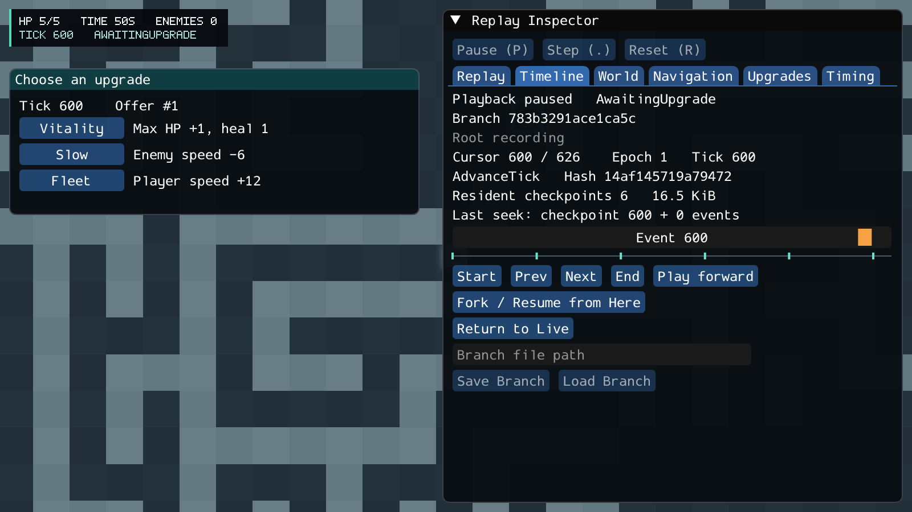
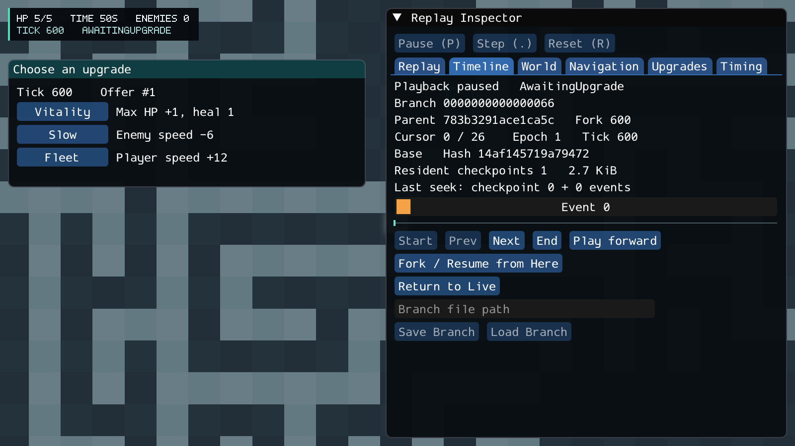
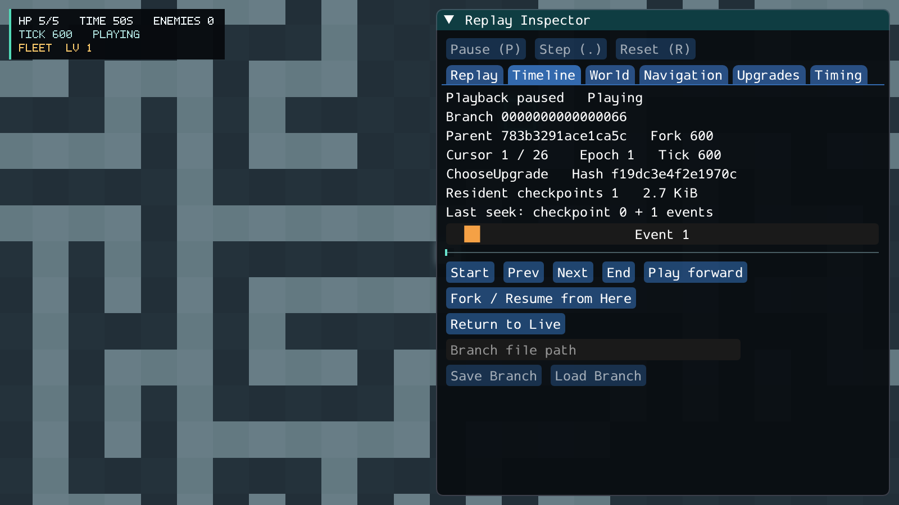

# M10.2 · Timeline & Time Travel

M10.2 依赖仍在审查中的 [M10.1 PR #20](https://github.com/Graham1019/Tiny2D-Engine/pull/20)，起点为 `c09a5fc78818fee7dbfbbd6e87790eab0c7f0aae`。时间轴使用 Replay Lab 中的 NavigationSession。时间轴定位、分支和文件验证均可在无窗口的进程中运行。

## 事件位置与 Checkpoint

Cursor 0 对应 Replay Base。Cursor k 对应已经应用前 k 个事件的完整状态。每个事件按 M10.1 的 Sequence 引用，例如第 600 个 Advance 和紧随其后的 Choice 可以显示相同的 Tick。Reset 后即使 Tick 回到 0，Cursor 仍随事件前进。

Timeline 接收有界 ReplayData，验证整条记录后展示 Base。不可变的事件向量直接支持按游标访问，验证候选共享该记录。每个 Checkpoint 提供 recordingId、cursor、对应的期望状态 Hash 和完整规范 Snapshot 文件字节。recordingId 取自完整 Replay 文件的 FNV-1a 64，用于核对来源。规则与位级确定性沿用 M10.1 的平台范围；这些指纹没有认证能力。[Timeline 接口](../game/include/tiny2d_game/Timeline.h) · [验证实现](../game/src/Timeline.cpp)

默认每 120 个事件设置 Checkpoint。Base 始终保留。缓存默认限 64 MiB 和 4,096 项，可按调用者指定的较小限额运行。空间核算包含快照字节向量和 Checkpoint 元数据向量实际保留的容量。预算容不下 Base 会拒绝构造。后续 Checkpoint 将超限时，间隔翻倍、保留对齐的新稀疏序列。interval=0 仅保留 Base。完整事件序列仍可用于访问每个位置。事件向量、正在展示的会话、候选及临时编码内存独立计量。

Seek 用二分查找选择目标之前最近的 Checkpoint，校验记录身份和预期 Hash，解码、语义恢复并比较规范字节后，从该游标调用同一个 ReplayPlayer 的逐事件验证路径。成功后一次移动替换显示会话。越界、损坏和重演失败会保留此前位置和权威状态。一次 Seek 的成本含恢复一次地图/缓存、二分查找和后缀事件数次生产模拟与 Hash 检查。相邻事件前向播放可以直接使用当前已验证状态。[共享回放器](../game/src/Replay.cpp)

## 身份与分叉

历史身份由地图 Epoch、敌人槽及 Offer Serial 定义。在过去的 Offer 上选择时需要保留实际候选和当时的两个 RNG。记录身份由记录或分支 ID、游标定义。运行实例的 revision 用于失效已借用的选择、键盘事件和延迟退休的 GPU 查询。观看暂停、时间轴滑块、Checkpoint 存储和性能采样都在权威状态之外。

子分支以分叉 Cursor 的已验证快照为新 Base，随后由 ReplayRecorder 对真实生产命令从 Sequence 1 开始录制。父记录保留自己的前缀与未来。T2BR v1 使用已有的 24 字节文件头，Payload 存储子 ID、父逻辑 ID、父记录内容 ID、分叉 Cursor（各 u64）、嵌入的 Replay 文件长度（u32）和完整 T2RP。子分支可单独读取、验证、续写；即使没有父文件也能恢复其起始状态。只有同时取得父记录时，才能与父游标的实际状态交叉核对来源。用户文件沿用原子创建与禁止覆盖策略。[分支接口](../game/include/tiny2d_game/ReplayBranch.h) · [编解码及恢复](../game/src/ReplayBranch.cpp)

下列命令独立验证全部事件，并打印指定位置的实际 Tick、HP、速度和状态 Hash。最后一个参数省略时显示终点。进程使用 CPU，无需创建窗口。

```sh
build/m102-release/tiny2d_timeline_verify replay docs/data/m101/cross-process/C/events.replay 601
build/m102-release/tiny2d_timeline_verify branch /path/to/child.branch
```

## Replay Lab

打开 Replay 页输入文件路径并加载，或启动下方样例。Timeline 标签页提供当前分支、事件类型、Hash、Checkpoint 标记、内存、Cursor 和实际回放距离。拖动滑块会暂停观看，释放后执行一次 Seek。Start、Prev、Next、End 和 Play forward 可以检查相邻控制事件。Fork / Resume from Here 建立新子分支并接受真实导航输入；在父子视图之间切换可以重新检查任一段历史。Child 正在录制时使用其真实 session，进入查看时才为其不可变记录构建索引。Lab 将默认 Checkpoint 容量对半分给两条时间轴，合计最多 64 MiB 和 4,096 项。载入独立子文件可继续另一次分叉。[Lab 时间轴所有者](../lab/src/TimelineView.cpp) · [控件与输入路由](../lab/src/ReplayApp.cpp) · [帧循环与运行实例失效](../lab/src/MapApp.cpp)

```sh
LAB=build/m102-release/lab/tiny2d_lab
"$LAB" --scene replay --replay docs/data/m102/parent.replay --seek-event 600 --timeline-view on
"$LAB" --scene replay --branch-in docs/data/m102/fleet.branch --timeline-view on
python3 tests/m102_finite.py "$LAB" --evidence /tmp/tiny2d-m102-new-evidence
```

`--seek-event N` 在目标位置暂停。`--fork-at N --branch-out NEW` 从目标建立一条自包含分支；有限帧分支第一帧可在原 Tick 选择增益，此后每个可绘制帧按脚本运行。`--branch-in` 与普通 Replay 文件入口互斥，重放的一切模拟输入取自文件。[参数解析](../lab/src/Neon.cpp)

## 同一个 Offer 的两种未来

Seed 71、零敌人，父记录包含 626 个事件。父 Cursor 600 和子 Cursor 0 的 Snapshot 文件逐字节相同，均在 Epoch 1 / Tick 600，权威 Hash 为 `14af145719a79472`。父 Cursor 601 选择 Vitality，HP 6/6、移动速度 120，Hash 为 `52b6aaabf796d40d`。子 Cursor 1 选择 Fleet，HP 5/5、移动速度 132，Hash 为 `f19dc3e4f2e1970c`。两者均停在同一个模拟 Tick。独立进程各自验证全部 626 和 26 个事件，并分别重现各自 Tick 625 的最终 Snapshot 和原始 PNG。分叉前后的父 Replay 文件字节相同。[父记录](data/m102/parent.replay) · [独立子分支](data/m102/fleet.branch) · [边界和 SHA-256](data/m102/boundaries.csv) · [原生 GL 运行](data/m102/branch-gl.log) · [CPU 独立验证](data/m102/standalone.log)

| 父记录已选 Vitality | Seek 到选择之前 |
|---|---|
|  |  |

| 子分支 Base | 子分支选择 Fleet |
|---|---|
|  |  |

## 定位成本

Release，Seed 71，每组 2,400 个实际事件，包含移动、选择以及终局或 Tick 720 后的 Reset。每个策略预热 3 次再测量 128 次确定性随机 Seek，同一组的五种策略使用相同目标序列。下表单位为毫秒。保留内存取 Checkpoint 实际容量；“最坏事件数”按完整索引间隔计算。逐样本数据提供选中 Checkpoint、实际重演数、恢复、重演及总耗时，重演每个事件均继续验证。[夹具](../tests/benchmark_m102.cpp) · [原始数据](data/m102/seek.csv) · [全分位数](data/m102/quantiles.csv) · [复算](data/m102/quantiles.py)

| 地图/敌人 | 间隔 | Checkpoint 数 / 字节 | 实际重演 p50 | 最坏事件数 | Seek p50 / p95 / p99 ms |
|---|---:|---:|---:|---:|---:|
| 64×40 / 16 | 仅 Base | 1 / 3,195 | 1164 | 2400 | 11.48 / 22.91 / 23.24 |
| 64×40 / 16 | 60 | 41 / 136,004 | 27 | 59 | 0.58 / 0.94 / 1.06 |
| 64×40 / 16 | 120 | 21 / 69,005 | 62 | 119 | 0.91 / 1.52 / 1.69 |
| 64×40 / 16 | 240 | 11 / 35,409 | 111 | 239 | 1.39 / 2.62 / 2.75 |
| 64×40 / 16 | 480 | 6 / 19,282 | 248 | 479 | 2.67 / 4.74 / 4.90 |
| 128×96 / 256 | 仅 Base | 1 / 18,923 | 1164 | 2400 | 85.69 / 170.37 / 174.18 |
| 128×96 / 256 | 60 | 41 / 850,797 | 27 | 59 | 3.86 / 5.84 / 6.13 |
| 128×96 / 256 | 120 | 21 / 434,846 | 62 | 119 | 6.44 / 10.93 / 11.46 |
| 128×96 / 256 | 240 | 11 / 224,828 | 111 | 239 | 10.58 / 18.44 / 18.95 |
| 128×96 / 256 | 480 | 6 / 121,843 | 248 | 479 | 20.24 / 34.58 / 35.79 |

该测量覆盖同一设备和夹具。建索引需要一次完整文件验证，表格的 Seek 耗时从验证完成后的用户定位命令开始。短间隔会增加缓存；同一位置需要恢复与重建地图，因此恰好命中 Checkpoint 也有固定成本。GPU Timestamp 为 N/A。

## 正确性和验收

CPU 测试对 4,342 个状态位置进行顺序和乱序访问，比较完整字段与规范字节，覆盖同 Tick 控制、待选增益、GameOver、Victory、Reset、Regenerate。100,000 事件夹具在 4 KiB、最多 8 项的限制下实际保留 7 项 / 1,868 B，最长重演 16,383 个事件。替换 Checkpoint 内容、记录身份、Hash 或损坏字节都会保留此前已验证状态。分支套件还覆盖暂停单步、跨 Epoch 旧 Offer、失败 Fork、再分叉的逻辑父 ID、满容量文件和导出后的独立续写。[定位与压力](../tests/m102_timeline.cpp) · [分支与损坏验证](../tests/m102_branch.cpp)

本阶段完整 CTest 通过 Debug GL 81/81、Release GL 81/81、Release GL OFF 45/45；CPU ASan/UBSan 15/15。真实 ImGui 鼠标拖动、释放与 Next Event 由 GL 测试执行，独立进程验证父子记录。[Debug](data/m102/ctest-debug.log) · [Release](data/m102/ctest-release.log) · [GL OFF](data/m102/ctest-off.log) · [Sanitizers](data/m102/sanitizers.log) · [交互测试](../tests/m102_timeline_gl.cpp) · [跨进程测试](../tests/m102_finite.py)

重新执行 15 张历史 PNG 字节对照、Sandbox Draw 1/500/1/5、32,400 条地图输入、11,319 条导航权威状态记录及独立 BFS。原 Survivor、Shader 热重载、粒子、增益与全部前置场景纳入本阶段回归。[GL 与 Sandbox](data/m102/regress.log) · [地图](data/m102/map-regression.log) · [导航](data/m102/navigation-regression.log) · [BFS](data/m102/bfs.csv)

Mac 主设备验收状态为 **Pending User Acceptance**。记录构建 Head、Seed、运行模式、窗口与 framebuffer 尺寸；如遇状态问题，保留 Replay、Branch、Cursor、Epoch/Tick 及两个状态 Hash。

- [ ] 打开示例父 Replay，在 599、600、601 之间拖动与单步。释放才定位，600 显示候选，601 显示同 Tick 的 Vitality。记录 Last seek 的 Checkpoint 和重演数。
- [ ] 停在 600 分叉，选择 Fleet 并移动，再切父分支到末尾。父仍为 Vitality，子为 Fleet。独立保存子文件，关闭父记录后再载入检查。
- [ ] 在暂停状态分叉，验证一次 ManualStep、Resume、Reset 和 Regenerate，检查历史 Epoch 和局部 Cursor。旧选择和按住的键不得跨运行实例生效。
- [ ] 损坏副本或输入越界游标，检查当前会话和已验证位置能继续使用。F2、窗口缩放、最小化、失焦恢复和跨屏操作需由主设备实际体验。
