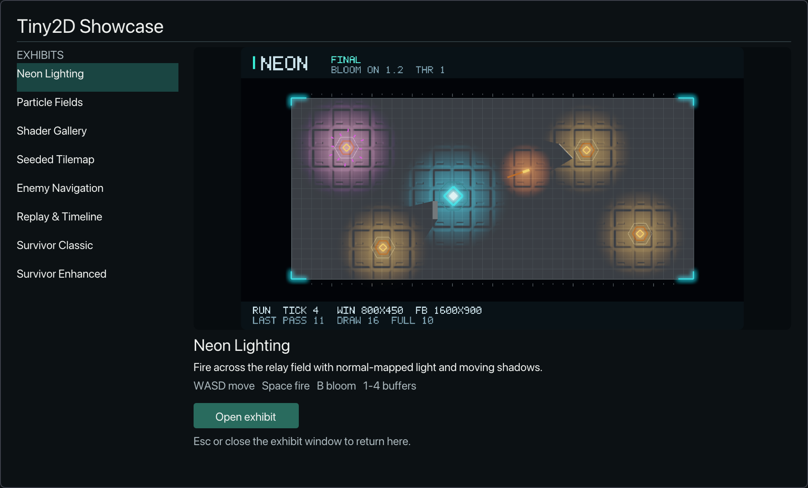
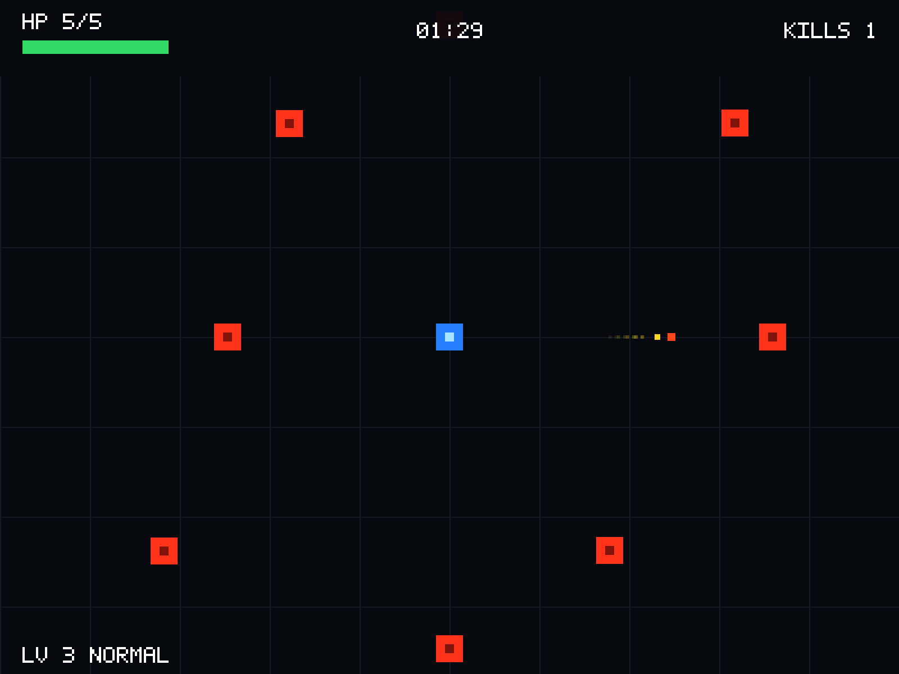
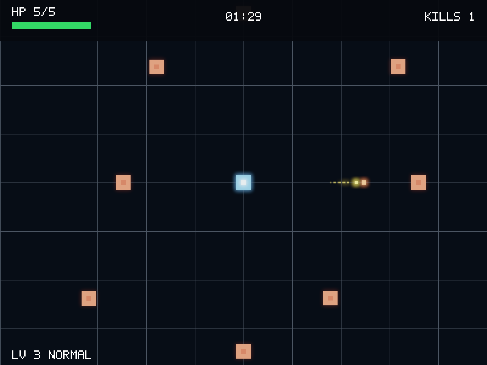

# M11.1 · Tiny2D Showcase 与 Survivor Enhanced

`tiny2d_lab --scene showcase` 打开统一展厅。选择左侧展品，点击 **Open exhibit**，即可进入实际运行的 Lab 场景或独立 Survivor。关闭子窗口或按 Esc 后回到同一个展厅，可以再次打开展品。窄窗口使用下拉列表选择。入口来自 M10.2 的堆叠分支；M10.1、M10.2 及本阶段的源码 Review、主设备验收分别记录在路线图中。[路线图](lab-roadmap.md)



## 启动与控制

```sh
cmake -S . -B build/m111-release -DCMAKE_BUILD_TYPE=Release -DTINY2D_OPENGL_TESTS=ON
cmake --build build/m111-release --parallel
build/m111-release/lab/tiny2d_lab --scene showcase
build/m111-release/Tiny2DSurvivor.app/Contents/MacOS/Tiny2DSurvivor --presentation enhanced
```

| 展品 | 可以实际操作的内容 | 运行画面 |
|---|---|---|
| Neon Lighting | WASD 移动、Space 发射、B 切换 Bloom；在 Inspector 检查法线与动态阴影 | [Neon](media/m111/neon.png) |
| Particle Fields | 8,192 个活动粒子；在 Forces 调整吸引、排斥、旋涡或风场，在场景中拖动中心，暂停后可单步 | [粒子实绘](media/m111/particles.png) |
| Shader Gallery | 在 Inspector 选择 Aurora、Orbitals、Contours。P 暂停，按 F5 或 Reload 加载当前源码。失败时检查诊断，再修正源码并重载 | [展品](media/m111/shaders.png) · [错误保留旧画面](media/m111/reload-failed.png) · [恢复后](media/m111/reload-recovered.png) |
| Seeded Tilemap | WASD 行走，P 暂停，句号单步。World 页输入 Seed 再重建；R 重置当前 Seed | [Seed 71](media/m111/map-71.png) · [Seed 72](media/m111/map-72.png) |
| Enemy Navigation | 看敌人如何沿通行图追踪玩家。WASD 改变目标格，路径叠加显示下一段，Tick 600 点击当前 Offer 的候选 | [默认敌群](media/m111/navigation.png) · [待选 Offer](media/m111/navigation-offer.png) |
| Replay & Timeline | 从随展厅安装的记录进入 Tick 600；拖动事件滑块后释放，查看选择前后状态，Fork 后实际继续另一种选择 | [待选位置](media/m111/timeline-offer.png) · [独立子记录的 Fleet](media/m111/timeline-child.png) |
| Survivor Classic | 菜单 1–5 选择难度、Enter 开局、WASD 移动、自动射击；终局按 R 使用已选难度再开一局 | [普通难度击杀瞬间](media/m111/survivor-classic.png) |
| Survivor Enhanced | 同一菜单、会话、输入与战斗规则，增强版将世界与命中特效绘入 HDR，并可用 B 切换 Bloom | [相同击杀 Tick](media/m111/survivor-enhanced.png) · [同 Tick 关闭 Bloom](media/m111/enhanced-bloom-off.png) |

展厅启动时根据自身可执行文件定位资源，预览使用真实截图。普通开发构建从 Lab 同目录的 assets 取得图片和演示 Replay。启动命令用参数数组传给 `posix_spawn`，不经过 shell；父窗口同一时间拥有一个子进程。父进程用 `waitpid` 回收退出状态，启用下一次启动。子进程异常退出时报告状态；关闭展厅时有界等待并回收自己创建的子进程。每次打开独立创建窗口、GL Context、输入状态和模拟 Session。原 Lab 默认 Neon 和各单场景 CLI 仍可直接使用。[展品与进程所有权](../lab/src/ShowcaseProcess.cpp) · [展厅帧循环](../lab/src/ShowcaseApp.cpp) · [离线资产](../cmake/StageShowcaseAssets.cmake)

## Survivor 的精选整合

Classic 沿用直接显示世界与 HUD 的路径。Enhanced 在同一 Survivor 窗口内复用 Lab 的 HDR/Bloom Pipeline。网格、GameSession 的 Scene 和由 CombatEvent 驱动的 VFX 在 World Pass 合批提交；角色与 VFX 的亮度增益仅作用在提交的颜色。Bloom 开启时提取亮区并水平、垂直模糊，随后进行输出变换，再以逻辑像素相机绘制原有 HUD 与覆盖层。HUD 保持原字体、层级及健康/击杀/难度信息。窗口 framebuffer 改变时按实际像素重建目标，GL 对象在所属 Context 内释放。[共用绘制函数](../sandbox/src/SurvivorPresentation.h) · [增强显示适配器](../sandbox/src/EnhancedSurvivor.cpp) · [HDR Pipeline](../lab/src/Pipeline.cpp)

模拟仍由 SurvivorFlowController、GameSession、固定时间步与原有 CombatVFX 消费流程拥有。一次 fixedUpdate 后，CombatEvent 的序号、种类、Tick 和精确位置保持可观察。增强显示读取这些结果，在绘制时提交亮色，不改变生成、射击、命中、伤害、无敌期或终局优先级。独立应用不带参数时保留 Classic 菜单。有限帧模式自动以选定难度进入游戏，每帧消费一次固定步，终局冻结后仍绘制余下帧；跟踪文件只记录实际推进的 Tick。[Survivor 会话与帧循环](../sandbox/src/SurvivorDemo.cpp) · [跟踪字段](../sandbox/src/SurvivorTrace.cpp) · [命令行](../sandbox/src/SurvivorMain.cpp)

```sh
OUT=$(mktemp -d)
LAB=build/m111-release/lab/tiny2d_lab
SURVIVOR=build/m111-release/Tiny2DSurvivor.app/Contents/MacOS/Tiny2DSurvivor
"$LAB" --scene showcase --showcase-tour all --child-frames 24 --showcase-output "$OUT/visits"
"$SURVIVOR" --presentation classic --difficulty 3 --frames 600 --trace "$OUT/classic.csv"
"$SURVIVOR" --presentation enhanced --difficulty 3 --frames 600 --bloom on \
  --trace "$OUT/enhanced.csv" --metrics "$OUT/metrics.csv" --capture "$OUT/enhanced.png"
cmp "$OUT/classic.csv" "$OUT/enhanced.csv"
```

Survivor 的 `--capture`、`--metrics` 和 `--trace` 要求有限帧和独立的新路径。`--bloom on|off` 用于 Enhanced。展厅的 `--showcase-exhibit ID` 选择初始预览，`--showcase-tour` 接受 all 或按逗号排列的展品 ID，可重复同一 ID。游览完成后可保存最终展厅画面；各个子进程分别输出自己的文件。

## 实测与复现

```sh
OUT=$(mktemp -d)
python3 tests/m111_journey.py build/m111-release --evidence "$OUT/journey"
python3 tests/m111_journey.py --summarize "$OUT/journey/data"
ctest --test-dir build/m111-release --output-on-failure
```

端到端脚本从临时工作目录启动可执行文件，检查父窗口的启动/退出记录、实际 PID、子进程写出的逐帧指标、PNG 数据块和 framebuffer 尺寸。专项场景使用产品 CLI 与生产 OpenGL 夹具。Shader 测试在临时副本上修改源码，编译、链接及接口错误保留旧 Program 与 HDR 内容；成功更换源码后重新绘制并检查 HDR 像素差。Map 的两个 Seed 使用同一 21×13 尺寸、Tick 和视图。Navigation 运行到真实 Offer，Replay 则从保存的父记录 Fork 并独立验证子文件。[端到端脚本](../tests/m111_journey.py) · [Shader 回滚与读回](../tests/test_m82_gl.cpp)


### 八个展品与两次重开

实测按表中顺序进入八个展品，然后再次打开 Neon、Survivor Enhanced，共 10 次启动、10 次回收、10 个退出码 0。关窗返回及重新打开使用不同子 PID。粒子场景提交 8,192 个实例、1 次粒子绘制。Timeline 展品打开已验证父记录的 Cursor 600；独立新建的子 ID 111 在自身 Cursor 1、历史 Tick 600 选择 Fleet，速度为 132，父文件原始字节仍一致。首次试运行发现历史菜单资源的 .png 扩展名对应 JPEG 内容；安装资产改用本阶段的两张真实 framebuffer PNG，重新运行整个游览通过。[进程与画面记录](data/m111/visits.csv) · [各展品指标](data/m111/frames.csv) · [逐命令日志](data/m111/journey.log) · [截图尺寸与校验](data/m111/captures.csv)

### 战斗规则与像素对照

独立启动两个呈现模式，各绘制 600 帧，使用相同固定输入。比较的是每个推进 Tick 的整个 CSV 行，包括实体槽序、代际、稳定序号、HP、过期 Tick、精确浮点位置/速度/变换、生成与射击期限、无敌期、碰撞计数，以及这一步新增事件的 Sequence、种类、Tick、位置位模式。终局后的绘帧不会新增 Tick。每组两份原始 CSV 逐字节一致，提交一份无损压缩的公共轨迹以及两边独立计算的 SHA-256。另用原 `tiny2d_sandbox --scene survivor-demo` 重跑两档，最终统计一致，最后一帧均为 3 Draw。[对照记录](data/m111/combat-parity.csv) · [Lv.3 全轨迹](data/m111/level-3-authority.csv.gz) · [Lv.5 全轨迹](data/m111/level-5-authority.csv.gz)

| 难度 | 实际推进 Tick | ProjectileHit / EnemyKilled / PlayerDamaged | 终局 | 公共轨迹字节数 |
|---|---:|---:|---|---:|
| 3 · Normal | 383 | 11 / 5 / 5 | GameOver，0 HP，5 kills | 250,294 |
| 5 · Extreme | 338 | 12 / 6 / 5 | GameOver，0 HP，6 kills | 228,934 |

普通难度第一个 EnemyKilled 出现在 Tick 87。以下图片固定该事件和相机位置，在同一设备用三次真实运行分别捕获；增强模式关闭 Bloom 的画面可在表格中打开。[同 Tick 关闭 Bloom](media/m111/enhanced-bloom-off.png)

| Classic | Enhanced |
|---|---|
|  |  |

### Release CPU 开销

Apple M5 Pro、macOS 26.7.3、Apple Clang 21。专门的三个独立进程各绘制 180 帧，前 30 帧预热，余下 150 帧按 nearest-rank 统计，单位 µs。Survivor 两组均为普通难度，Bloom 开启的 Enhanced 多出亮部提取、两级方向模糊及输出变换，1600×1200 framebuffer 的 HDR 目标共 26,880,000 字节。表内为 CPU 构建或提交时段；GPU 时间记 N/A。[环境](data/m111/environment.txt) · [逐帧压缩 CSV 与分位数](data/m111/presentation/) · [采集与复算](../scripts/measure_showcase.py)

| 场景 / 指标 | p50 | p95 | p99 |
|---|---:|---:|---:|
| 展厅 GUI 构建 | 7.50 | 11.88 | 13.00 |
| 展厅 GUI 提交 | 21.58 | 29.17 | 32.92 |
| Classic 固定模拟步 | 1.42 | 3.38 | 4.96 |
| Enhanced 固定模拟步 | 1.92 | 6.00 | 7.83 |
| Classic 绘制提交 | 64.96 | 87.25 | 106.54 |
| Enhanced 绘制提交 | 119.42 | 141.46 | 169.75 |

配对游览另保留两种难度两种呈现的原始指标，在每组相同的第 121–300 帧取 180 个游戏内样本，避免将终局静止帧混入该组统计。专门采集与配对游览的样本窗口分别计算。[配对样本分位数](data/m111/survivor-quantiles.csv) · [普通 Classic](data/m111/level-3-classic.metrics.csv.gz) · [普通 Enhanced](data/m111/level-3-enhanced.metrics.csv.gz) · [极端 Classic](data/m111/level-5-classic.metrics.csv.gz) · [极端 Enhanced](data/m111/level-5-enhanced.metrics.csv.gz)

## 历史回归与主设备验收

完整测试纳入 Showcase 进程 CPU 与真实 OpenGL 生命周期、Survivor CPU、增强 GL 与 CLI，以及贯穿八个展品的 Journey。历史测试继续覆盖原 Sandbox Draw、Survivor、M7 图像、M8 粒子/Shader、M9 地图/导航及 M10 Snapshot、Replay、Checkpoint 和 Branch。M9.1 独立基线仍有 32,400 条匹配，M9.2 与已验收源码独立编译出的 11,319 个权威边界仍相同。[回归驱动](../scripts/check_historical_baselines.py) · [地图对照](data/m111/map-regression.log) · [导航对照](data/m111/navigation-regression.log) · [CPU 回归](data/m111/cpu-regression.log)

本阶段完整 CTest 为 Debug GL ON 87/87、Release GL ON 87/87、Release GL OFF 47/47。选定 CPU ASan/UBSan 17/17。历史 GL 校验覆盖 15 张 M7 PNG、Sandbox Draw 1 / 500 / 1 / 5，普通及极端 Survivor 的实际游戏统计还由 Journey 独立核对。[Debug](data/m111/ctest-debug.log) · [Release](data/m111/ctest-release.log) · [GL OFF](data/m111/ctest-off.log) · [Sanitizers](data/m111/sanitizers.log) · [历史 GL](data/m111/regress.log)

Mac 主设备状态为 **Pending User Acceptance**。请记录测试 Head、系统、显示缩放和当前屏幕，逐项人工确认。

- [ ] **进入与返回。** 启动 Showcase，观察八个预览。进入各展品，用 Esc 或关闭子窗口返回，重开 Neon 和 Survivor。关闭运行中的展厅后检查子窗口一起退出。
- [ ] **窗口和焦点。** 改变宽度、最小化与恢复，在支持时跨不同缩放显示器。检查预览和按钮布局、真实子窗口输入、回展厅后焦点，以及重新按下按键的行为。
- [ ] **画面与工具。** 在 Neon 切换光照、法线和阴影，在 Particles 拖动力场，在 Shader Gallery 保存临时编辑、F5 触发失败、修复并重载，核对版本与显示。
- [ ] **地图与导航。** 更换地图 Seed，暂停、单步并查看碰撞。等待导航 Offer，点击一次，确认模拟恢复。开启路径观察转角运动。
- [ ] **时间轴。** 在 Replay 查看首个 Offer 前后，同 Tick 选择使状态变化。Fork，选择另一项，保存后重新加载。回父记录检查其原有未来。
- [ ] **Survivor。** 在 Classic 和 Enhanced 中用相同难度试玩，核对移动、自动攻击、受击、菜单、HUD 和终局重开；增强版切换 Bloom 并观察实际命中/击杀反馈。
- [ ] **旧入口。** 直接运行默认 Neon、独立 Survivor 和 Sandbox，核对原入口与原有操作。
