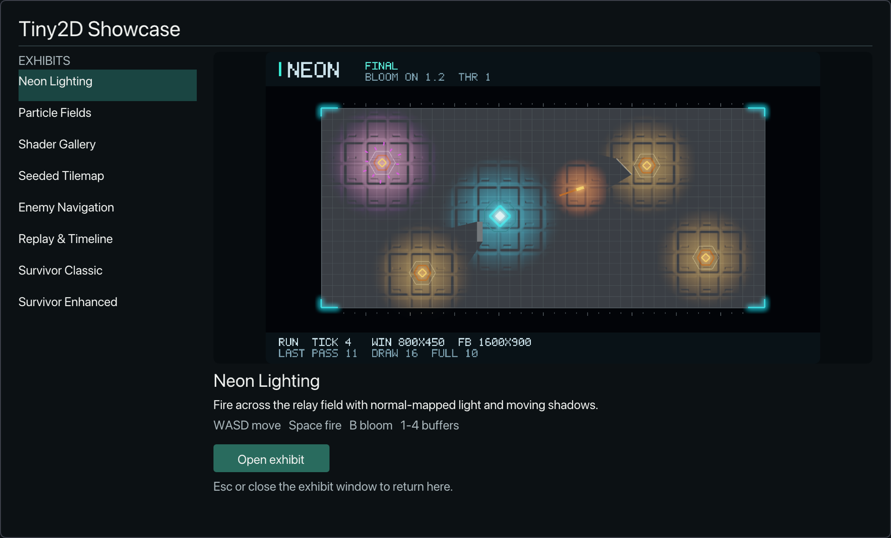

# M11.2 · macOS 候选包与作品集

在仓库外解压的 Tiny2D Showcase 0.6.0-rc1 已通过 LaunchServices 启动测试。八个展品和一次重复打开共创建并回收九个原生子进程。包内 mid.snap 从 Epoch 1 / Tick 37 恢复；独立录制和回放至 Tick 77 时，最终快照和 GL 截图均逐字节相同。[仓库外运行记录](data/m112/smoke/native.log) · [逐次状态、像素和 Hash](data/m112/smoke/smoke.json)



## 交付物和来源

本地 ZIP 为 `build/m112-dist/candidate-m910alvb/Tiny2D-Showcase-0.6.0-rc1-macos-arm64.zip`，共 2,867,277 B。SHA-256 为 `6172dcbe750655a4fd525e02167a28109d9a3dd8b664e1d4fc9f6bc1a91e40f5`。实际源提交为 `4dff8ddabfd6aa902f0310e55b90eed1c11764c4`。构建器对该提交执行 git archive，从独立源码树配置 Release、arm64、部署目标 26.0。修复源码和测试先提交，随后单独提交候选清单与验收证据。旧候选的构建目录和[原始证据](https://github.com/Graham1019/Tiny2D-Engine/tree/f1f1cca9f3699f50509eb04f7463a821c12501c7/docs/data/m112)保留供对照。包内 63 份资源与源提交及最终工作区逐字节一致。[候选源码与工作区复核](data/m112/source-equivalence.log) 当前主机为 Apple M5 Pro，macOS 26.7.3，Apple Clang 21，SDK 26.5。候选包使用开发者本地 ad-hoc 签名。本地 ZIP 和视频可由所有者在验收时直接打开。[候选数据](data/m112/candidate.json) · [SHA256SUMS](data/m112/SHA256SUMS) · [完整清单与 Mach-O 依赖](data/m112/manifest.json) · [主设备验收指南](releases/v0.6.0-rc1.md)

Showcase 的主可执行文件根据实际路径 execv 同一 App 中的 Lab helper。所有展品调用使用独立 argv，Survivor 是同一目录中的第二款 App。程序以 bundle 相对路径读取 Shader、纹理、八张预览及示例 Snapshot/Replay/Branch。清单记录了 77 项文件/链接和 7 个 Mach-O；每个二进制的架构、部署目标和私有 dylib 闭包均已验证。两份应用内各有 GLFW、libpng 和许可证，候选包含 Dear ImGui MIT 全文与程序化纹理通知。原 M6.3c 的 ZIP 哈希和旧验包流程已复测。[依赖重定位、签名和归档](../scripts/package_showcase_macos.py) · [独立验包](data/m112/bundle-verification.log) · [原版兼容记录](data/m112/legacy-compat.log)

## 封版审查修复

Lab 与 Survivor 在创建窗口前解析所有 CLI 输出，沿符号链接检查路径，并拒绝任意 `.app` 内的目标。打包程序将 PNG、CSV 和录制文件写入外部私有暂存目录，成功结束时只向新名字发布。若稍后有其他文件占用某个名字，本次已发布的文件会回滚。Snapshot、Replay 和 Branch 继续使用原有写入、同步、回读及原子发布流程。开发版 Lab 的截图与指标沿用覆盖语义。[共享输出策略](../engine/src/Platform/OutputFiles.cpp) · [Lab 入口](../lab/src/main.cpp) · [Survivor 入口](../sandbox/src/SurvivorMain.cpp) · [PNG 临时描述符](../lab/src/Capture.cpp) · [磁盘文件发布](../game/src/SnapshotFile.cpp)

Gallery 在编译顶点和片元着色器前，通过同一个非阻塞文件描述符检查普通文件类型和 1 MiB 上限，读取时检查截断、增长与 I/O 错误。实际 GL 回归覆盖恰好 1 MiB 的合法程序、超限顶点文件和无写端片元 FIFO。运行时检验上一程序的绑定、版本与 HDR 像素，启动时检验相同错误输入下的包内回退和工作副本保留。[有界读取](../engine/src/Platform/BoundedFile.cpp) · [Shader 读取入口](../sandbox/src/ShaderAssets.cpp) · [GL 事务](../lab/src/ShaderReloadManager.cpp) · [真实 GL 测试](../tests/test_m82_gl.cpp)

## 仓库外的实际运行

验收脚本的工作目录与解压目录不同，路径包含空格和中文。它通过系统 LaunchServices 打开展厅，另行启动 Survivor，并从同一个展厅连续打开八个展品，再打开一次 Neon。每个子进程都有结束状态、真实像素读回及其对应模式的观测数据。负向测试前、负向测试后和全部巡检后分别校验两款 App 的签名。77 项清单记录、清单自身的 SHA-256、目录名与权限均一致，其中 76 项位于两款 App 内。导出的 Snapshot、Replay、Branch、工作副本和截图位于外部目录。[独立执行脚本](../scripts/smoke_showcase_candidate.py) · [29 张读回图的尺寸和 SHA-256](data/m112/smoke/smoke.json)

| 场景 | 实际操作与结果 |
|---|---|
| 签名输出保护 | Survivor 的 capture、trace、metrics 和 Lab 的 capture、metrics 各覆盖自身包、另一款包、指向包内目录的外部符号链接，以及包内资源的外部硬链接。20 项均提前拒绝，同组合法输出也未创建。第 21 项在 Gallery 启动后才占用 metrics 目标，独占发布失败且包内资源和暂存清理均符合预期。两款 App 的中文及空格相对路径输出均成功。[逐项命令、诊断与签名](data/m112/smoke/output%20protection/signature-protection.log) |
| 继续模拟和录制 | 加载随包的 Tick 37 快照，录制 40 个真实模拟事件。独立回放到 Tick 77 的权威 Hash 为 `1cdbd94f8f42180b`，最终快照和截图逐字节一致。[录制](data/m112/smoke/restored-suffix.replay) · [最终快照](data/m112/smoke/verified-final.snap) |
| 同一 Tick 的分歧 | 父 Cursor 600 显示待选，601 保留 Vitality。独立加载随包的 Fleet 子分支，又从父 600 新建一条分支，重放这 8 个事件到 Tick 607，Hash 为 `1eb254f33134a43d`。[现场导出分支](data/m112/smoke/new-fork.branch) |
| Shader 安全编辑 | 从外部副本启动，冻结同一 Tick。语法错误、超限 Shader 和无写端 FIFO 都保留原程序版本和像素，修正后画面与版本改变，重启读到保存的修改。无效启动编辑可退回包内有效程序。两款应用仍通过签名校验。[原始](media/m112/native-shader-original.png) · [驱动拒绝后的原图](media/m112/native-shader-rejected.png) · [修复后的画面](media/m112/native-shader-recovered.png) |
| 文件诊断 | 截断、版本、长度、校验和、合法校验和但 Tick 3601 的文件，以及期望 Hash 错一位的第三个事件均被发现。旧活动会话的规范字节保持一致。[重测拒绝记录](data/m112/file-rejections.log) · [错误 Replay 样例](data/m112/bad-sequence-3.replay) |

## 最终回归

| 本阶段构建 | 结果 | 覆盖与记录 |
|---|---:|---|
| Debug，原生 OpenGL | 89/89 | 含 41 项带 GUI/OpenGL 标签的测试。[完整 CTest](data/m112/ctest-debug.log) |
| Release，原生 OpenGL | 89/89 | 同一套断言实际运行于优化构建。[完整 CTest](data/m112/ctest-release.log) |
| Release，GL 测试关闭 | 48/48 | CPU 游戏、状态文件、历史、进程与工作副本测试。[完整 CTest](data/m112/ctest-off.log) |
| Debug，ASan + UBSan | 20/20 | M9–M11 的 18 个专项 CPU 用例，以及 M3 资源加载和 M7.2 CSV。两种 Sanitizer 遇错即停。[完整输出](data/m112/sanitizers.log) · [插桩核验](data/m112/sanitizer-instrumentation.log) |
| 历史像素和提交 | 15/15 PNG | M7 图像逐字节一致，原 Sandbox Triangle、Immediate、Batch、Multitexture 的末帧 Draw 分别为 1、500、1、5。原 Survivor 窗口检查通过。[运行记录](data/m112/regress.log) |
| Shader Gallery | 3/3 PNG | Aurora、Orbitals 和 Contours 按 M8.2 的 1,320 帧参数生成，逐字节匹配旧 PNG。这三次开发版 Lab 均成功覆写已有的外部截图和 CSV。[历史图像比较及真实 GL 拒绝记录](data/m112/gallery-history.log) |
| M10/M11 专项 | 20/20 | Debug、Release 原生 GL 全套均包含这 20 项。M10.1 另做 1,929 次跨进程完整快照比较，6 类拒绝保留正在运行的状态。[跨进程验证](data/m112/cross-process.log) · [文件诊断](data/m112/file-rejections.log) |
| 历史模拟 | 32,400 + 11,319 条 | MapSession 比较原 M9.1 的位置位模式、碰撞和查询计数，Navigation 比较已验收 M9.2 的完整记录。[地图](data/m112/map-regression.log) · [导航](data/m112/navigation-regression.log) |
| 规则和导航 | 两种地图各 4,096/4,096 | 256 敌人移动夹具与独立 BFS 对照；14 次黄金选择、各级上限及 Seed 71 默认场景 Tick 702 GameOver 保持。[种子和规则](data/m112/cpu-regression.log) · [逐样本 BFS](data/m112/bfs.csv) |

M11.1 巡检曾发现历史缩略图扩展名和真实编码不符，改用来自 Classic/Enhanced 的原生 PNG。完整测量还覆盖从不同 cwd 传递相对路径；GLFW 初始化保留调用方工作目录。M11.2 验证旧打包工具时曾因相对暂存目录使 CMake fixup 失败，使用绝对暂存路径后两次验包均通过。新版构建器在使用输入目录前解析绝对路径。当前独立验收各步骤有各自的原始日志。[巡展和修复](milestone-11-1.md) · [旧工具复测](data/m112/legacy-compat.log)

## 最终性能复测

以下性能数据采自首份候选源码 `ae0b9ae1981c6e716f3dde646e36c812eecc1f55` 的本机 Release 构建。本轮修复复测功能、包完整性与历史画面，性能表保留原测量来源。表中三列依次为 p50、p95、p99，各行注明单位。精灵夹具每种模式运行 5 次，每次预热 30 帧、计量 40 帧。Lab 在 1600×900 帧缓冲上运行 360 帧，取后 240 帧。展厅和 Survivor 各丢弃 30 帧，计量 150 帧。[复测脚本](data/m112/measure.py) · [原始样本与分位数](data/m112/performance/) · [从样本独立复算的记录](data/m112/performance-validation.log)

| 夹具与指标 | p50 | p95 | p99 |
|---|---:|---:|---:|
| 500 个单纹理精灵，立即绘制 CPU 提交，µs，500 Draw | 485.500 | 506.583 | 517.625 |
| 同一夹具，批处理 CPU 提交，µs，1 Draw | 97.083 | 112.041 | 131.041 |
| HDR 光照及阴影，帧 CPU 总耗时，µs，16 Draw | 379.708 | 494.584 | 535.750 |
| 8,192 粒子，262,144 B 实例上传，µs，1 Draw | 4.291 | 5.583 | 9.458 |
| 128×96 地图，准备可见 Tile，µs，390 / 12,288 格 | 2.084 | 3.583 | 4.334 |
| 128×96 地图，256 敌人更新，µs | 27.959 | 35.000 | 40.709 |
| 展厅 ImGui 提交，µs | 19.792 | 27.500 | 29.958 |
| Survivor Classic 绘制 CPU 耗时，µs | 62.625 | 72.416 | 81.042 |
| Survivor Enhanced 绘制 CPU 耗时，µs | 114.750 | 155.667 | 223.916 |

最大地图的 16 个 BFS 观察点中，共享距离场构建 13 次、展开 78,637 个节点；逐敌人正向查找执行 4,096 次、展开 17,531,589 个节点。两者的 4,096 个首步逐项匹配。光照的掩码提交 p50 为 151.792 µs，HDR 目标集占用 66,240,000 B。Lab 的 `GL_TIMESTAMP` 返回 0 位，相关 GPU 耗时记为 N/A。独立的 M4 精灵夹具用 `GL_TIME_ELAPSED` 收回了 3,200 个 GPU 样本，在 500 精灵 CPU 夹具中，按每种模式合并后的 200 帧取最近秩，立即模式 p50/p95/p99 为 242.334/306.126/369.292 µs，批处理为 170.626/223.125/248.250 µs。各夹具计时不用于推算用户帧率。[BFS](data/m112/bfs.csv) · [Lab 分位数](data/m112/performance/render-quantiles.csv) · [M4 GPU 原始样本](data/m112/performance/m4-gpu-frames.csv.gz) · [展厅与 Survivor](data/m112/performance/presentation/quantiles.csv)

64×40、16 敌人、Tick 37 各取 120 个样本。Snapshot 为 3,275 B，含 32 个事件的 Replay 为 4,947 B，32 个事件全部验证。捕获、内存编码、内存解码、语义验证、缓存重建、完整恢复和 Hash 的 p50 分别为 2.417、4.333、7.416、25.083、257.584、282.584 和 4.250 µs。实际文件写入与读取的 p50 分别为 274.125 和 19.542 µs。每事件录制额外耗时 p50/p95/p99 为 6.905/7.133/7.220 µs，验证耗时为 9.085/9.397/9.475 µs。128×96、256 敌人的同边界快照为 20,923 B，完整恢复 p50 为 1.649 ms，每事件验证 p50 为 68.615 µs。数据表另列初始、待选、终局与零敌人夹具。[Snapshot 与 Replay 分位数](data/m112/performance/snapshot-quantiles.csv) · [原始样本](data/m112/performance/snapshot.csv.gz)

同一条 2,400 事件的最大地图、256 敌人记录，每种策略预热 3 次后，使用同一组 128 个随机目标。仅保留 Base 时占用 18,923 B，重演事件数中位数为 1,164，Seek p50/p95/p99 为 83.168/162.008/166.776 ms。间隔 120 时共保留 21 个 Checkpoint、434,846 B，中位数重演 62 个事件，最坏距离 119 个事件，耗时为 6.142/10.521/11.053 ms。完整样本含间隔 60、120、240、480 和两种地图尺寸。[Seek 分位数](data/m112/performance/seek-quantiles.csv) · [逐次选中 Checkpoint、恢复与重演耗时](data/m112/performance/seek.csv.gz)

原始里程碑的场景参数与测量口径随数据保留，便于复现实验。[批渲染](performance-m41.md) · [HDR 和阴影](data/m74b/quantiles.md) · [粒子](data/m81/quantiles.csv) · [可见 Tile](data/m91/quantiles.csv) · [共享导航](data/m92/quantiles.csv) · [Snapshot](data/m101/quantiles.csv) · [Checkpoint](data/m102/quantiles.csv)

## 审查顺序

| 顺序 | 建议首先阅读 | 验证材料 |
|---|---|---|
| M10.1 · Snapshot / Replay | [各所有者和候选恢复](../game/src/NavigationSnapshot.cpp)、[规范字节](../game/src/SnapshotCodec.cpp)、[生产事件分发与逐事件验证](../game/src/Replay.cpp)、[Replay Lab](../lab/src/ReplayApp.cpp) | [跨进程实验 A–E](milestone-10-1.md)、[首个坏事件与回滚](data/m101/cross-process/rejections.log)、[性能](data/m101/quantiles.csv)、[PR #20](https://github.com/Graham1019/Tiny2D-Engine/pull/20) |
| M10.2 · Timeline | [有界 Checkpoint 与事务 Seek](../game/src/Timeline.cpp)、[独立分叉与父记录身份](../game/src/ReplayBranch.cpp)、[历史和运行时界面](../lab/src/TimelineView.cpp) | [4,342 个位置与 100,000 事件压力](../tests/m102_timeline.cpp)、[分支文件及 UI](milestone-10-2.md)、[Seek 性能](data/m102/quantiles.csv)、[PR #21](https://github.com/Graham1019/Tiny2D-Engine/pull/21) |
| M11.1 · Showcase / Survivor | [子进程启动和回收](../lab/src/ShowcaseProcess.cpp)、[世界与 HUD 所有者](../sandbox/src/SurvivorPresentation.h)、[增强适配器](../sandbox/src/EnhancedSurvivor.cpp)、[HDR Pipeline](../lab/src/Pipeline.cpp) | [展厅巡检](../tests/m111_journey.py)、[普通和极端难度逐 Tick 记录](data/m111/combat-parity.csv)、[截图与渲染开销](milestone-11-1.md)、[PR #22](https://github.com/Graham1019/Tiny2D-Engine/pull/22) |
| M11.2 · RC / portfolio | [Finder 入口](../sandbox/src/ShowcaseMain.cpp)、[候选构建](../scripts/package_showcase_macos.py)、[验包器](../scripts/verify_showcase_macos.py)、[用户 Shader 工作副本](../lab/src/ShaderWorkspace.cpp) | [候选包清单](data/m112/manifest.json)、[独立 smoke](data/m112/smoke/smoke.json)、[人工验收](releases/v0.6.0-rc1.md) |

## 作品集

README 提供候选包和源码两种启动路径。架构图说明 GPU Context 所有权、CPU 事件、缓存与历史身份。面试材料包含 21 个源码主题，中英文简历提供渲染和引擎岗位两个侧重点。[README](../README.md) · [架构](project-architecture-overview.md) · [里程碑演进](development-history.md) · [双语简历](portfolio-resume.md) · [面试题](interview-walkthrough.md)

100 秒 H.264 演示由 13 张实机截图离线编排，已解码核对全部 100 个样本。MP4 位于 `build/m112-portfolio/Tiny2D-Showcase-100s.mp4`。原图、时间区间与英文字幕均可复现。[逐镜分镜和复现命令](media/m112/storyboard.md) · [视频哈希与时长](data/m112/movie.log)

## 适用范围

Snapshot 与 Timeline 支持 NavigationSession，固定 60 Hz。相同规则与受支持的浮点构建环境构成本次确定性验证边界。Checkpoint 有数量和字节预算，当前分支策略保留父历史和可导出的独立子分支。Mac 主设备体验、跨缩放显示器、外部下载隔离和其他系统/设备属于待验项目。M10.1、M10.2 和 M11.1 已通过源码审查。M11.2 修复等待最终 Review，四阶段的主设备人工验收仍待用户执行。[人工验收清单](releases/v0.6.0-rc1.md)

## 从源码重跑

测试在每个里程碑自己的 Debug、Release 和无图形测试构建目录中执行。GL OFF 配置的 CTest 可在无窗口环境运行；打磨 UI、像素回读和历史截图的套件使用有图形登录会话的 macOS。ASan 与 UBSan 在同一 Debug 构建启用，对关键 CPU 目标运行指定套件。下例在仓库根目录运行，可把 m112 替换为前一分支的阶段名并在对应分支执行。

```sh
cmake -S . -B build/m112-debug -DCMAKE_BUILD_TYPE=Debug -DTINY2D_OPENGL_TESTS=ON
cmake -S . -B build/m112-release -DCMAKE_BUILD_TYPE=Release -DTINY2D_OPENGL_TESTS=ON
cmake -S . -B build/m112-off -DCMAKE_BUILD_TYPE=Release -DTINY2D_OPENGL_TESTS=OFF
for cfg in debug release off; do
  cmake --build "build/m112-$cfg" --parallel 6 && ctest --test-dir "build/m112-$cfg" --output-on-failure || exit 1
done
cmake -S . -B build/m112-san -DCMAKE_BUILD_TYPE=Debug -DTINY2D_OPENGL_TESTS=OFF \
  '-DCMAKE_CXX_FLAGS=-fsanitize=address,undefined -fno-sanitize-recover=all -fno-omit-frame-pointer'
cmake --build build/m112-san --parallel 6
ASAN_OPTIONS=halt_on_error=1:abort_on_error=1 UBSAN_OPTIONS=halt_on_error=1:print_stacktrace=1 \
  ctest --test-dir build/m112-san -R '^(M3CPUTests|M72CPU|(M91|M92|M101|M102|M111|M112)_.*CPU)$' --output-on-failure
OUT=$(mktemp -d)
python3 scripts/check_historical_baselines.py build/m112-release "$OUT/history"
RELEASE_DIR=build/m112-release sh docs/data/m81/regress.sh
python3 docs/data/m112/measure.py build/m112-release "$OUT/performance"
```
