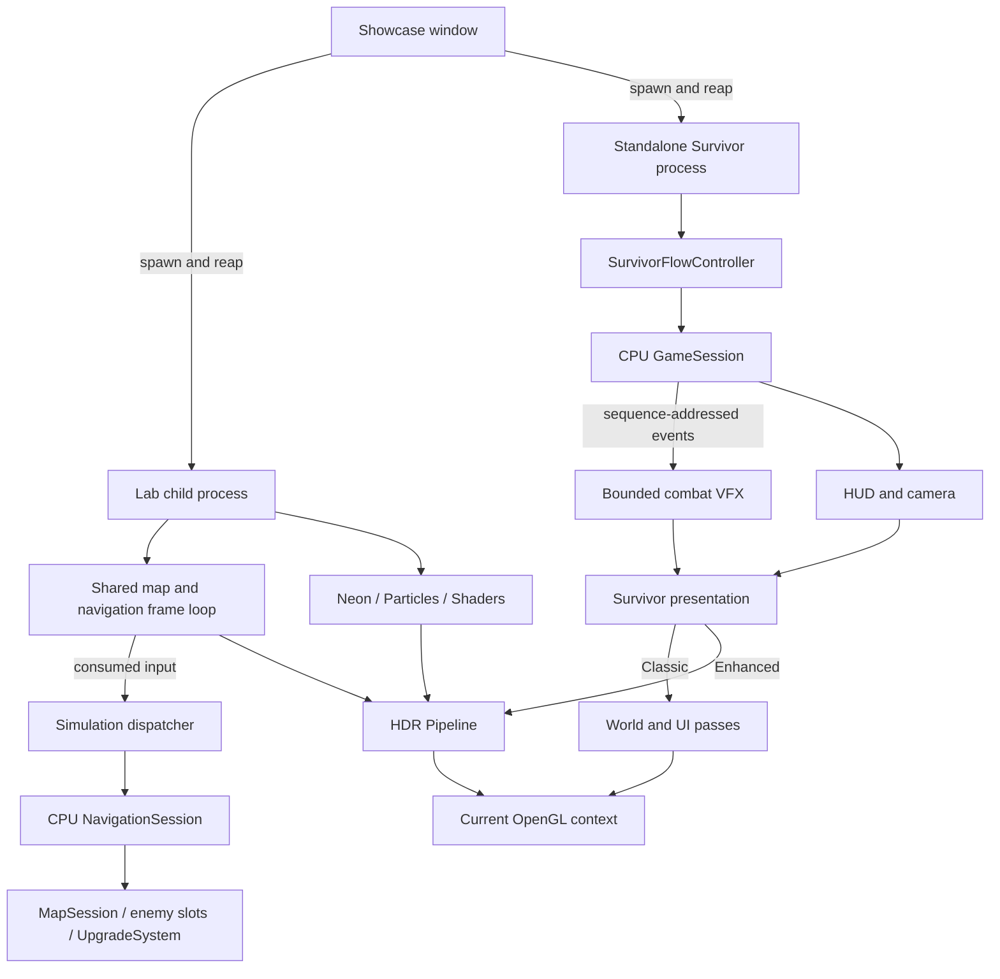
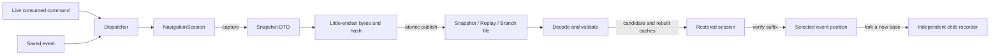

# Architecture and ownership

A single frame crosses three boundaries. The platform reports input and framebuffer size, the CPU world consumes zero or more fixed steps, and the renderer submits a read-only view of the resulting state. Showcase adds a process boundary around each exhibit. A saved replay contains the CPU state and consumed commands needed to cross the second boundary again.

## Native application boundaries

**Showcase** owns its GLFW window, ImGui context and one active child PID. The exhibit registry defines eight fixed launch profiles. The parent passes arguments directly to the executable and reaps it on exit. Keyboard input, runtime selections, GL resources and mutable game state belong to each child process. This keeps a reopened exhibit independent of its previous instance. The price is a new process and window on each entry. [Registry and child ownership](../lab/src/ShowcaseProcess.cpp) · [Native menu](../lab/src/ShowcaseApp.cpp) · [Launch/reopen coverage](../tests/m111_journey.py)

**Survivor** coordinates difficulty, start, terminal restart, the 60 Hz combat step, cameras and display. GameSession owns a CPU Scene, simulation counters and a 512-entry CombatEvent ring. Effects consume each event by sequence and use a bounded pool. The game retains responsibility for damage, hits and kills. Both presentations use the same update call, entity data, World and UI submissions. Classic submits directly. Enhanced submits the world to Lab's HDR pass, brightens actors and effects at submission, and places the HUD after output mapping. At Normal and Extreme difficulty, separately launched applications produced byte-identical authoritative traces. [GameSession](../game/include/tiny2d_game/GameSession.h) · [Combat VFX](../sandbox/src/vfx/CombatVFX.cpp) · [Survivor frame loop](../sandbox/src/SurvivorDemo.cpp) · [Actual comparisons](data/m111/combat-parity.csv)

**Lab** owns display parameters, the HDR pipeline and Inspector. Scene-specific CPU owners prepare sprites, particle instances, shader uniforms or map/debug geometry. A shared map frame loop handles Simulation, Navigation, Replay and Timeline views. The renderer reads published values without drawing random samples or applying gameplay commands. The independent Sandbox preserves the original sprite demos, benchmark comparisons and classic Survivor entry. [Map loop](../lab/src/MapApp.cpp) · [Lab dispatch](../lab/src/main.cpp) · [Sandbox entry](../sandbox/src/main.cpp)

## What lives at each lifetime

| Owner | Stored state and lifetime | Boundary / failure behavior |
|---|---|---|
| Window / GLObject | A GPU name, resource type and owning GLFW Context. Window outlives renderer members. | Main-thread creation, use and destruction require the correct current context. Move transfers ownership. Predictable invalid uses throw before touching the other context. [GLObject](../engine/src/Renderer/GLObject.cpp) |
| Scene / SceneRenderer | Slot and generation identify an object in one Scene. The renderer owns queued references and per-pass stats. | Resolution rejects foreign/stale handles. Pass guards release queued work on exception; already-submitted work can have reached the GPU. [Scene](../engine/src/Scene/Scene.cpp) · [Renderer](../engine/src/Renderer/SceneRenderer.cpp) |
| Batch / particle renderer | Static quad topology or corners and preallocated streaming vertex/instance data. | Batch preserves source order and flushes at capacity/texture limits. Instancing uploads one eight-float record per active particle and one draw for a populated group. [Batch](../engine/src/Renderer/BatchRenderer.cpp) · [ParticleRenderer](../lab/src/ParticleRenderer.cpp) |
| Pipeline / shader manager | Floating-point render targets, optional lighting/normals/masks, programs, views and display transform. | Resize and shader replacement use complete candidates. A failed shader edit leaves the installed program usable. Debug previews and display controls are outside simulation. [Pipeline](../lab/src/Pipeline.cpp) · [Reload manager](../lab/src/ShaderReloadManager.cpp) |
| MapSession / NavigationSession | Generated tiles and parameters, Epoch/Tick, player collision state, enemy slots/waypoints, HP/cooldown, phase, RNG streams, levels and current offer. | One production implementation handles both live input and replay commands. GridNavigator and the distance field are derived from the map, character size and current target tile. [World](../engine/src/World/MapSession.cpp) · [Gameplay](../game/src/NavigationSession.cpp) |
| Replay / Timeline | Base Snapshot, immutable ordered events, expected hashes, validated event cursor, bounded canonical checkpoint bytes. | Reset may rewind Tick while Sequence advances. Restoration always rebuilds caches. A failed seek leaves the last valid displayed state. [Dispatcher and player](../game/src/Replay.cpp) · [Timeline](../game/src/Timeline.cpp) |
| Branch / UI instance | Child ID, parent logical and content IDs, fork cursor, embedded child recording. UI owns an independent revision. | Fork starts a new sequence at the selected verified state. UI invalidates old selections, held inputs and delayed history samples on replacement, even if the logical Epoch repeats. [Branch](../game/src/ReplayBranch.cpp) · [UI ownership](../lab/src/TimelineView.cpp) · [Observation filtering](../lab/src/Observation.h) |

## One upgrade decision across time

For the bundled recording, position 600 is a pending offer at Epoch 1, Tick 600. Position 601 has the same Epoch/Tick and a selected Vitality upgrade. Forking at 600 preserves the parent; child position 1 can instead choose Fleet. A branch file embeds its starting Snapshot, local event stream and provenance. It can play independently on the same supported build. The canonical state excludes timings, GL objects, UI selections, wall time and cache layouts. [Snapshot transaction](../game/src/NavigationSnapshot.cpp) · [Saved examples and branch evidence](milestone-10-2.md)

## Rendering and measurement

The Lab's linear HDR scene can be assembled directly or from Albedo, Emission and per-light contributions. Optional signed world-space normals influence the diffuse term; per-light visibility masks suppress occluded contributions. A half-resolution bright extraction and separable blur feed final tone mapping, followed by display-referred HUD/debug content. Resize uses framebuffer pixels, while cameras and UI use their defined logical sizes. The portfolio records CPU timings and actual framebuffer readbacks on an Apple M5 Pro. GPU timestamps were unavailable on this device. [HDR and color](milestone-07-1.md) · [Normals](milestone-07-4a.md) · [Hard shadows](milestone-07-4b.md) · [Final validation](milestone-11-2.md)

## Distribution and verification

The release candidate pairs Showcase and Survivor apps, embeds the actual Lab helper, assets and examples, and resolves native dynamic dependencies into the distributable layout. Verification starts at the archived artifacts, including independent extraction, signature and dependency checks, and a native smoke test. On-disk snapshots and shader edits use explicitly writable destinations. In the native candidate smoke run, the packaged helper imported an example, sought a recorded offer, forked a child, and reloaded a repaired fragment program while all 76 signed bundle entries matched their original inventory. The current validation covers a single macOS arm64 host. [Native traces](data/m112/smoke/native.log) · [Boundaries and hashes](data/m112/smoke/smoke.json) [Bundle structure and closure](release-architecture.md) · [Candidate checks and manual acceptance](releases/v0.6.0-rc1.md)

Further reading includes [Scene identity](scene-architecture.md), [discrete collisions](collision-design.md), [fixed-step policy](fixed-timestep.md), [Survivor combat](gameplay-architecture.md), [VFX priority and saturation](vfx-lifecycle.md) and [render-pass recovery](m63b1-review-fixes.md).
