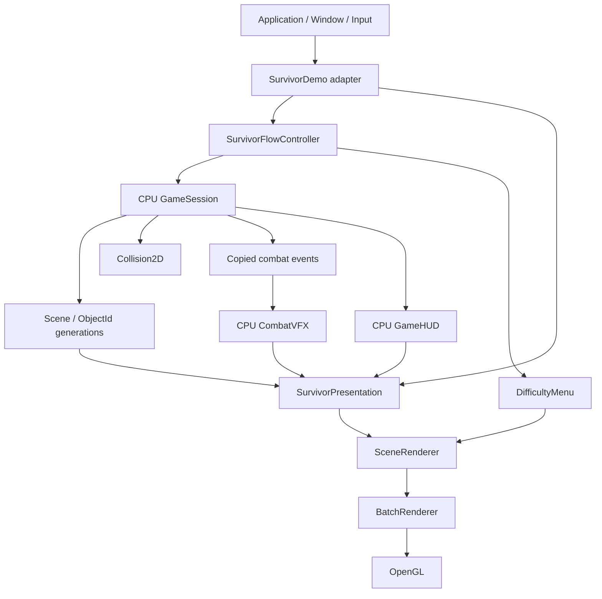

# Project architecture overview

Arrows show coordination/data flow, not inheritance. GameSession never calls the
GPU or VFX. SurvivorDemo owns the flow, cameras, renderer and presentation objects.
GameSession owns CPU Scene and combat state; Collision2D emits ordered contacts.
VFX consumes copied sequence-addressed events after each fixed update, without
modifying gameplay. HUD reads game state; menu reads flow difficulty.

## Decisions worth explaining

- **Ownership:** Application's Window outlives derived Survivor GPU members.
  Window owns the GLFW handle and shared runtime; current owning GL context is
  required during creation, use and destruction. RAII does not make wrong-context
  destruction safe; explicit checks enforce that contract.
- **Handles:** Scene identity plus slot generation rejects foreign and stale
  ObjectIds when slots are reused. Numeric handles avoid retaining pointers into
  storage through mutation. This is not concurrent access protection.
- **Simulation:** 60 Hz ticks make rules and identical-input fixtures repeatable.
  The accumulator bounds catch-up at six steps and drops excess time. Focus loss
  resets timing. This is not a cross-platform bit-exact determinism guarantee.
- **Batching:** Four vertices per quad go into a dynamic VBO; fixed topology uses
  a static EBO. Capacity and texture-slot limits trigger flush. Fewer draw calls
  reduce submission overhead, but pixel cost and driver waiting remain.
- **Recovery:** SceneRenderer preflights predictable failures; RenderPass guard
  cancels outstanding commands on exceptions. CPU VFX/HUD preparation precedes
  the guarded GPU passes. Cancellation cannot undo already submitted GPU draws.
- **Bounded VFX:** A 512-event ring and 128 visual instances bound memory/work;
  Death > Hit > Trail priority protects salient feedback under saturation.
  Old events may be overwritten and low-priority effects dropped. Preallocated
  scene slots reduce per-hit churn, not every allocation throughout the engine.

Read [Scene](scene-architecture.md), [collision](collision-design.md),
[fixed tick](fixed-timestep.md), [gameplay](gameplay-architecture.md),
[VFX](vfx-lifecycle.md), [render recovery](m63b1-review-fixes.md),
and [release structure](release-architecture.md) for contracts and evidence.
