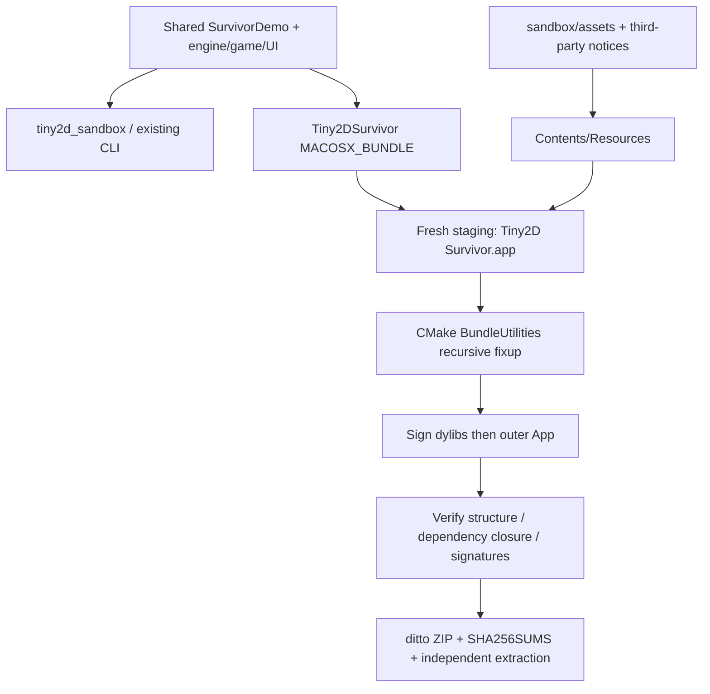

# macOS release architecture



`SurvivorMain.cpp` validates shipped assets and calls `runSurvivor(0)`; zero means
interactive difficulty selection, not the finite-run auto-start path. Sandbox
main.cpp is unchanged. Both compile the same SurvivorDemo.cpp; no duplicate game loop.
The engine, game and UI are static libraries; GLFW/libpng are dynamic on this host.

```text
Tiny2D Survivor.app/Contents/
  Info.plist
  MacOS/Tiny2DSurvivor
  Resources/assets/{shaders,textures}/
  Resources/licenses/{GLFW-LICENSE.md,libpng-LICENSE.txt,README.md}
  Frameworks/{libglfw.3.5.dylib,libpng16.16.dylib}
```

The CMake developer output is `Tiny2DSurvivor.app`; distribution staging supplies
the space-containing product name. Identifier `io.github.graham1019.tiny2d.survivor`
uses the repository owner's GitHub namespace, with no third-party brand claim.
Marketing version 0.5.0, bundle build 5001, candidate filename v0.5.0-rc1.
Deployment target 26.0 matches both installed dylibs; only 26.5.1 was tested.

## Resource contract

`_NSGetExecutablePath` followed by filesystem canonicalization resolves symlinks.
For an executable in `Contents/MacOS`, assets come only from sibling
`Contents/Resources/assets`; otherwise they come only from executable-adjacent
`assets`. Neither cwd nor source path nor Homebrew is searched. Missing files
throw with the exact expected path. Shader reads retain IO diagnostics.
Survivor uses generated white texture and embedded renderer shaders; all legacy
external shaders/textures and original notices are nevertheless shipped.
The App resource directories are refreshed from scratch to remove stale files.
Resource targets run on every build, including an explicit Tiny2DSurvivor build.

## Reproduce

```bash
cmake -S . -B build/m63c-release -DCMAKE_BUILD_TYPE=Release -DTINY2D_OPENGL_TESTS=ON
cmake --build build/m63c-release --parallel
cmake --build build/m63c-release --target package_macos
# Or, after building:
scripts/package_macos.sh build/m63c-release
scripts/verify_macos_bundle.sh 'build/m63c-dist/candidate-XXXXXX/Tiny2D Survivor.app'
```

Scripts quote paths. Each packaging invocation creates a new candidate directory
and independent temporary extraction. CMake recursively discovers/fixes dependencies
using BundleUtilities; system frameworks are not copied. The resulting references
use `@executable_path/../Frameworks`. The verifier checks every included dylib,
arm64 slices, deployment minima, assets/notices byte-for-byte and rejects external
non-system loads or Homebrew/user rpaths. It intentionally fails on unresolved @rpath
rather than assuming it is safe. Run on a macOS host with Python 3.9+ and CMake.

All relocation precedes signing. Nested libraries receive `codesign --force --sign -`,
then the App; `--deep` is used for verification only. Ad-hoc is neither Developer ID
nor notarization. No certificates, Apple credentials or upload service are used.
The local `spctl` result says `accepted; override=security disabled`: this host's
existing policy cannot establish normal Gatekeeper acceptance. No policy was changed.

ZIP creation uses ditto to retain macOS bundle metadata; SHA256SUMS names the ZIP.
Repeated builds are procedural/reproducible, not promised byte-identical archives
(timestamps/signatures can vary). Build trees, .app, .zip and dylibs are ignored.
For external distribution, owner review, source-license choice, Developer ID and
notarization remain separate decisions.

## Unified Showcase candidate · 0.6.0-rc1

The original Survivor packaging entry above remains available. The unified builder exports a specific Git commit into a fresh directory, builds arm64 Release products with deployment target 26.0, and stages executable bytes and an explicit asset inventory in two sibling applications. The native Finder entry resolves its own bundle path and replaces itself with the adjacent Lab helper via execv. The helper uses posix_spawn to open one exhibit at a time. The standalone Survivor entry defaults to its difficulty menu. Moving the enclosing directory preserves the paths between the applications. [Builder](../scripts/package_showcase_macos.py) · [Finder entry](../sandbox/src/ShowcaseMain.cpp) · [Exhibit selection and child ownership](../lab/src/ShowcaseProcess.cpp)

```text
Tiny2D-Showcase-0.6.0-rc1-macos-arm64/
  Tiny2D Showcase.app/Contents/
    MacOS/{Tiny2DShowcase,tiny2d_lab}
    Frameworks/                         relocated GLFW and libpng
    Resources/assets/{shaders,showcase,examples,...}
    Resources/licenses/
  Tiny2D Survivor.app/Contents/
    MacOS/Tiny2DSurvivor
    Frameworks/
    Resources/{assets,licenses}/
  manifest.json
  README.txt
```

Both bundles carry their own dependencies, plist and ad-hoc signature. BundleUtilities updates Mach-O install names before signing. The verifier checks every embedded executable and dylib, arm64 slices, deployment minima, resolved non-system loads and resource hashes, then requests strict signature verification. A second validation starts from an independent ZIP extraction. The sidecar SHA256SUMS names the ZIP, and manifest.json inside the directory identifies its build commit, versions and per-file contents. [Closure verifier](../scripts/verify_showcase_macos.py)

The Lab locates installed shaders, examples and previews relative to its executable. The packaged Shader Gallery creates a working copy under Application Support or an explicit external directory. F5 compiles the edited program, preserving the active program and its version when a candidate fails. Replay accepts user-selected external paths for snapshots, recordings and branches. Existing save files use create-only publication. All edits and replay exports in the independent smoke run leave the two signed application trees byte-identical. [Writable shader workspace](../lab/src/ShaderWorkspace.cpp) · [Replay files](../lab/src/ReplayApp.cpp) · [Independent smoke](../scripts/smoke_showcase_candidate.py)

Reproduce the build from a checkout of the recorded source. Both directory arguments can name new folders. Each invocation makes its own candidate subdirectory.

```sh
python3 scripts/package_showcase_macos.py build/m112-dist-builds build/m112-dist
python3 scripts/verify_showcase_macos.py "/path/to/candidate.zip" --source .
python3 scripts/smoke_showcase_candidate.py "/path/to/candidate.zip" "/tmp/Tiny2D smoke 独立"
```

The unified candidate uses marketing version 0.6.0 and build 6001. Local arm64 evaluation, ad-hoc signing, and independent extraction/readback are recorded separately from human acceptance. Developer ID distribution, notarization, licensing of repository source and publication require owner decisions. [Candidate record and Mac acceptance](releases/v0.6.0-rc1.md) · [Final validation](milestone-11-2.md)
