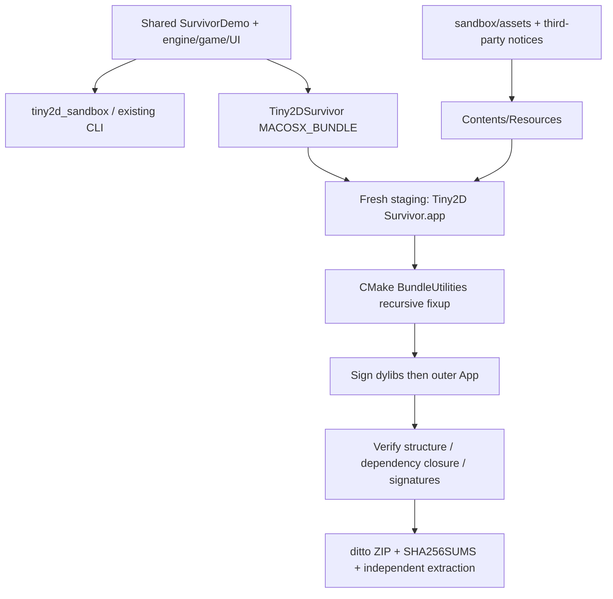

# macOS release architecture



`SurvivorMain.cpp` validates shipped assets and calls `runSurvivor(0)`; zero means
interactive difficulty selection, not the finite-run auto-start path. Sandbox
main.cpp is unchanged. Both compile the same SurvivorDemo.cpp; no duplicate game loop.
The engine, game and UI are static libraries; GLFW/libpng are dynamic on this host.

```text
Tiny2D Survivor.app/Contents/
  Info.plist
  MacOS/Tiny2DSurvivor
  Resources/assets/{shaders,textures}/
  Resources/licenses/{GLFW-LICENSE.md,libpng-LICENSE.txt,README.md}
  Frameworks/{libglfw.3.5.dylib,libpng16.16.dylib}
```

The CMake developer output is `Tiny2DSurvivor.app`; distribution staging supplies
the space-containing product name. Identifier `io.github.graham1019.tiny2d.survivor`
uses the repository owner's GitHub namespace, with no third-party brand claim.
Marketing version 0.5.0, bundle build 5001, candidate filename v0.5.0-rc1.
Deployment target 26.0 matches both installed dylibs; only 26.5.1 was tested.

## Resource contract

`_NSGetExecutablePath` followed by filesystem canonicalization resolves symlinks.
For an executable in `Contents/MacOS`, assets come only from sibling
`Contents/Resources/assets`; otherwise they come only from executable-adjacent
`assets`. Neither cwd nor source path nor Homebrew is searched. Missing files
throw with the exact expected path. Shader reads retain IO diagnostics.
Survivor uses generated white texture and embedded renderer shaders; all legacy
external shaders/textures and original notices are nevertheless shipped.
The App resource directories are refreshed from scratch to remove stale files.
Resource targets run on every build, including an explicit Tiny2DSurvivor build.

## Reproduce

```bash
cmake -S . -B build/m63c-release -DCMAKE_BUILD_TYPE=Release -DTINY2D_OPENGL_TESTS=ON
cmake --build build/m63c-release --parallel
cmake --build build/m63c-release --target package_macos
# Or, after building:
scripts/package_macos.sh build/m63c-release
scripts/verify_macos_bundle.sh 'build/m63c-dist/candidate-XXXXXX/Tiny2D Survivor.app'
```

Scripts quote paths. Each packaging invocation creates a new candidate directory
and independent temporary extraction. CMake recursively discovers/fixes dependencies
using BundleUtilities; system frameworks are not copied. The resulting references
use `@executable_path/../Frameworks`. The verifier checks every included dylib,
arm64 slices, deployment minima, assets/notices byte-for-byte and rejects external
non-system loads or Homebrew/user rpaths. It intentionally fails on unresolved @rpath
rather than assuming it is safe. Run on a macOS host with Python 3.9+ and CMake.

All relocation precedes signing. Nested libraries receive `codesign --force --sign -`,
then the App; `--deep` is used for verification only. Ad-hoc is neither Developer ID
nor notarization. No certificates, Apple credentials or upload service are used.
The local `spctl` result says `accepted; override=security disabled`: this host's
existing policy cannot establish normal Gatekeeper acceptance. No policy was changed.

ZIP creation uses ditto to retain macOS bundle metadata; SHA256SUMS names the ZIP.
Repeated builds are procedural/reproducible, not promised byte-identical archives
(timestamps/signatures can vary). Build trees, .app, .zip and dylibs are ignored.
For external distribution, owner review, source-license choice, Developer ID and
notarization remain separate decisions.
