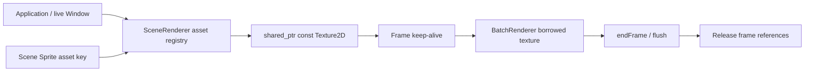

# Scene architecture — M5

Scene 不拥有 Window、Texture 或 OpenGL 对象。GameObject 提供只读 id()，其余数据是 Transform2D、enabled、可选 SpriteData、可选 Shape、velocity 的直接组合；SpriteData.asset 是适配层资源键。M5 没有组件注册、虚基类或完整 ECS：少量可选数据足够表达原型，并能在无 Context 时测试。

## Handle 与存储

ObjectId = {uint64 sceneId, uint32 index, uint32 generation}；M5.1 在 find/destroy 中强制验证所属 Scene，进程内原子 token 不复用，溢出拒绝。Scene 不可复制。每个槽位 unique_ptr 拥有一个 GameObject，vector 扩容不会移动对象。find 返回临时借用指针：禁止跨 destroy/clear 保存；长期引用必须保存 ID 并重新 find。Scene 不会替调用者管理借用指针。无效 find 返回 nullptr，重复 destroy 返回 false。

删除立即将槽位标记 dead；find/count/renderables 随即排除它。更新过程中对象内存保留到统一 collect，防止当前回调引用被立即释放。collect 增加 generation；达到 UINT32_MAX 的槽位永久退休，绝不绕回旧代数。索引上限 UINT32_MAX，达到上限抛 length_error。Clear 立即使全部现有 ID 失效，不重置代数。

每次 update 固定一份创建顺序 ID 快照，新建对象从下次 update 开始运动和碰撞，但更新结束后的渲染可以看到它。删除立即退出碰撞和渲染，不产生针对删除对象的 Exit。仍存活对象的 enabled/collider 变化在下次检测产生 Exit。碰撞回调中删除使后续涉及该 ID 的通知被跳过。

renderables 按 renderOrder 稳定排序，同值保持创建顺序；复用槽位的新对象排在创建序列尾部。不会按纹理排序。update 不支持递归，异常会清理延迟删除并解除更新状态，但已完成的逻辑修改不回滚。

## Transform

世界 X 右、Y 下，位置是 Sprite 左上角；size × scale 得到一次有效尺寸。rotation 弧度、屏幕顺时针、围绕有效尺寸中心旋转。scale 必须有限且正；不支持翻转和零尺寸 Sprite。Collider 只加 position，不受视觉旋转或缩放影响。

## Ownership / pass

SceneRenderer::setAsset/removeAsset 管理共享资源；begin/submit/end 是显式整次 Pass，render 是便捷包装。M5.1 render 在 begin 之前完成全部命令 preflight，submit 在入队之前完成本次提交 preflight；帧引用按纹理对象身份去重。即使 Scene clear、资源注册表 removeAsset 且外部 owner reset，直到 endFrame 完成，纹理仍然存活。注册表可跨帧缓存资源，资源卸载需显式 removeAsset；删除 CPU 对象不隐式卸载资源。

所有适配层操作和销毁必须在主线程、原 live Context 中执行，错误 Context 的 end 保留队列和引用，恢复 Context 后可重试。上传异常沿用 BatchRenderer endFrame 的队列清理，并释放帧引用；提交运行期失败时尝试 cancel，绝不通过 end 恢复；输入验证失败不改变此前显式提交。Cancel 不撤销此前 Flush。没有共享所有权环。成员逆序析构先 BatchRenderer、后帧引用及资源表；Arena 派生成员在基类 Application::Window 之前释放。调用者不得移动 Texture2D 的底层资源或在 pass 中改变外部 GL 状态。

API: create / destroy / find / count / clear / objects / renderables / update / contacts。Scene update 接受每对象逻辑回调与碰撞事件回调；Scene 本身也会按 velocity × dt 移动对象。

M5.1 的完整异常契约、Scene token 和测量见 [review fixes](m51-review-fixes.md)。
